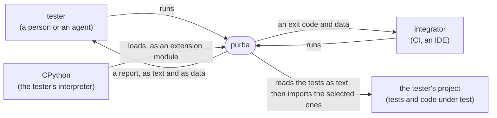
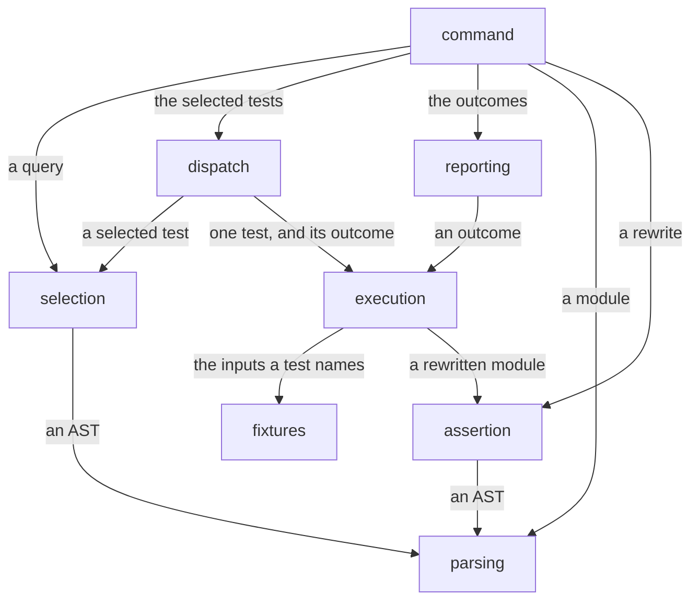
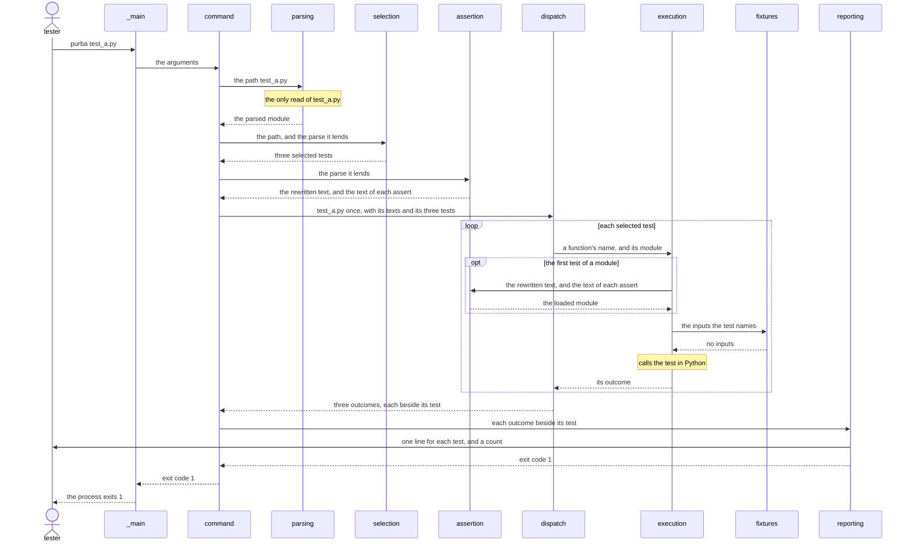

# purba's landscape

This file shows purba whole, at the level of its parts, and ranks the order in which each part and concern is designed in depth.

## The problem

A [tester](CONTEXT.md#tester) needs a test run to tell the truth about their code, fast enough to run often.
pytest is the most used Python test framework, at about twice the share of unittest.
Its core is held by the backward compatibility its users depend on, so its strict options stay off by default, and a change like subtests took nine years to land.
Its collection is import, so selecting ten tests still imports the whole suite.
The language lets a test do almost anything, and agents that write tests have been measured editing the test instead of fixing the code.
So a run can go green while checking nothing, and the reader may not notice.

## The quality priorities

Each quality wins over every quality below it.

1. **Honest outcome.** Green means a behaviour was checked, `unknown` is never shown as clean, and no outcome depends on the worker that ran the test.
2. **Explicit.** Nothing affects a test, or its outcome, unless the test names it, and a test names its inputs by type.
3. **Legible result.** A person and an agent both read what failed and why, with no re-run.
4. **Reviewable core.** A change inside one part can be reviewed without reading another part.
5. **Fast feedback.** Selecting a subset does no work for the tests outside it.

## The driver scenarios

Each quality has one scenario, and a test can check it on any machine.

- **Honest outcome.** Given a pinned third-party suite and its desired-state suite, when pytest runs the first and purba the second, then each test name has the same outcome in both.
- **Explicit.** Given a test that states no expectation, when purba runs it, then purba does not report it as passed.
- **Legible result.** Given the deliberately broken pinned suite, when purba runs it, then each failure's report matches its agreed expected output, as text for a person and as data for an agent.
- **Reviewable core.** Given a change inside one part that leaves its interface unchanged, when the change is made, then no file of another part changes.
- **Fast feedback.** Given a 10,000-test suite, when the tester selects 10 tests, then no other test module is imported.

[purba ranks an honest outcome first](docs/decisions/purba-ranks-an-honest-outcome-first.md) holds why for these three sections.

## The context

[purba runs inside the tester's interpreter](docs/decisions/purba-runs-inside-the-testers-interpreter.md) holds why.

## The parts and their dependencies

- **command.** Reads the arguments, lends each parsed module to selection and each selected one to assertion, starts a run, and returns reporting's exit code.
- **selection.** Reads the AST of each test file, imports none of them, and answers which tests a query names.
- **parsing.** Reads a test file, turns its source into an AST, and reports a file that does not parse as a diagnostic.
- **dispatch.** Hands each selected test to a worker and returns its outcome, or the error it gave in place of one, whatever the worker is.
- **execution.** Imports a selected test's module, builds its inputs through fixtures, calls the test, and makes its outcome.
- **fixtures.** Builds each input a test names by type, and tears it down after.
- **assertion.** Rewrites each assert in a selected module before the run, so that a failure shows its values, and loads the module when execution imports it.
- **reporting.** Renders each outcome as text for a person, and as data for an agent or an integrator.

In the parts diagram, an arrow points from a part to the part whose interface it uses.

[purba divides by responsibility and not by language](docs/decisions/purba-divides-by-responsibility-and-not-by-language.md) holds why.
[Command lends one parse to selection and assertion](docs/decisions/command-lends-one-parse-to-selection-and-assertion.md) holds why command hands each parsed module on.
[A worker loads each module once, and command hands each module once](docs/decisions/a-worker-loads-each-module-once.md) holds why command hands dispatch each module once, and why a worker loads it once.
[Execution calls a test by its function's name, and reporting prints the identity it is given](docs/decisions/execution-calls-a-test-by-its-functions-name.md) holds why execution and reporting never name the identity's type.
[Reporting renders the exit code, and command returns it](docs/decisions/reporting-renders-the-exit-code-and-command-returns-it.md) says which part holds the rule that counts, and which part renders the exit code.

## The invariants

- **lazy work.** No part imports, rewrites, builds or runs anything outside the selection, in command, dispatch, execution, fixtures and assertion.
- **an outcome is data.** An outcome carries no live Python object, in execution, dispatch and reporting.
- **an outcome is final.** No part changes an outcome once it is made, in dispatch and reporting.
- **one identity.** No part names a test except by the identity that selection gives it, in dispatch, execution and reporting.
- **one parser.** No part but parsing turns Python source into an AST, in selection and assertion.
- **an async fixture stays on its loop.** No async fixture leaves the event loop that built it, in execution and fixtures.
- **an async fixture shares its test's task.** No async fixture built for one test runs outside that test's task, in execution and fixtures.
- **the diagram is the only wiring.** No part uses an interface that the parts diagram does not draw, in every part.

[An invariant needs no design of its own](docs/decisions/an-invariant-needs-no-design-of-its-own.md) holds why.

## The cross-cutting concerns

- **the Rust/Python seam.** Carries a live Python object between Rust and Python, in execution, fixtures and assertion.
- **strictness.** Never shows as passed what was not checked, in selection, execution, fixtures and reporting. No switch turns it off.
- **configuration.** States facts about the project, or tightens a check, in command, selection, dispatch and reporting.
- **interrupt handling.** Stops the run on Ctrl-C and tears down what was built, in command, dispatch, execution, fixtures and reporting.
- **errors.** Keeps a test's outcome, a diagnostic about the tester's project and an error inside purba apart, in every part.

[A concern is what no part can own](docs/decisions/a-concern-is-what-no-part-can-own.md) holds why.

## The risks

Each [risk](CONTEXT.md#risk) lands on the one part or concern whose design in depth reduces it.

- **text selection disagrees with import.** Given a pinned suite, when selection reads the AST of its test files, then it names a test that import does not define, or misses one that import defines. Lands on selection; probability high, impact high.
- **a fixture reaches a test that never named it.** Given two tests where only the first names a fixture, when both run, then the outcome of the second depends on that fixture. Lands on fixtures; probability high, impact high.
- **an outcome depends on the worker.** Given a selection, when it runs on one worker and then on many, then the outcome of some test differs. Lands on dispatch; probability high, impact high.
- **purba's own error shows as a test failure.** Given a defect inside purba during a test, when purba reports the run, then the test shows as failed, and not as an error inside purba. Lands on errors; probability medium, impact high.
- **an interrupt leaves a fixture built.** Given a run stopped by Ctrl-C during a test, when purba exits, then a fixture built for that test is never torn down. Lands on interrupt handling; probability medium, impact high.
- **an async fixture leaves its loop or its task.** Given an async fixture that two async tests name, when both run, then a test raises a cross-loop error, or the fixture's teardown never runs. Lands on fixtures; probability medium, impact high.
- **a change in one part edits another part.** Given a change inside one part that leaves its interface unchanged, when the change is made, then a file of another part changes. Lands on command; probability high, impact medium.
- **strictness refuses a test that checks.** Given a test that checks its result through a helper, when purba runs it, then purba does not report it as passed. Lands on strictness; probability medium, impact medium.
- **parsing refuses a file that CPython runs.** Given a file that a supported CPython imports, when parsing reads it, then parsing reports a diagnostic and selection finds no test in it. Lands on parsing; probability low, impact high.

## The order of design

Each part or concern waits for the parts it uses and the concerns that cross it, and risk orders what nothing blocks.

1. **errors.**
2. **interrupt handling.**
3. **strictness.**
4. **parsing.**
5. **configuration.**
6. **selection.**
7. **the Rust/Python seam.**
8. **fixtures.**
9. **assertion.**
10. **execution.**
11. **dispatch.**
12. **reporting.**
13. **command.**

[A design in depth waits for what it assumes](docs/decisions/a-design-in-depth-waits-for-what-it-assumes.md) holds why for these two sections.

## What belongs in this file

This section is the register of this file, and [a register belongs to one location](docs/decisions/a-register-belongs-to-one-location.md#confirmation) names it.

The file holds nine sections, in this order: the problem, the quality priorities, the driver scenarios, the context, the parts and their dependencies, the invariants, the cross-cutting concerns, the risks, and the order of design.

A line belongs here when all three are true.

1. It is one line or one diagram under one of the nine sections.
2. It states purba's shape now, and links the record or issue that holds why.
3. It defines no word. A word specific to purba goes in `CONTEXT.md`.

A diagram is a `mermaid` fence, as [a figure in a record is a fence GitHub renders](docs/decisions/a-figure-in-a-record-is-a-fence-github-renders.md) requires of a record.

Each item takes one line.
A risk or an order line leaves the file when the design in depth of its part or concern merges.
