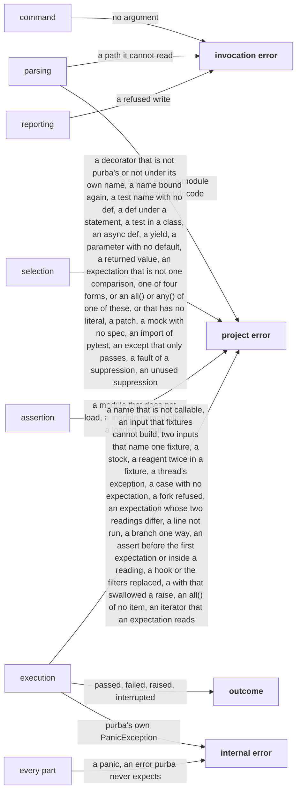

# A failure's kind is what the part that first sees it observes

## Context and Problem Statement

The concern [errors](../../LANDSCAPE.md#the-cross-cutting-concerns) keeps apart what a [run](../../CONTEXT.md#run) says about a test and what goes wrong around it.
A kind that no part can tell from another kind cannot travel along the parts diagram.
No check can apply such a kind.
On `main` at `efb4c9c`, purba prints `error` for a test that raised, a module that does not load, and a defect of its own.

| fact | source |
|---|---|
| exit 4 held a test that raised, a module that did not load and a defect of purba, on `main` at `efb4c9c` | [the inventory of failure shapes](https://github.com/kalonji-tools/purba/issues/652#issuecomment-6403261116) |
| six of seven surveyed runners print a test that raised as failed, and only `unittest` sets it apart | [the research of test-runner failures](https://github.com/kalonji-tools/purba/blob/56d78a28c577c265e926eceb9ef510cfcb04ef55/research/test-runner-failures.md?plain=1#L138) |
| pytest names the helpers of its rewrite with a character that no identifier holds, "to avoid clashing" | [pytest's `rewrite.py`](https://github.com/pytest-dev/pytest/blob/9.1.1/src/_pytest/assertion/rewrite.py#L768) |
| PyO3's `PanicException` derives from `BaseException` | [PyO3's `panic.rs`](https://github.com/PyO3/pyo3/blob/v0.29.2/src/panic.rs#L6-L16) |
| each PyO3 extension builds its own `PanicException`, and PyO3 resumes a panic only for the exact type of its own | [PyO3's `exceptions.rs`](https://github.com/PyO3/pyo3/blob/v0.29.2/src/exceptions.rs#L190), [PyO3's `err/mod.rs`](https://github.com/PyO3/pyo3/blob/v0.29.2/src/err/mod.rs#L279-L314) |
| `load` puts a test module in `sys.modules` under its file's name, then looks up `compile` | [`load`](https://github.com/kalonji-tools/purba/blob/efb4c9c/crates/assertion/src/lib.rs#L189-L195) |

## Considered Options

- **A kind is the true cause of a failure.** No part can tell a `NameError` that purba's rewrite causes from one that a typo of the tester causes. So no check can apply the kind.
- **A test that raised gives an error in place of an outcome.** One error then holds a raise, a failed load and a defect of purba. Execution loses the kind.
- **The words purba used: usage error, diagnostic and error inside purba.** A full disk is no usage error. "Diagnostic" names no place to fix. "Error inside purba" is a phrase and not a name.
- **A forged pass is a defect.** `_purba_ran` is not on the [public surface](../../CONTEXT.md#public-surface), so a hand call breaks no promise.
- **A `with` whose entry or cleanup raises is a breach of a test.** The code that the `with` runs raised, so the case fails.

## Decision Outcome

**Reach:** `crates/**` `/CONTEXT.md` `/LANDSCAPE.md`

**Area:** errors

**A failure's kind is what the part that first sees it observes.**
Each part can check an exception class or a branch that it holds.

| kind | what a part sees | the tester fixes it in |
|---|---|---|
| [invocation error](../../CONTEXT.md#invocation-error) | an argument, a path the tester typed, data purba cannot take, a refused write | the command, or where it runs |
| [project error](../../CONTEXT.md#project-error) | a module that does not parse, decode or load, a test purba refuses to call, an exception that no test's call raised, a case with no expectation, an expectation whose two readings differ, a breach that execution sees as a case runs, an unused suppression | the tester's code |
| [outcome](../../CONTEXT.md#outcome) | the test's call returned after an expectation ran, or raised, or a `with` of the test raised as it entered or cleaned up | the code under test, or the test |
| [internal error](../../CONTEXT.md#internal-error) | a panic, an error purba never expects, purba's own `PanicException` that crosses a test's call | a bug report to purba |

The name of each error kind says where the tester fixes the error.

- **A fault of purba that a part sees as another kind keeps the kind that the part sees.** The defect is filed on its own.
- **A test whose call raised has the outcome `raised`.** The test's body ran, so the run can say something about the test. An `AssertionError` when an assert that ran did not hold gives `failed`. A raise from the entry or the cleanup of a `with` of the test gives `failed` when it ends the call. The failed line then names the `with`. purba's own `PanicException` is an internal error. Another extension's `PanicException` gives `raised`.
- **An error from a call that purba makes on its own objects is an internal error.** An error while the tester's text compiles or runs belongs to the tester.
- **What the tester typed is the invocation, and what the run finds is the project.** A module that the tester names and purba cannot read is an invocation error. A module that purba finds by itself and cannot read is a project error.
- **A test that purba refuses to call is a project error for that test alone.** Selection sees an `async def`, a `yield`, a parameter with no default, and a `return` of a value. It also sees a decorator that is not purba's or not under purba's own name, and a name bound again. It sees a test name with no `def`, a `def` under a statement, and a test in a class. It sees an [expectation](../../CONTEXT.md#expectation) that is neither one comparison nor `not x`, `isinstance(x, T)`, `x.startswith(y)` or `x.endswith(y)`, nor an `all()` or an `any()` of one of these. It sees a comparison with no literal on either side too. It also sees a [patch](../../CONTEXT.md#patch) and a mock with no spec in a test's body. It sees an import of pytest in a test module, and an `except` in a test's body that only passes. A [private name](../../CONTEXT.md#private-name) gives a [notice](../../CONTEXT.md#notice) under the case, and no error. Execution sees a name that is not callable, an input that fixtures cannot build, and two inputs that name one fixture. It also sees an input whose fixture builds a stock. In a fixture, it sees one reagent twice.
- **A breach that execution sees as a case runs is a project error for that test alone.** Execution sees most such breaches in the lines before the first expectation, and others at a reading. It sees a line that did not run, and a branch that went one way only. It sees a marked assert outside the cleanup of a `with` or inside a reading. It also sees a hook or the warning filters that a statement replaced. It sees a `with` that swallowed a raise and skipped a line. At the reading of an expectation, it sees an `all()` whose reading holds no item, and a name that holds an iterator.
- **A module that replaced a hook or the warning filters as it loaded is a project error of the module.** Execution sees it at the end of the load, and the error blocks each test of the module.

A case gets the line of the first of these that it meets. A suppression of a check of the practice tier skips its breach, as [A suppression is an outcome and not a switch](a-suppression-is-an-outcome-and-not-a-switch.md#decision-outcome) says.

| order | what the case met | its line |
|---|---|---|
| 1 | an interrupt | `interrupted` |
| 2 | an assert before the first expectation or inside a reading, a hook or the filters replaced, an `all()` of no item, or an expectation that read an iterator, whichever came first | a project error |
| 3 | a raise that ends the call | `raised`, or `failed` when a `with`'s entry or cleanup raised it |
| 4 | a line that did not run, a branch that went one way, a `with` that swallowed a raise | a project error, each breach joined by `; ` |
| 5 | a fork refused, a module's process that ended before a replay sent its reading, or two readings that differ | a project error |
| 6 | a `try` of one path whose statement did not raise, or an expectation that did not hold; no expectation; or each expectation held | `failed`, a project error, or `passed` |

Order 2 and order 5 hold whether a fork or a replay reads an expectation alone.

- **A thread's exception is a project error of the test or the load that left the thread alive.** A thread with no such owner charges the test or the load that runs in its process when the thread raises. After a test returns, its process joins each thread that is not a daemon. Such a thread charges that test. The test keeps its outcome, and a load that succeeds still succeeds. A `threading.Thread` that raises `SystemExit`, and not a subclass of it, gives no error, because CPython prints none. [A run exits 0 only when it checked something and every case passed](a-run-exits-0-only-when-it-checked-something-and-every-test-passed.md#decision-outcome) gives the outcome `raised` to a test when a thread's call to `os._exit` ends its process. It fails a load when such a call ends the load's process. It names the exception of a load that the first interrupt lands in. [Of the exceptions CPython ignores, only a thread's is a project error](of-the-exceptions-cpython-ignores-only-a-threads-is-a-project-error.md#decision-outcome) charges the exception of a thread that `_thread` starts to the test or the load that runs.
- **That no test ran is no kind.** [A run exits 0 only when it checked something and every case passed](a-run-exits-0-only-when-it-checked-something-and-every-test-passed.md#decision-outcome) holds its code.
- **A module named after a loaded module is a project error.** The tester fixes it by a new name for the file. Assertion sees the name before it loads the module.
- **The text of an internal error names the part that found it.**
- **An interrupt is no kind of failure.** [An interrupt stops the run, and a second one exits at once](an-interrupt-stops-the-run-and-a-second-one-exits-at-once.md#decision-outcome) holds what an interrupt stops. [An interrupted run prints its count, and dies by the signal](an-interrupted-run-prints-its-count-and-dies-by-the-signal.md#decision-outcome) gives the test that the interrupt lands in the outcome `interrupted`, whether its call then passes, fails or raises. [The interrupt record's Downside](an-interrupt-stops-the-run-and-a-second-one-exits-at-once.md#decision-outcome) names exceptions, as when the parent's ignore or mask holds an interrupt signal.

The figure shows each part and the kinds that it first sees.

**Downside:**

- **A test can call `_purba_read` itself, and forge a pass.** It reaches it through `globals()`, or through `getattr` on `sys.modules`, so execution sees an ordinary pass. A test can reach pytest's helpers in the same way.
- **A fault of purba that a part sees as a failed assert shows as failed.** The tests of each part guard against it.
- **A tester who knows pytest must learn the words again.** pytest prints a raise in a test's call as failed. It calls a raise outside the call an error.
- **A daemon thread that is alive when the process of its test ends gives no line.** The run can exit 0.
- **A library that replaces `threading.excepthook` and puts it back inside one call hides a thread's exception from purba.** The thread is a `threading.Thread` that raises during that call. purba sees a hook replaced only after a statement of the test before its first expectation, and as the module loads. A hook that a reading replaces hides each later thread's exception too.

## Confirmation

`mise run test:rust` checks that a test that selection refuses, and a module that does not parse or load, prints a project error.
`mise run test:rust` checks that a thread's exception charges the test or the load that left the thread alive.

`mise run test:wheel` checks that no path, and a stdout that takes no write, print an invocation error.
`mise run test:wheel` checks that each breach that execution sees as a case runs prints a project error.
It checks that a `with` whose entry or cleanup raised prints `failed`.
It checks that a module that its encoding cannot decode prints a project error.
It checks that a module named after a loaded module prints a project error.
No command checks the rest of this record.

[A case of each kind checks that no failure prints as another kind](a-case-of-each-kind-checks-that-no-failure-prints-as-another-kind.md#decision-outcome) names the gate of the kinds.

[An error stops only the work that depends on it](an-error-stops-only-the-work-that-depends-on-it.md#decision-outcome) says what each kind stops.
[A panic inside a test gives that test an internal error](a-panic-inside-a-test-gives-that-test-an-internal-error.md#decision-outcome) says how execution sees a panic that a test catches.
[A run exits 0 only when it checked something and every case passed](a-run-exits-0-only-when-it-checked-something-and-every-test-passed.md#decision-outcome) gives each kind its exit code.
[A module that binds a name purba adds is a project error](a-module-that-binds-a-name-purba-adds-is-a-project-error.md#decision-outcome) says what purba does with a module that binds the name of its hook.

[A test names the fixture of each input](a-test-names-the-fixture-of-each-input.md#decision-outcome) says how a test names its inputs.
[A test returns nothing, and the first part that sees a breach of a test refuses it](a-test-returns-nothing-and-the-first-part-that-sees-a-breach-refuses-it.md#decision-outcome) says what a test returns, and which part refuses a test that breaks it.
[A test carries only purba's own decorators](a-test-carries-only-purbas-own-decorators.md#decision-outcome) says which decorators and bindings selection refuses.
[A test names two values of one type by two fixtures](a-test-names-two-values-of-one-type-by-two-fixtures.md#decision-outcome) says which fixture execution refuses.
