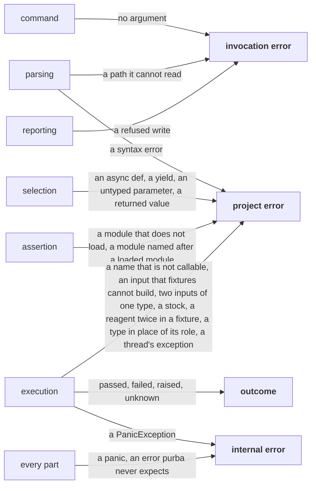

# A failure's kind is what the part that first sees it observes

## Context and Problem Statement

The concern [errors](../../LANDSCAPE.md#the-cross-cutting-concerns) keeps apart what a [run](../../CONTEXT.md#run) says about a test and what goes wrong around it.
A kind that no part can tell from another kind cannot travel along the parts diagram.
No check can apply such a kind.
purba prints `error` for a test that raised, for a module that does not load, and for a defect of its own.

| fact | source |
|---|---|
| exit 4 held a test that raised, a module that did not load and a defect of purba, on `main` at `efb4c9c` | [the inventory of failure shapes](https://github.com/kalonji-tools/purba/issues/652#issuecomment-6403261116) |
| six of seven surveyed runners print a test that raised as failed, and only `unittest` sets it apart | [the research of test-runner failures](https://github.com/kalonji-tools/purba/blob/56d78a28c577c265e926eceb9ef510cfcb04ef55/research/test-runner-failures.md?plain=1#L138) |
| pytest names the helpers of its rewrite with a character that no identifier holds, "to avoid clashing" | [pytest's `rewrite.py`](https://github.com/pytest-dev/pytest/blob/9.1.1/src/_pytest/assertion/rewrite.py#L768) |
| PyO3's `PanicException` derives from `BaseException` | [PyO3's `panic.rs`](https://github.com/PyO3/pyo3/blob/v0.29.2/src/panic.rs#L6-L16) |
| `load` puts a test module in `sys.modules` under its file's name, then looks up `compile` | [`load`](https://github.com/kalonji-tools/purba/blob/efb4c9c/crates/assertion/src/lib.rs#L189-L195) |

## Considered Options

- **A kind is the true cause of a failure.** Rejected. No part can tell a `NameError` that purba's rewrite causes from one that a typo of the tester causes. So no check can apply the kind.
- **A failure's kind is what the part that first sees it observes.** Chosen. Each part can check an exception class or a branch that it holds.
- **A test that raised gives an error in place of an outcome.** Rejected. One error then holds a raise, a failed load and a defect of purba. Execution loses the kind.
- **A test that raised has the outcome `raised`.** Chosen. The test's body ran, so the run can say something about the test.
- **The words purba used: usage error, diagnostic and error inside purba.** Rejected. A full disk is no usage error. "Diagnostic" names no place to fix. "Error inside purba" is a phrase and not a name.
- **Invocation error, project error and internal error.** Chosen. Each name says where the tester fixes the error.
- **A forged pass is a defect.** Rejected. `_purba_ran` is not on the [public surface](../../CONTEXT.md#public-surface), so a hand call breaks no promise.

## Decision Outcome

**Reach:** `crates/**` `/CONTEXT.md` `/LANDSCAPE.md`

**A failure's kind is what the part that first sees it observes.**

| kind | what a part sees | the tester fixes it in |
|---|---|---|
| [invocation error](../../CONTEXT.md#invocation-error) | an argument, a path the tester typed, data purba cannot take, a refused write | the command, or where it runs |
| [project error](../../CONTEXT.md#project-error) | a module that does not parse or load, a test purba refuses to call, an exception that no test's call raised | the tester's code |
| [outcome](../../CONTEXT.md#outcome) | the test's call returned or raised | the code under test, or the test |
| [internal error](../../CONTEXT.md#internal-error) | a panic, an error purba never expects, a `PanicException` that crosses a test's call | a bug report to purba |

- **A fault of purba that a part sees as another kind keeps the kind that the part sees.** The defect is filed on its own.
- **A test whose call raised has the outcome `raised`.** An `AssertionError` when the last assert that ran did not hold gives `failed`. A `PanicException` is an internal error.
- **What the tester typed is the invocation, and what the run finds is the project.** A module that the tester names and purba cannot read is an invocation error. A module that purba finds by itself and cannot read is a project error.
- **A test that purba refuses to call is a project error for that test alone.** In a test with no decorator, selection sees an `async def`, a `yield`, an untyped parameter with no default, and a `return` of a value. Execution sees a name that is not callable, an input that fixtures cannot build, and two inputs of one type. It also sees a stock that a test names. In a fixture, it sees one reagent twice, and a type in place of its role.
- **A thread's exception during a test is a project error.** The test keeps its own outcome. A call to `os._exit` from a thread differs: [A run exits 0 only when it checked something and every test passed](a-run-exits-0-only-when-it-checked-something-and-every-test-passed.md#decision-outcome) gives the test that runs the outcome `raised`.
- **That no test ran is no kind.** [A run exits 0 only when it checked something and every test passed](a-run-exits-0-only-when-it-checked-something-and-every-test-passed.md#decision-outcome) holds its code.
- **A module named after a loaded module is a project error.** The tester fixes it by a new name for the file. Assertion sees the name before it loads the module.
- **The text of an internal error names the part that found it.**
- **The kind of an interrupt waits for the design in depth of interrupt handling.**

The figure shows each part and the kinds that it first sees.

**Downside:**

- **A test can call `_purba_ran` itself, and forge a pass.** It reaches it through `globals()` or `sys.modules`, so execution sees an ordinary pass. A test can reach pytest's helpers in the same way.
- **A fault of purba that a part sees as a failed assert shows as failed.** A module that declares `coding: latin-1` and holds UTF-8 bytes is one. The tests of each part guard it.
- **A test that catches `BaseException` hides an internal error.** `PanicException` derives from `BaseException`, so the test sees the panic, and execution does not.
- **A failure that no part sees has no kind.** A test that ends the process through `posix._exit` or a crash leaves no line for itself.
- **A tester who knows pytest must learn the words again.** pytest prints a raise in a test's call as failed. It calls a raise outside the call an error.

## Confirmation

`mise run test:rust` checks that a test that selection refuses is a project error.
No command checks the rest of this record.
[A test module named builtins.py replaces builtins, and purba's own load fails](https://github.com/kalonji-tools/purba/issues/662) builds part of what it decides.
[Wayfinder: purba's errors, telling each kind of failure apart from the first part that sees it](https://github.com/kalonji-tools/purba/issues/652) holds the rest.

[An error stops only the work that depends on it](an-error-stops-only-the-work-that-depends-on-it.md#decision-outcome) says what each kind stops.
[A run exits 0 only when it checked something and every test passed](a-run-exits-0-only-when-it-checked-something-and-every-test-passed.md#decision-outcome) gives each kind its exit code.
[A module that binds a name purba adds is a project error](a-module-that-binds-a-name-purba-adds-is-a-project-error.md#decision-outcome) says what purba does with a module that binds the name of its hook.
[A test names its inputs by type and returns nothing](a-test-names-its-inputs-by-type-and-returns-nothing.md#decision-outcome) says what a test is, and which part refuses a test that breaks it.
[A test names two values of one type by two roles](a-test-names-two-values-of-one-type-by-two-roles.md#decision-outcome) says which fixture execution refuses.
