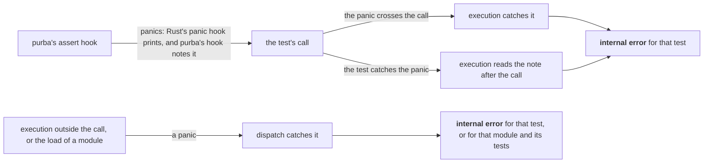

# A panic inside a test gives that test an internal error

## Context and Problem Statement

[An error stops only the work that depends on it](an-error-stops-only-the-work-that-depends-on-it.md#decision-outcome) says that a panic inside a test stops that test.
On `main` at `fb70f65`, a panic inside a test ends the run, and the error that dispatch hands holds only text.
So reporting cannot tell an [internal error](../../CONTEXT.md#internal-error) from a [project error](../../CONTEXT.md#project-error), and a panic costs the line of each later test.

| fact | source |
|---|---|
| PyO3 resumes a panic when it fetches its own `PanicException`, and prints a banner and the Python traceback first | [PyO3's `err/mod.rs`](https://github.com/PyO3/pyo3/blob/v0.29.2/src/err/mod.rs#L279-L314) |
| a test that catches `BaseException` catches a `PanicException`, and execution sees the test return | [the prototype's runs](https://github.com/kalonji-tools/purba/blob/03e43b9/prototype-715/RESULTS.txt) |
| when dispatch alone catches a panic, the next test takes the call to `os._exit` that the test before it made | [the prototype's runs](https://github.com/kalonji-tools/purba/blob/03e43b9/prototype-715/RESULTS.txt) |

## Considered Options

- **Dispatch alone catches a panic around each test.** Rejected. The next test takes a recorded call to `os._exit`, and a test that catches the panic hides it.
- **Execution catches a panic around the test's call, and dispatch catches the rest.** Rejected. A test that catches the panic hides it.
- **purba's hooks raise an exception of purba's own, and dispatch catches the rest.** Rejected. Each hook carries a wrapper, and stderr loses the Python traceback with the tester's line.
- **A wrap of Rust's panic hook records each panic, execution catches around the call, and dispatch catches the rest.** Chosen. The next test keeps its line, and a test that catches the panic cannot hide it.
- **A variant of the value that dispatch hands carries an internal error.** Rejected. Execution then needs a second type of error to reach dispatch.
- **One error carries a project error or an internal error.** Chosen. What dispatch hands keeps its shape.

## Decision Outcome

**Reach:** `crates/**`

**A panic inside a test gives that test an internal error.**

The figure shows where each panic stops.

- **The error that execution hands is a project error or an internal error.** An internal error carries the part that found it, and its message. Both are data.

**Downside:**

- **A panic on another thread during a test charges that test.** The record belongs to the process.
- **A test that catches the panic runs on after it.** Its later code runs before it has its internal error.
- **A hook that cannot be put back gives each later test of its module an internal error.** Each of those tests calls the hook.
- **purba writes code around Rust's panic hook.** The wrap must call the hook it replaces, or the tester loses the text that [a line names its kind in the glossary's words](a-line-names-its-kind-in-the-glossarys-words.md#decision-outcome) keeps.
- **stderr holds PyO3's banner and a Python traceback beside Rust's hook.** A panic that crosses a test's call prints both.

## Confirmation

No command checks this record yet.
[A panic that stops the run exits 125 and asks for a report](https://github.com/kalonji-tools/purba/issues/728) builds the wrap of Rust's panic hook, and [a panic inside a test prints that test's internal error, and tests/kinds.bats checks each kind](https://github.com/kalonji-tools/purba/issues/729) builds the rest.
Both use the switch that [a test causes an internal error through a switch that only a test build carries](a-test-causes-an-internal-error-through-a-switch-that-only-a-test-build-carries.md#decision-outcome) decides.

[A failure's kind is what the part that first sees it observes](a-failures-kind-is-what-the-part-that-first-sees-it-observes.md#decision-outcome) holds which errors are internal.
[An error stops only the work that depends on it](an-error-stops-only-the-work-that-depends-on-it.md#decision-outcome) says what an internal error stops.
[A line names its kind in the glossary's words](a-line-names-its-kind-in-the-glossarys-words.md#decision-outcome) says what an internal error prints.
