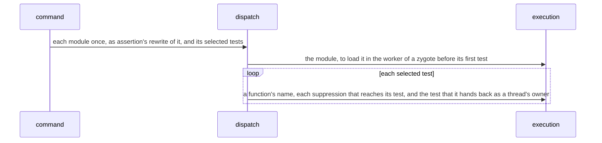

# A worker loads each module once, and command hands each module once

## Context and Problem Statement

Dispatch hands execution one test at a time.
The tests of `test_a.py` share one module.
Each slice of the walking skeleton needs to know what crosses to dispatch, and how often a module loads.

| fact | source |
|---|---|
| pytest 9.0.3 runs the body of a test module once for its three tests | [the probe](https://github.com/kalonji-tools/purba/issues/564#issuecomment-6252106214) |
| a selected test, the rewritten text of its module and the text of each assert cross as plain data | [command lends one parse to selection and assertion](https://github.com/kalonji-tools/purba/blob/f40c283/docs/decisions/command-lends-one-parse-to-selection-and-assertion.md#decision-outcome) |

## Considered Options

- **Execution loads the module again for each test.** The module body then runs once for each test. An outcome can then differ from pytest's.
- **Each selected test carries the rewritten text of its module.** Each test of a module then carries a copy of the same text.

## Decision Outcome

**Reach:** `crates/**` `/LANDSCAPE.md`

**Area:** dispatch

**A worker loads each module once, and command hands each module once.**
The module body runs once for its tests, as under pytest.
The worker of the module's [zygote](../../CONTEXT.md#zygote) loads it.
Each test's process starts from the module as the load left it.

The sequence of one run in [the landscape](../../LANDSCAPE.md#the-parts-and-their-dependencies) draws these hand-offs too.
A worker does not load a module again after the module fails to load.
Dispatch runs none of that module's tests.

[Execution calls a test by its function's name, and reporting prints the identity it is given](execution-calls-a-test-by-its-functions-name.md#decision-outcome) holds why execution takes a function's name.

**Downside:**

- **A module whose load leaves a Python thread alive loads again in the process of each test.** Its body then runs once more than its tests.

## Confirmation

`mise run test:rust` checks that a zygote loads a module once for two of its tests.
It checks that a module that fails to load runs its body once for two of its tests.
It checks that dispatch runs no test of such a module, and hands each on as blocked.
It checks that each test that dispatch hands on reads the module as its load left it.
`mise run test:wheel` checks that a module body runs once for all its tests.

`mise run test:rust` does not check that command hands each module once.
A run takes one module, so command hands it at most once.
[Each test runs in a process of its own](each-test-runs-in-a-process-of-its-own.md#decision-outcome) says how each test reaches the module that its zygote loaded.
