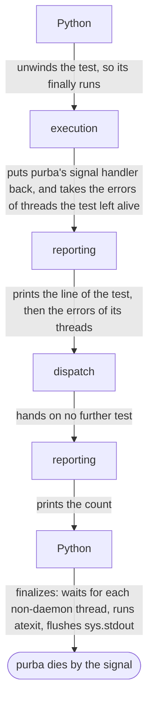

# An interrupt puts back no more than a normal end does

## Context and Problem Statement

[An interrupt stops the run, and a second one exits at once](an-interrupt-stops-the-run-and-a-second-one-exits-at-once.md#decision-outcome) says what an [interrupt](../../CONTEXT.md#interrupt) stops.
[An interrupted run prints its count, and dies by the signal](an-interrupted-run-prints-its-count-and-dies-by-the-signal.md#decision-outcome) says how the run ends.
No record says what each part puts back, in what order, or how long purba's signal handlers live.

| fact | source |
|---|---|
| execution guards `os._exit` and hooks `threading.excepthook` once, for the life of the process | [`execution/src/lib.rs`](https://github.com/kalonji-tools/purba/blob/04ae25d8ed73a849e42fe3fc174cc13975a1d15e/crates/execution/src/lib.rs#L232-L234) |
| execution wraps Rust's panic hook once in a process | [`execution/src/panic.rs`](https://github.com/kalonji-tools/purba/blob/04ae25d8ed73a849e42fe3fc174cc13975a1d15e/crates/execution/src/panic.rs#L45-L56) |
| assertion leaves each module it loads in `sys.modules`, and puts back what was there only when the load raises or panics | [`assertion/src/lib.rs`](https://github.com/kalonji-tools/purba/blob/04ae25d8ed73a849e42fe3fc174cc13975a1d15e/crates/assertion/src/lib.rs#L184-L195) |
| reporting flushes each line that it writes | [`reporting/src/lib.rs`](https://github.com/kalonji-tools/purba/blob/04ae25d8ed73a849e42fe3fc174cc13975a1d15e/crates/reporting/src/lib.rs#L102-L112) |
| CPython finalizes, and only then ends itself by SIGINT | [CPython's `main.c`](https://github.com/python/cpython/blob/v3.15.2/Modules/main.c#L840-L849) |
| finalization waits for each non-daemon thread, runs `atexit`, and flushes `sys.stdout` | [CPython's `pylifecycle.c`](https://github.com/python/cpython/blob/v3.15.2/Python/pylifecycle.c#L2284-L2300), [L2460-L2463](https://github.com/python/cpython/blob/v3.15.2/Python/pylifecycle.c#L2460-L2463) |
| after the flush, finalization gives each signal that has a Python signal handler its default action, and skips a signal that is ignored; it then calls each `Py_AtExit` function | [CPython's `pylifecycle.c`](https://github.com/python/cpython/blob/v3.15.2/Python/pylifecycle.c#L2465-L2466), [`signalmodule.c`](https://github.com/python/cpython/blob/v3.15.2/Modules/signalmodule.c#L1731-L1746), [`pylifecycle.c` L2598](https://github.com/python/cpython/blob/v3.15.2/Python/pylifecycle.c#L2598) |
| an exception in the wait for threads turns each thread left into a daemon, and finalization goes on | [CPython's `pylifecycle.c`](https://github.com/python/cpython/blob/v3.15.2/Python/pylifecycle.c#L3818-L3835) |
| today a Ctrl-C in the wait for threads after the count ends the wait, and the run still exits with the code of its count | [the probe of a thread that a test leaves alive](https://github.com/kalonji-tools/purba/issues/782#issuecomment-6643493328) |

## Considered Options

- **Each part puts back what it changed in purba's process.** Rejected. The process dies after the count. Execution installs its guard and its hooks once for the process.
- **Each part leaves the process as a normal end leaves it, as today.** Chosen. Nothing that a part changes outlives the process.
- **A signal after the count reaches Python's own signal handler, as today.** Rejected. Python reports a Ctrl-C in its wait for threads as ignored. The run then exits with the code of its count.
- **purba's signal handlers stay until finalization gives each signal its default action.** Chosen. A Ctrl-C in the wait for threads then ends purba by the signal, as an interrupt in a test does.
- **purba hides the text that Python prints when an interrupt ends its wait for threads.** Rejected. purba would replace `sys.unraisablehook` after the count. The new hook would hide the error of a test's `atexit` function too.
- **Python prints its own text.** Chosen. The tester reads which wait the interrupt ended.

## Decision Outcome

**Reach:** `crates/**` `tests/**`

**An interrupt puts back no more than a normal end does.**

- **Each part leaves the process as a normal end leaves it.** `sys.modules` keeps each module that assertion loaded, and execution keeps its guard and its hooks.
- **purba's signal handlers stay until the first interrupt, or finalization, gives each signal its default action.** They stay after a normal end too. A signal that comes later ends purba, unless the parent ignores it.
- **The errors of the threads that the interrupted test left alive still print.** They print after the line of the test.

After an interrupt in a test, the run ends in this order:

Each test after the interrupted one is an [unreached test](../../CONTEXT.md#unreached-test).

- **A first interrupt during finalization ends only the wait for threads.** Python prints that it ignored the `KeyboardInterrupt`. The rest of finalization runs. Then purba dies by the signal. [An interrupt stops the run, and a second one exits at once](an-interrupt-stops-the-run-and-a-second-one-exits-at-once.md#decision-outcome) says what a second one does.

**Downside:**

- **A non-daemon thread that a test leaves alive holds the process after the count.** The tester reads the count, but purba does not end.
- **A Ctrl-C that ends the wait for that thread makes a run whose tests all passed die by SIGINT.**
- **A second interrupt skips the flush of `sys.stdout`.** The tester loses a line that a test printed to a pipe.
- **A program that calls purba's `_main` and goes on keeps purba's signal handlers.** Its next Ctrl-C reaches purba's signal handler, not its own. After an interrupted run, its next interrupt ends it by the default action.
- **After a Ctrl-C ends the wait for threads, Python's traceback reads like a crash.**

## Confirmation

`mise run test:wheel` checks that a first interrupt starts no later test, and that purba dies by SIGINT.
It checks that the test the interrupt lands in is `interrupted`, and that an interrupt in a load leaves each test unreached.
It checks that a signal handler of a test or a module lives only for its call or its load.
It checks that a second interrupt ends purba at once by that interrupt's signal, even while a cleanup runs C code.
It checks that SIGTERM and SIGHUP do what SIGINT does.
It checks that a Ctrl-C after the count ends Python's wait for threads, and lets a test's `atexit` function finish.
