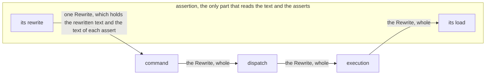

# Assertion's rewrite crosses each part whole, and only assertion opens it

## Context and Problem Statement

Assertion's rewrite of a module holds the rewritten text and the text of each assert.
On `main` at `09618c5`, command split the rewrite in two.
Dispatch and execution carried each half as a field.

| fact | source |
|---|---|
| 20 lines in the tests of dispatch and execution write a mark by hand, each with a list of asserts to match | [Assertion's rewrite crosses command, dispatch and execution whole, and only assertion opens it](https://github.com/kalonji-tools/purba/issues/720) |
| a rename of the hook inside assertion alone fails 11 tests of dispatch and execution | [Assertion's rewrite crosses command, dispatch and execution whole, and only assertion opens it](https://github.com/kalonji-tools/purba/issues/720) |
| "A field of a module crosses from command to dispatch to execution. A new field edits each of them." | [the identity record](https://github.com/kalonji-tools/purba/blob/09618c5/docs/decisions/execution-calls-a-test-by-its-functions-name.md?plain=1#L51) |
| `mise run lint:wiring` refuses a dev-dependency of dispatch on assertion, and reads no Rust source | [Assertion's rewrite crosses command, dispatch and execution whole, and only assertion opens it](https://github.com/kalonji-tools/purba/issues/720), [`scripts/check-wiring.sh`](https://github.com/kalonji-tools/purba/blob/f40c283/scripts/check-wiring.sh) |

## Considered Options

- **The rewritten text and the text of each assert cross as two fields.** Rejected. The tests of dispatch and execution write each mark by hand. A new field edits each part.
- **The rewrite crosses whole, and dispatch names its type through execution.** Chosen. No test of dispatch or execution knows the hook. The parts diagram keeps its arrows.

## Decision Outcome

**Reach:** `crates/**` `/LANDSCAPE.md`

**Area:** assertion

**Assertion's rewrite crosses each part whole, and only assertion opens it.**

| question | answer |
|---|---|
| how dispatch names its type | as `purba_execution::Rewrite`, because execution's interface takes it |
| how a test of another part builds one | `Rewrite::of_source`, from the text of a module with a plain `assert` |
| how parsing reads a text that no file holds | `parse_source`. `parse` reads the file, then calls it |

[Execution calls a test by its function's name, and reporting prints the identity it is given](execution-calls-a-test-by-its-functions-name.md#decision-outcome) holds what a module holds.

**Downside:**

- **Dispatch names a type of assertion, and the parts diagram draws no arrow between them.** `mise run lint:wiring` reads no Rust source, so it does not see the use. The reviewer looks for a use other than to carry the rewrite. [Each part is a crate](each-part-is-a-crate.md#decision-outcome) names this cost for each re-export.
- **The tests of dispatch and execution build a rewrite through assertion's interface.** Parsing or the function `rewrite` can then fail them with a defect of its own.
- **Any part that holds a rewrite can read it.** `text()` and `asserts()` stay public for assertion's own tests. Nothing refuses another part that calls them.
- **Assertion gains a public function that only tests call.** This is `Rewrite::of_source`. It calls `parse_source`, which parsing makes public for it. `parse` also calls `parse_source`.

## Confirmation

`mise run test:rust` checks that dispatch and execution run a module that `Rewrite::of_source` built.
It checks that assertion's `load` gives the hook the text of each assert.
`mise run lint:wiring` checks that no manifest of dispatch names assertion.
No command checks that only assertion reads a rewrite.
