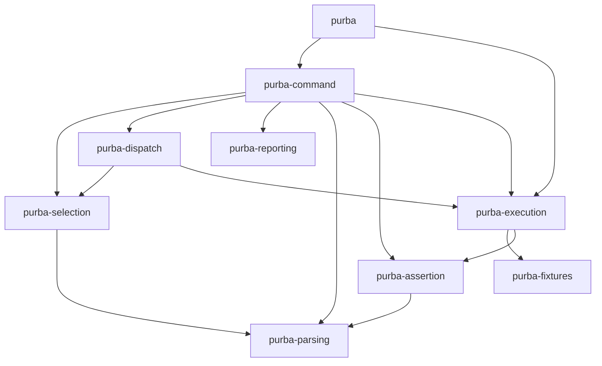

# Each part is a crate

## Context and Problem Statement

[The landscape](../../LANDSCAPE.md#the-parts-and-their-dependencies) draws which part uses which.
One of its invariants is "the diagram is the only wiring".
[A gate refuses each invariant a tool can see, from the first code it reads](a-gate-refuses-each-invariant-a-tool-can-see.md#decision-outcome) gives that invariant a gate once each part has a boundary that a tool reads.
[Every part of the skeleton is Rust, inside the extension module](every-part-of-the-skeleton-is-rust-inside-the-extension-module.md#decision-outcome) names no crate.

| fact | source |
|---|---|
| reporting's `use` of a crate that its manifest did not name stopped at `E0432: unresolved import` | [How do three layouts of a part's boundary compare when the walking skeleton and purba's own tasks run on them?](https://github.com/kalonji-tools/purba/issues/556#issuecomment-6168468953) |
| inside one crate, a `use` between two part modules that the diagram does not draw compiled | [How do three layouts of a part's boundary compare when the walking skeleton and purba's own tasks run on them?](https://github.com/kalonji-tools/purba/issues/556#issuecomment-6168468953) |
| a grep for `crate::<part>` missed `use crate::{execution, selection};` | [How do three layouts of a part's boundary compare when the walking skeleton and purba's own tasks run on them?](https://github.com/kalonji-tools/purba/issues/556#issuecomment-6168468953) |
| `cargo metadata` read each arrow that a part's manifest named | [How do three layouts of a part's boundary compare when the walking skeleton and purba's own tasks run on them?](https://github.com/kalonji-tools/purba/issues/556#issuecomment-6168468953) |
| a `pub use` of another part's crate carried an arrow that neither the compiler nor `cargo metadata` saw | [How do three layouts of a part's boundary compare when the walking skeleton and purba's own tasks run on them?](https://github.com/kalonji-tools/purba/issues/556#issuecomment-6168468953) |
| on Linux, only a test binary whose test called Python needed `libpython` | [How do three layouts of a part's boundary compare when the walking skeleton and purba's own tasks run on them?](https://github.com/kalonji-tools/purba/issues/556#issuecomment-6168468953) |
| with PyO3 in reporting's manifest and a `Py<PyAny>` in its code, `lint:wiring`, `lint:crates`, `lint:licences`, `lint:manifests` and `lint:rust` each exited 0 | [The wiring gate lets a crate name pyo3 only where the seam's line names its part](https://github.com/kalonji-tools/purba/issues/1193) |
| command's tests start Python through PyO3, and command's own code does not name PyO3 | [`crates/command/Cargo.toml` L10-L19](https://github.com/kalonji-tools/purba/blob/0f560edd/crates/command/Cargo.toml#L10-L19), [`crates/command/tests/interrupt.rs` L5](https://github.com/kalonji-tools/purba/blob/0f560edd/crates/command/tests/interrupt.rs#L5) |
| crates.io holds a crate under seven of the eight part names | [`selection`](https://crates.io/crates/selection), [`parsing`](https://crates.io/crates/parsing), [`dispatch`](https://crates.io/crates/dispatch), [`fixtures`](https://crates.io/crates/fixtures), [`assertion`](https://crates.io/crates/assertion), [`reporting`](https://crates.io/crates/reporting), [`command`](https://crates.io/crates/command) |

## Considered Options

- **One crate, with a module for each part.** An arrow the diagram does not draw compiles. Each test needs `libpython`.
- **A cli, a lib and a core, with command in cli and the other parts as modules of core.** Inside core, an arrow the diagram does not draw compiles. A grep misses a grouped `use`. Each test of core needs `libpython`.
- **PyO3 only in the crate that builds the extension module.** Each part that reaches Python grows inside that one crate, the bridge that [purba divides by responsibility and not by language](purba-divides-by-responsibility-and-not-by-language.md#considered-options) rejects.
- **A crate named for its part alone.** A crate on crates.io already holds most of those names.
- **No check of where a part names PyO3.** Every gate passes a part that names PyO3 and passes data.

## Decision Outcome

**Reach:** `crates/**` `/LANDSCAPE.md` `scripts/check-wiring.sh` `scripts/test/check-wiring.bats`

**Area:** design

**Each part of purba is a crate, and its manifest names what it uses.**
The compiler refuses an arrow that a part's manifest does not name.

| what | where |
|---|---|
| a part | the crate `purba-<part>` |
| its interface | the `pub` items of the crate's `src/lib.rs` |
| the parts it uses | the `purba-*` entries of each table of dependencies in its `Cargo.toml`, dev and build included |
| PyO3 | a dependency only of a part that [crosses the seam](the-skeleton-crosses-the-seam-in-execution-and-assertion.md#decision-outcome), as the seam's line in [the landscape](../../LANDSCAPE.md#the-cross-cutting-concerns) names it. A part that the line names may go without PyO3. Any part may name PyO3 among its dev-dependencies |
| the crate of a concern | the crate `purba-<x>` that the concern's line in [the landscape](../../LANDSCAPE.md#the-cross-cutting-concerns) names. It uses no part, and each part that the line names may use it |
| the crate that builds the extension module | `purba`, which holds `#[pymodule]` and `_main`. It uses `purba-command`, `purba-execution` for the wrap of Rust's panic hook and for purba's signal handler, and `purba-errors` for the part of a panic |

The diagram leaves out `purba-errors` and `purba-config`, the crates of the errors and configuration concerns.

[Every crate lives under crates/](every-crate-lives-under-crates.md#decision-outcome) holds where each crate lives.
[Execution calls a test by its function's name, and reporting prints the identity it is given](execution-calls-a-test-by-its-functions-name.md#decision-outcome) holds how a test crosses a part that does not use selection.

- **A check compares the arrows of the manifests with the diagram.** It reads the `purba-*` edges from `cargo metadata`, and the arrows of the parts diagram in [the landscape](../../LANDSCAPE.md#the-parts-and-their-dependencies). It also refuses a call in the sequence of one run that goes along no drawn arrow, and an answer that goes back along none. It refuses a drawn arrow between two crates that the manifest does not use. It refuses a message whose end is not a part, an actor or `_main`. It refuses a part that names PyO3 outside its dev-dependencies, when the seam's line does not name the part. It refuses a part that uses a concern's crate when the concern's line does not name the part. It refuses a part that a concern's crate uses. It skips the crate `purba`, which is not a part.
- **The pull request that adds the second part builds the check.** It runs the check green and red, as [a gate refuses each invariant a tool can see, from the first code it reads](a-gate-refuses-each-invariant-a-tool-can-see.md#decision-outcome) requires.
- **This record binds no Python file.** The design in depth that first moves a part to Python decides how the boundary of that part shows.

**Downside:**

- **A part that re-exports another part's crate, or a type of it, with `pub use` carries an arrow that no check sees.** The reviewer looks for it. Execution re-exports assertion's `Rewrite`, as [Assertion's rewrite crosses each part whole, and only assertion opens it](assertions-rewrite-crosses-each-part-whole-and-only-assertion-opens-it.md#decision-outcome) decides.
- **A type that moves from one part to another edits two manifests.**
- **No check reads the words of a message in the sequence.** A slice that changes what crosses an arrow edits the message by hand.
- **The check reads only the dependencies of a part's own manifest.** The check passes a part that links PyO3 through a part it uses along a drawn arrow.
- **A dev-dependency on PyO3 passes, though a dev-dependency on a part is a use.** A part's tests may start Python while its code passes data.
- **The check reads the seam's parts from the wording of one line.** It takes the parts after the last ", in " of the line's first sentence. A rewrite of that sentence changes what the check allows.
- **The check refuses two shapes that do not breach the invariant.** It refuses a drawn arrow that no manifest uses, because that arrow leaves the diagram false. It refuses an end of a message that is not a part, an actor or `_main`, for the same reason.

## Confirmation

`mise run lint:wiring` refuses a use between two parts that the parts diagram does not draw, in a manifest and in the sequence of one run.
It refuses a part that names PyO3 outside its dev-dependencies, when the seam's line does not name the part.
It refuses a part that uses a concern's crate when the concern's line does not name the part.
It refuses a part that a concern's crate uses.
`mise run test:shell` runs the check on a fixture for each shape it refuses.
No command checks which parts `purba` uses, because the check skips the crate `purba`.
