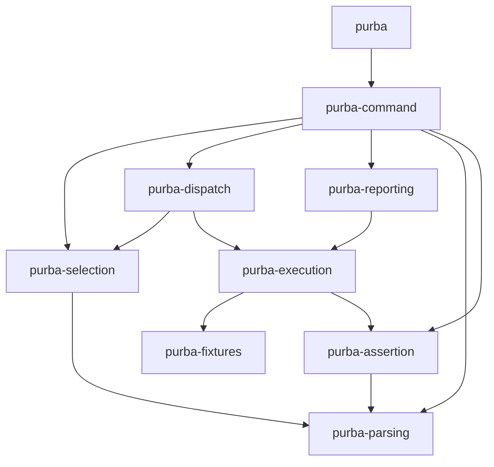

# Each part is a crate

## Context and Problem Statement

[The landscape](../../LANDSCAPE.md#the-parts-and-their-dependencies) draws which part uses which.
One of its invariants is "the diagram is the only wiring".
[A gate refuses each invariant a tool can see, from the first code it reads](a-gate-refuses-each-invariant-a-tool-can-see.md#decision-outcome) gives that invariant a gate once each part has a boundary that a tool reads.
[Every part of the skeleton is Rust, inside the extension module](every-part-of-the-skeleton-is-rust-inside-the-extension-module.md#decision-outcome) names no crate.

| fact | source |
|---|---|
| reporting's `use` of a crate that its manifest did not name stopped at `E0432: unresolved import` | [How do three layouts of a part's boundary compare when the walking skeleton and purba's own tasks run on them?](https://github.com/kalonji-tools/purba/issues/556#issuecomment-6168468953) |
| inside one crate, a `use` between two part modules that the diagram does not draw compiled | [How do three layouts of a part's boundary compare when the walking skeleton and purba's own tasks run on them?](https://github.com/kalonji-tools/purba/issues/556#issuecomment-6168468953) |
| a grep for `crate::<part>` missed `use crate::{execution, selection};` | [How do three layouts of a part's boundary compare when the walking skeleton and purba's own tasks run on them?](https://github.com/kalonji-tools/purba/issues/556#issuecomment-6168468953) |
| `cargo metadata` read each arrow that a part's manifest named | [How do three layouts of a part's boundary compare when the walking skeleton and purba's own tasks run on them?](https://github.com/kalonji-tools/purba/issues/556#issuecomment-6168468953) |
| a `pub use` of another part's crate carried an arrow that neither the compiler nor `cargo metadata` saw | [How do three layouts of a part's boundary compare when the walking skeleton and purba's own tasks run on them?](https://github.com/kalonji-tools/purba/issues/556#issuecomment-6168468953) |
| on Linux, only a test binary whose test called Python needed `libpython` | [How do three layouts of a part's boundary compare when the walking skeleton and purba's own tasks run on them?](https://github.com/kalonji-tools/purba/issues/556#issuecomment-6168468953) |
| crates.io holds a crate under seven of the eight part names | [`selection`](https://crates.io/crates/selection), [`parsing`](https://crates.io/crates/parsing), [`dispatch`](https://crates.io/crates/dispatch), [`fixtures`](https://crates.io/crates/fixtures), [`assertion`](https://crates.io/crates/assertion), [`reporting`](https://crates.io/crates/reporting), [`command`](https://crates.io/crates/command) |

## Considered Options

- **One crate, with a module for each part.** Rejected. An arrow the diagram does not draw compiles. Each test needs `libpython`.
- **A cli, a lib and a core, with command in cli and the other parts as modules of core.** Rejected. Inside core, an arrow the diagram does not draw compiles. A grep misses a grouped `use`. Each test of core needs `libpython`.
- **PyO3 only in the crate that builds the extension module.** Rejected. Each part that reaches Python grows inside that one crate, the bridge that [purba divides by responsibility and not by language](purba-divides-by-responsibility-and-not-by-language.md#considered-options) rejects.
- **A crate named for its part alone.** Rejected. A crate on crates.io already holds most of those names.
- **A crate for each part, with PyO3 in each part that crosses the seam.** Chosen. The compiler refuses an arrow that a part's manifest does not name.

## Decision Outcome

**Reach:** `crates/**` `/LANDSCAPE.md` `scripts/check-wiring.sh`

**Each part of purba is a crate, and its manifest names what it uses.**

| what | where |
|---|---|
| a part | the crate `purba-<part>` |
| its interface | the `pub` items of the crate's `src/lib.rs` |
| the parts it uses | the `purba-*` entries of each table of dependencies in its `Cargo.toml`, dev and build included |
| PyO3 | a dependency of each part that [crosses the seam](the-skeleton-crosses-the-seam-in-execution-and-assertion.md#decision-outcome) |
| the crate that builds the extension module | `purba`, which holds `#[pymodule]` and `_main`, and uses `purba-command` alone |

[Every crate lives under crates/](every-crate-lives-under-crates.md#decision-outcome) holds where each crate lives.
[Execution calls a test by its function's name, and reporting prints the identity it is given](execution-calls-a-test-by-its-functions-name.md#decision-outcome) holds how a test crosses a part that does not use selection.

- **A check compares the arrows of the manifests with the diagram.** It reads the `purba-*` edges from `cargo metadata`, and the arrows of the parts diagram in [the landscape](../../LANDSCAPE.md#the-parts-and-their-dependencies). It also refuses a call in the sequence of one run that goes along no drawn arrow, and an answer that goes back along none. It refuses a drawn arrow between two crates that the manifest does not use. It refuses a message whose end is not a part, an actor or `_main`. It skips the crate `purba`, which is not a part.
- **The pull request that adds the second part builds the check.** It runs the check green and red, as [a gate refuses each invariant a tool can see, from the first code it reads](a-gate-refuses-each-invariant-a-tool-can-see.md#decision-outcome) requires.
- **This record binds no Python file.** The design in depth that first moves a part to Python decides how the boundary of that part shows.

**Downside:**

- **A part that re-exports another part's crate with `pub use` carries an arrow that no check sees.** The reviewer looks for it.
- **A type that moves from one part to another edits two manifests.**
- **No check reads the words of a message in the sequence.** A slice that changes what crosses an arrow edits the message by hand.
- **The check refuses two shapes that do not breach the invariant.** It refuses a drawn arrow that no manifest uses, because that arrow leaves the diagram false. It refuses an end of a message that is not a part, an actor or `_main`, for the same reason.

## Confirmation

`mise run lint:wiring` refuses a use between two parts that the parts diagram does not draw, in a manifest and in the sequence of one run.
`mise run test:shell` runs the check on a fixture for each shape it refuses.
The slices of [Wayfinder: purba's walking skeleton, running every part on main](https://github.com/kalonji-tools/purba/issues/533) add the other crates.
