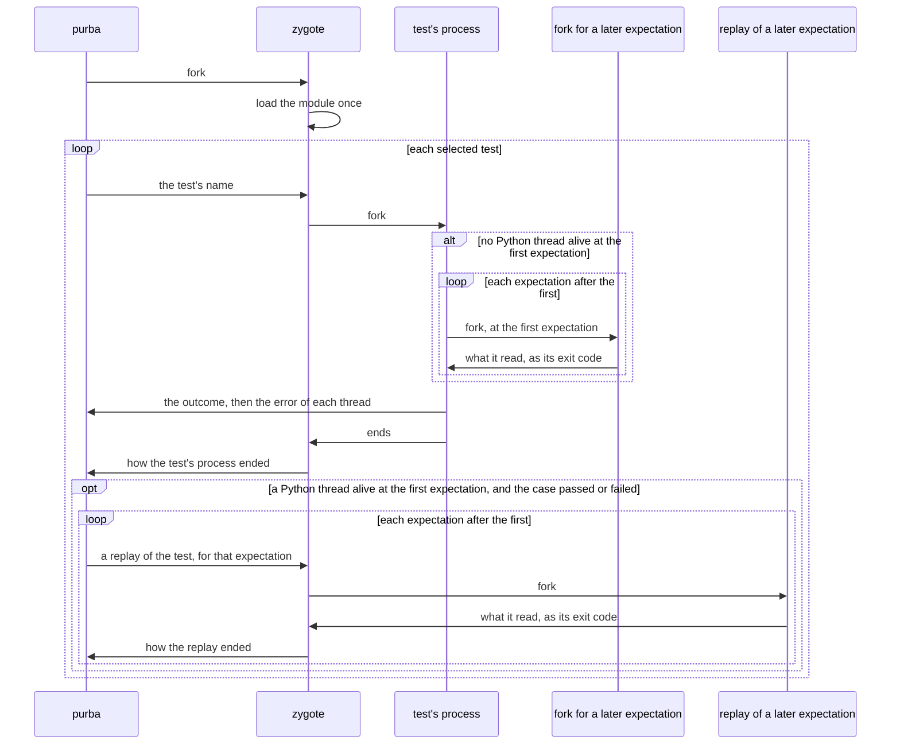

# Each test runs in a process of its own

## Context and Problem Statement

When the tests of a module share one interpreter, a test can fail for what an earlier test left.

| fact | source |
|---|---|
| the text of click's tests showed none of its 3 leaks, because each is behind a call | [the prototype](https://github.com/kalonji-tools/purba/blob/1e0ef96/proto-689/RESULTS.md) |
| click's 1,978 tests ran in 2.4 s in one interpreter, and in 16.0 s with a fork for each test | the same |
| for each test after the first: a fork 0.9 ms, a forkserver with the module preloaded 3.7 ms, a spawn 53 ms | the same |
| the forkserver ignored a preload that raised `ImportError`, and the module body ran 6 times for 5 tests | the same |
| forkserver is "Available on POSIX platforms which support passing file descriptors over Unix pipes", spawn is "Available on POSIX and Windows platforms", and on macOS "The _fork_ start method should be considered unsafe" | [Python's documentation](https://docs.python.org/3/library/multiprocessing.html) |
| on macOS 26 with Python 3.14, a child crashed in 34 of 40 calls to an Apple framework that its parent called, and in 0 of 40 when the probe forked a zygote that loaded the module and forked the test | [run 43643867901](https://github.com/kalonji-tools/purba/actions/runs/43643867901) of [a probe of a zygote in Python](https://github.com/kalonji-tools/purba/tree/eff7a9d/research/macos-start/zygote) |

## Considered Options

- **One interpreter for the tests of a module.** click's tests leak through it.
- **The tests whose text shows them isolated share one interpreter.** The text of click's tests showed none of its leaks.
- **The forkserver of `multiprocessing` loads the module.** It ignores a preload that raises `ImportError`, and the module body then runs for each test.
- **A thread alive at the first expectation gives a replay for each expectation but the last.** No replay would then read the last expectation alone.

## Decision Outcome

**Reach:** `crates/**` `/LANDSCAPE.md`

**Area:** dispatch

**Each [test](../../CONTEXT.md#test) runs in a process of its own.**
No change that a test makes in memory reaches another test.
A crash ends one test, and not the run.

- **A [zygote](../../CONTEXT.md#zygote) of purba's own loads the module once, and forks each test.** purba sees a failed load itself.
- **A module that fails to load gives one project error.** The zygote then forks no test.
- **macOS starts each test as Linux does.** A test that the probe's zygote forked crashed in no call to an Apple framework.
- **A Python thread alive after the load makes each test load the module in its own process.** A fork keeps only the thread that called it. A thread of the module would not run in the test.
- **A test whose process ends before its outcome has the outcome `raised`.** The line names the signal, `raised: its process died by SIGABRT`, or the exit code, `raised: its process exited 0 before its outcome`.
- **After its test returns, the test's process joins each thread that is not a daemon, then runs the test's `atexit` functions.** A daemon thread ends with the process.
- **Each process runs only the `atexit` functions that it registered.** So the functions that a load registered run once, at the end of the zygote, unless the load leaves a thread alive.
- **At its first [expectation](../../CONTEXT.md#expectation), the test's process forks once for each later expectation, one fork at a time, before any reading.** Each fork reads its one expectation alone, and ends by `_exit` with what it read as its exit code. No `finally` block, `atexit` function or join of a thread runs in it. The test's process then reads each expectation in order. An expectation whose two readings differ gives a project error. A fork whose reading reaches an assert ends at that assert, and gives a project error. An operating system that refuses the fork gives a project error too.
- **When a Python thread is alive at the first expectation, the test's process forks none, since a fork keeps only the thread that called it.** When the case then passes or fails on its expectations, the zygote forks a [replay](../../CONTEXT.md#replay) for each later expectation. It forks them one at a time, after the test's process ends. A replay ends with what it read as its exit code. A replay that reaches an assert ends at it, and gives a project error. It writes nothing to stdout or stderr, since the case already wrote the test's output once.
- **purba adds nothing to a test that the test does not name.**

**Downside:**

- **A tester pays a fork for each test.**
- **A module whose load leaves a Python thread alive runs its body, and each `atexit` function that the body registers, once more than its tests.**
- **A thread that `threading` does not know stays in the zygote when the zygote forks.** A thread that a framework starts below Python is such a thread. A lock that it held stays locked in each test's process.
- **A thread that `_thread` starts and that outlives the process of its test gives no line.** The run can exit 0.

## Confirmation

`mise run test:wheel` checks that a global that one test changes keeps the value of the import in the next test.
It checks that a module body runs once for all its tests, and once more for each test when the body leaves a thread alive.
It checks that a test whose process dies by a signal, or exits before its outcome, prints `raised`.
It checks that each other test then keeps its line.
It checks that the error of a thread that is not a daemon charges its test, and that a daemon thread charges nothing.

It checks that a reading which changes what a later expectation reads gives a project error.
It checks that a Python thread alive at the first expectation gives a replay for each later expectation.
It checks that a replay refuses an expectation whose value an earlier reading changed.
The `wheel` job runs these checks on Linux and on macOS.

[Can purba plan a run as Polars plans a lazy query, and reorganize its tests?](https://github.com/kalonji-tools/purba/issues/691) may replace it.
[What does purba do with a task that a test started and did not await?](https://github.com/kalonji-tools/purba/issues/693) decides what purba does with a task that a test leaves.

[A worker loads each module once, and command hands each module once](a-worker-loads-each-module-once.md#decision-outcome) holds how often a module loads.
[A test names the fixture of each input](a-test-names-the-fixture-of-each-input.md#decision-outcome), [A test returns nothing, and the first part that sees a breach of a test refuses it](a-test-returns-nothing-and-the-first-part-that-sees-a-breach-refuses-it.md#decision-outcome) and [A test carries only purba's own decorators](a-test-carries-only-purbas-own-decorators.md#decision-outcome) say what a test is.
