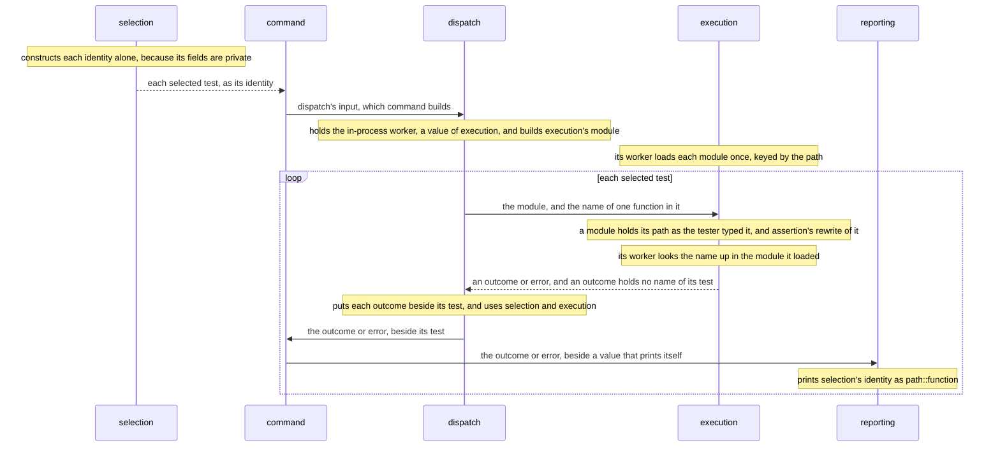

# Execution calls a test by its function's name, and reporting prints the identity it is given

## Context and Problem Statement

The invariant one identity says that no part names a test except by the identity that selection gives it.
[Each part is a crate](each-part-is-a-crate.md#decision-outcome), so a part names another part's type only through a crate that its manifest names.
In the parts diagram, execution and reporting use no interface of selection.

| fact | source |
|---|---|
| reporting's use of `purba_selection::TestId`, with no selection in its manifest, stopped at `E0433` | [the probe](https://github.com/kalonji-tools/purba/issues/563#issuecomment-6291610911) |
| command's `TestId { path, function }`, with private fields, stopped at `E0451` | [the probe](https://github.com/kalonji-tools/purba/issues/563#issuecomment-6291610911) |
| reporting's test, with a `&str` in place of the identity, passed with no selection in its manifest | [the probe](https://github.com/kalonji-tools/purba/issues/563#issuecomment-6291610911) |
| selection uses parsing | [the landscape](../../LANDSCAPE.md#the-parts-and-their-dependencies) |
| dispatch hands command "three outcomes, each beside its test" | [the landscape](https://github.com/kalonji-tools/purba/blob/d369fee/LANDSCAPE.md#the-parts-and-their-dependencies) |
| the gate for one identity misses "a part that formats its own name for a test" | [a gate refuses each invariant a tool can see](a-gate-refuses-each-invariant-a-tool-can-see.md#decision-outcome) |

## Considered Options

- **Execution and reporting use selection, as two new arrows of the parts diagram.** Only selection constructs an identity, so a test of either part parses a real module to get one.
- **The invariant binds dispatch alone.** Reporting then builds `path::function` itself, the breach that the gate for one identity misses.

## Decision Outcome

**Reach:** `crates/**` `/LANDSCAPE.md`

**Area:** execution

**Execution calls a test by its function's name, and reporting prints the identity it is given.**
Neither part names the identity's type, so the tests of execution and reporting need no identity of selection.

The part that uses another part builds that part's input.
[A tester runs purba on one module, and reads one line for each test](a-tester-runs-purba-on-one-module-and-reads-one-line-for-each-test.md#decision-outcome) lays out the line where an identity prints as `path::function`.
[A worker loads each module once, and command hands each module once](a-worker-loads-each-module-once.md#decision-outcome) holds why a worker loads each module once.
[Assertion's rewrite crosses each part whole, and only assertion opens it](assertions-rewrite-crosses-each-part-whole-and-only-assertion-opens-it.md#decision-outcome) holds how a rewrite crosses the parts.

**Downside:**

- **Reporting prints any value that prints itself.** Command can hand it a name that command formatted. The gate for one identity misses it. The reviewer looks for it.
- **Dispatch takes any value that implements its `Test`.** Command can hand dispatch a value of a type that command defines, in place of an identity. The gate for one identity misses it. The reviewer looks for it.
- **Execution takes the name of one function.** A test method of a class needs more than one name. The design in depth of execution decides how such a test crosses.
- **A module under two spellings of its path loads twice in one worker.** The design in depth of selection decides how an identity starts.
- **Dispatch names assertion's `Rewrite` through execution's interface.** [Assertion's rewrite crosses each part whole, and only assertion opens it](assertions-rewrite-crosses-each-part-whole-and-only-assertion-opens-it.md#decision-outcome) holds the cost.

## Confirmation

`mise run test:rust` checks that an identity prints as `path::function`.
It checks that a worker of execution calls a test by its function's name.
It checks that reporting prints each identity as it is given.
It checks that dispatch builds execution's module.
It checks that dispatch puts each outcome or error beside its test.
It checks that command builds dispatch's input from selection's tests.

The `compile_fail` doc tests on `TestId` check that no crate but selection constructs an identity or reaches one of its fields.
