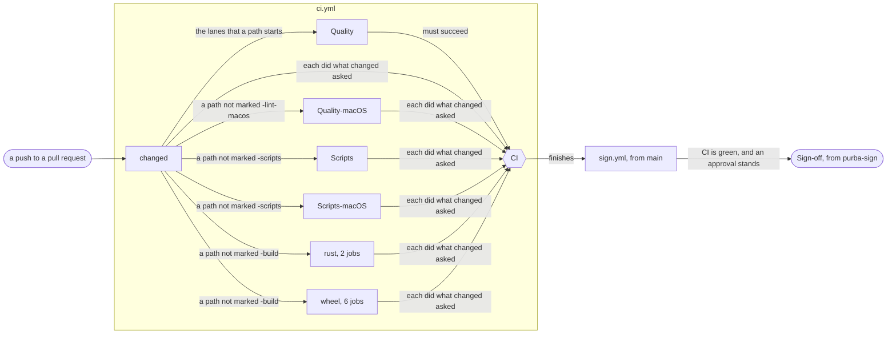

# One workflow runs every gate of a pull request

## Context and Problem Statement

Three workflows gated a pull request: `quality.yml`, `scripts.yml` and `build.yml`.
`Sign-off` waited for five of their jobs, so a push waited for the slowest of them.
The slowest ran on macOS.
There, bats ran one test at a time.
`Quality-macOS` and `Scripts-macOS` also built the cargo scripts again.
A push asked for more macOS jobs than the Free plan runs at once.

Each design had two bars.
One caps the span of a green push that runs the tests.
The other caps the count of files a reader opens from a push to `Sign-off`.
A repository of the prototype ran each design.

| measure | the three workflows | `ci.yml` |
| --- | --: | --: |
| median span of the slowest gate, s | 647, `Scripts` | 289, `CI` |
| p90 span of the slowest gate, s | | 319 |
| bar of the prototype, s | 326 | 326 |
| bar on purba's own runs, s | 314 | 314 |
| green pushes for each design | 10 | 10 |
| files from a push to `Sign-off` | 33 | 31 |

## Considered Options

- **The three workflows, with no lever.** `Scripts` missed the bar of time.
- **The three workflows, with the macOS cache, `bats --jobs` and the cap on macOS jobs.** Each gate met the bar of time, and a reader opened more files than with `ci.yml`. When two designs meet each bar, the one with fewer files wins.
- **A composite action for the steps the jobs share.** A reader opens more files than with `ci.yml`. Three records also bind a composite action.
- **A merge queue.** It moves the time of macOS past the approval, and cuts none of it.
- **Each cargo script built once before bats starts, and still run through `cargo run`.** On macOS, `cargo run` replaced the binary while another test started it.
- **`os` crossed with `python` in the wheel matrix.** Each check names its Python, but a push asks for more macOS jobs than the Free plan runs at once.
- **One step that loops over the two Pythons of a macOS job.** Under `set -e`, a failure of the first Python hides the second. The red step names both Pythons.

## Decision Outcome

**Reach:** `.github/workflows/ci.yml` `.github/workflows/sign.yml` `.github/workflows/cargo-scripts.yml` `.github/scripts/require-jobs.sh` `.github/scripts/check-run.sh` `.config/gates` `.config/tasks.toml` `.config/mise.toml` `scripts/check-records.sh` `scripts/check-macos-jobs.sh` `scripts/test/check-macos-jobs.bats` `scripts/test/require-jobs.bats` `scripts/test/check-records.bats` `/CONTRIBUTING.md`

**Area:** tooling

**One workflow, `ci.yml`, runs every gate of a pull request, and `Sign-off` waits for its job `CI`.**
Of the designs that met each bar, it leaves a reader the fewest files.

- **One workflow.** `ci.yml` holds the jobs that the three workflows held. Its last job, `CI`, needs each other job and runs under `always()`. It requires `Quality` to succeed, and passes `changed` with each other job to `require-jobs.sh`. `sign.yml` waits for `CI` alone, and names it as the gate and as carryable. `check-run.sh` reads the job `CI` from `ci.yml`, because the name of the gate names that file.
- **A macOS cache of the cargo scripts.** `cargo-scripts.yml` fills one cache for each OS on a push to `main`, and its key names the OS.
- **bats in parallel.** `test:shell` runs `bats --jobs` at twice the cores. `.config/mise.toml` pins GNU parallel as `conda:parallel`.
- **`ci.yml` asks for at most 5 macOS jobs on one push.** The Free plan runs 5 macOS jobs at once, so the macOS wheel matrix runs 2 jobs of 2 Pythons each. Each Python takes a step of its own, so a red step names its Python. The second step runs also when the first fails.
- **The tests run the built binary.** On macOS, each `cargo run` replaces the binary, also when it builds nothing, so a test in parallel can start it while it is gone. `test:shell` builds each cargo script once and sets `PURBA_CHECK_PROSE`. `check-records.sh` runs the `check-prose` that the variable names.

[CI runs a lane of the lint only when a path it reads changes](ci-runs-a-lane-of-the-lint-only-when-a-path-it-reads-changes.md) says which of these jobs skip, and how `CI` tells a skip from a failure.

**Downside:**

- **Only the median of `CI` meets purba's bar.** The p90 is above it.
- **On macOS, cargo compiles `check-prose` after the cache restores it.** Each macOS job of the scripts loses about half a minute to it.
- **A sixth macOS job on one push waits for a free runner.** `lint:macos-jobs` refuses one in `ci.yml`, and no lint reads another workflow.
- **A cancelled run of `CI` reads `failure`, not `cancelled`.** The job `CI` runs under `always()`, so it runs in a cancelled run too.
- **A test that fakes `cargo` must unset `PURBA_CHECK_PROSE`.** While it is set, the script runs the built binary, and the fake never runs.

## Confirmation

`mise run lint:macos-jobs` refuses a `ci.yml` that asks for more than 5 macOS jobs on one push, as [a gate refuses each invariant a tool can see](a-gate-refuses-each-invariant-a-tool-can-see.md) asks.
`scripts/test/check-macos-jobs.bats` tests that count.
`scripts/test/require-jobs.bats` tests `require-jobs.sh`.
No gate decides the time of a push.
No gate probes `Sign-off`.
The first four issues below measured the time.

The first three issues below also probed `Sign-off`.
It refused an unsigned commit.
It never appeared on a head with no approval, or with a gate that was not green.
A branch that edited `sign.yml` started its own `sign` job, and GitHub refused that job before its first step.

[Set up the repository of the prototype, and run today's CI there as the control arm](https://github.com/kalonji-tools/purba/issues/926) measured the three workflows.
[Build arm A, today's gate files with the three levers, and run it in the repository of the prototype](https://github.com/kalonji-tools/purba/issues/927) measured the three workflows with the levers.
[Build arm B, one CI gate with the three levers, and run it in the repository of the prototype](https://github.com/kalonji-tools/purba/issues/928) measured `ci.yml`.
[Build each cargo script once before bats starts, and run arm B with it in the repository of the prototype](https://github.com/kalonji-tools/purba/issues/929) found the race on macOS, and measured the built binary.
[How do a composite action and a reusable workflow name their check runs, and which can the sign job read as a gate?](https://github.com/kalonji-tools/purba/issues/918) counted the files of a composite action.
[Which levers does GitHub Actions give a public repository on the Free plan to cut the wall clock of a green push?](https://github.com/kalonji-tools/purba/issues/917) weighed the merge queue.
