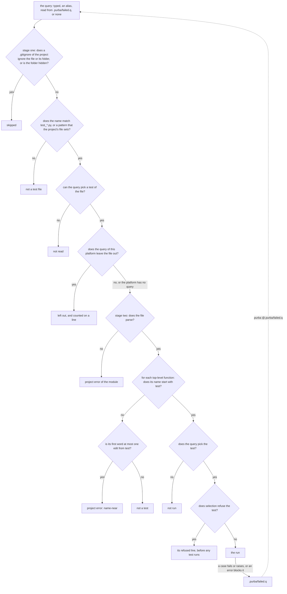

# purba picks a test by its name, and the tests of a run by one query

## Context and Problem Statement

[Selection](../../LANDSCAPE.md#the-parts-and-their-dependencies) was first in [the order of design](https://github.com/kalonji-tools/purba/blob/3093871b/LANDSCAPE.md?plain=1#L177).
A run took one path to one `.py` file.
The choice of a query waited for this design.
[A test carries only purba's own decorators](https://github.com/kalonji-tools/purba/blob/3093871b/docs/decisions/a-test-carries-only-purbas-own-decorators.md?plain=1#L74) left to it how a run picks its files by platform.

| fact | source |
|---|---|
| a run takes exactly one path to one `.py` file, and no flag; a directory and a query lost to the design of selection | [the record of a tester's run, L23 and L41](https://github.com/kalonji-tools/purba/blob/3093871b/docs/decisions/a-tester-runs-purba-on-one-module-and-reads-one-line-for-each-test.md?plain=1#L23-L41) |
| parsing keeps each function of the file whose name starts with `test` | [`crates/parsing/src/facts.rs` L294](https://github.com/kalonji-tools/purba/blob/3093871b/crates/parsing/src/facts.rs#L294) |
| in 9 pinned suites, a folder marker alone misses 17 of 189 test files, and catches 141 other files | [`research/selection-test-markers.md` L14](https://github.com/kalonji-tools/purba/blob/93af24df/research/selection-test-markers.md?plain=1#L14) |
| over 18 repositories, `*_test.py` names 2 files, and neither holds a test that purba can run; `tests.py` names 225, and 223 hold only methods of a class | [Which layouts of test files do Python projects use?](https://github.com/kalonji-tools/purba/issues/1239#issuecomment-7160743608), counted from [`files.tsv.gz`](https://github.com/kalonji-tools/purba/blob/e94f4626878baf96cee3482cf4bfc2684b80d213/research/test-layouts/files.tsv.gz) |
| when every public function of a test file is a test, the misspelled `tset_checkout` runs and passes, and purba refuses 956 helpers that it cannot call | [`proto/1229/RESULTS.md` L63 and L103](https://github.com/kalonji-tools/purba/blob/41daeb4e/proto/1229/RESULTS.md?plain=1#L63-L103) |
| a check for a name one edit from `test` finds no function in the 189 test files | [`proto/1229/RESULTS.md` L97](https://github.com/kalonji-tools/purba/blob/41daeb4e/proto/1229/RESULTS.md?plain=1#L97) |
| nextest 0.9.25 deprecated `--platform-filter` for `-E 'platform(...)'`; its reference says that "developers can learn the query language once and use it everywhere" | [nextest's changelog L2067-L2068](https://github.com/nextest-rs/nextest/blob/cargo-nextest-0.9.149/site/src/changelog.md#L2067-L2068), [filtersets L19-L23](https://github.com/nextest-rs/nextest/blob/cargo-nextest-0.9.149/site/src/docs/filtersets/reference.md#L19-L23) |
| Jujutsu and Mercurial save a query as an alias that takes an argument | [Jujutsu's `revsets.md` L596-L602](https://github.com/jj-vcs/jj/blob/v0.47.1/docs/revsets.md#L596-L602), [Mercurial's `revisions.txt`](https://foss.heptapod.net/mercurial/mercurial-devel/-/blob/7.1.2/mercurial/helptext/revisions.txt), L162 to L165 |
| nextest and pytest rerun the failures of a run from a record that they wrote | [nextest's `rerun.md` L9-L13](https://github.com/nextest-rs/nextest/blob/cargo-nextest-0.9.149/site/src/docs/features/record-replay-rerun/rerun.md#L9-L13), [pytest's `cache.rst` L13-L18](https://github.com/pytest-dev/pytest/blob/9.2.0/doc/en/how-to/cache.rst#L13-L18) |
| each query language drew fixes to its parser; pytest fails at 500 levels of parentheses, and Go's parser of `//go:build` lines drew CVE-2024-34158 | [`research/selection-queries.md` L16](https://github.com/kalonji-tools/purba/blob/e362ebed/research/selection-queries.md?plain=1#L16) |
| no probed language takes the id `store::migrate`, and a grammar written for purba parses it unchanged in each of five parser crates | [`research/selection-languages.md` L9](https://github.com/kalonji-tools/purba/blob/bbb57b1c/research/selection-languages.md?plain=1#L9) |
| oxitest's `-E` gives `&` and `\|` the same rank | [`research/selection-queries.md` L15](https://github.com/kalonji-tools/purba/blob/e362ebed/research/selection-queries.md?plain=1#L15) |
| oxitest reads `tag(db) \| tag(slow) & !tag(db)` as 4 tests where purba's grammar reads 7; it picks a misspelled test by a part of its name, and exits 0 on an empty pick | [`proto/1230/RESULTS.md` L7 and L43](https://github.com/kalonji-tools/purba/blob/e61910fc/proto/1230/RESULTS.md?plain=1#L7-L43) |
| pest and chumsky pick the same tests in every row with the depth limit on | [`proto/1230/RESULTS.md` L6](https://github.com/kalonji-tools/purba/blob/e61910fc/proto/1230/RESULTS.md?plain=1#L6) |
| with the limit off, on a debug build, the shallowest failure measured is 3000 levels of `(` on pest | [`proto/1230/RESULTS.md` L152](https://github.com/kalonji-tools/purba/blob/e61910fc/proto/1230/RESULTS.md?plain=1#L152) |
| the shell refuses a query of 10000 ids, about 390 KB: "Argument list too long" | [`proto/1230/RESULTS.md` L74](https://github.com/kalonji-tools/purba/blob/e61910fc/proto/1230/RESULTS.md?plain=1#L74) |
| in one blind round, which compares only with itself, with 5 as best: a tag scores 3.67 beside pytest's 3.67 and oxitest's 2.33; the line for a name near `test` scores 4.67 beside oxitest's 4.00 and pytest's 1.00; the failures printed as one query score 3.00 beside pytest's 4.00 and oxitest's 5.00 | [`proto/1231/README.md` L14-L16](https://github.com/kalonji-tools/purba/blob/6266c8a1/proto/1231/README.md?plain=1#L14-L16) |
| raters scored against the line for a name near `test` that the run still exits 0; against the printed query, they scored its 105 to 120 characters to copy and quote, that purba keeps nothing, and that the shell refused it without quotes | [`proto/1231/README.md` L21-L22](https://github.com/kalonji-tools/purba/blob/6266c8a1/proto/1231/README.md?plain=1#L21-L22) |

## Considered Options

- **A flag for each way to select, such as pytest's `-k` and `-m`.** A tester learns each flag, where one language serves each command.
- **A fuzzy match of the name that a tester types.** A near match runs a wrong test, and no error shows it (judgement).
- **purba takes over oxitest's `-E`.** Its precedence differs from purba's. Its match takes a misspelled test. Its empty pick exits 0.
- **purba borrows the query language of another tool.** No probed language takes purba's id as a query for that test.
- **A folder marks a test file, and the name of the file is free.** It misses test files at the root of a project, and runs the helper files of a test folder.
- **Every public function of a test file is a test.** A test with a misspelled name runs, so its name stays wrong. purba refuses each helper that it cannot call.
- **A name near `test` gives a notice, and the run's exit code does not change.** A run in CI passes with a test that never ran.
- **purba prints the failures as one query, and keeps nothing.** The tester copies a long query and quotes it.

## Decision Outcome

**Reach:** `crates/**` `tests/**` `/LANDSCAPE.md`

**Area:** selection

**purba picks a test by its name, and a tester names the tests of a run with one [query](../../CONTEXT.md#query).**
A name needs no list beside it.
A tester can save one query and run it again.



- **A run picks in two stages.** Stage one reads the paths of the files, and no file's text. Stage two parses only the files that stage one kept. So a run whose query names one file parses one file.
- **A [test file](../../CONTEXT.md#test-file) is a `.py` file whose name matches `test_*.py`.** Another pattern, such as `*_test.py`, `tests.py` or `test.py`, applies only when the [project's file](../../CONTEXT.md#projects-file) sets it. No folder marks a test file.
- **A [test](../../CONTEXT.md#test) is a function at the top level of a test file, and its name starts with `test`.**
- **A function whose name is near `test` is a [project error](../../CONTEXT.md#project-error).** The function sits at the top level of a test file, and its name does not start with `test`. The first word of its name ends at its first `_`. That word is at most one edit from `test`.
- **An edit changes, adds or drops one letter, or swaps two neighbours.** The check ignores case.
- **No suppression reaches the error of a name near `test`.** The function is no test, so its suppression sits above no test. [A suppression is an outcome and not a switch](a-suppression-is-an-outcome-and-not-a-switch.md#decision-outcome) makes such a suppression a fault. A helper that the check names takes another name.
- **The line of the error names its kind:** `<file>::<name> project error: [name-near] <name> is not a test, and its name is near the prefix test`. [A line names its kind in the glossary's words](a-line-names-its-kind-in-the-glossarys-words.md#decision-outcome) requires the kind. The words after the kind are the words that the raters scored.
- **Stage one skips each file or folder that a `.gitignore` file of the project ignores, and each hidden folder.** It reads no global file of git, and no `.git/info/exclude`, so a file that only one machine holds changes no outcome. Outside git, it reads no `.gitignore` file.
- **A folder that stage one cannot read is a [project error](../../CONTEXT.md#project-error) of that folder.** The other files run.
- **`purba` with no query runs each test file under the [root](../../CONTEXT.md#root).**

A query is the one way to name the tests of a run: `purba <query>`. No flag selects a test.

| term | names |
|---|---|
| `tests` | each test under the folder `tests` |
| `tests/test_a.py` | each test of that file |
| `tests/test_a.py::test_add` | that test |
| `tests/test_a.py::test_add::<case>` | that [case](../../CONTEXT.md#case), when the AST names it |
| `tag(slow)` | each test that carries the [tag](../../CONTEXT.md#tag) `slow` |
| `name(add)` | each test whose name holds `add` |
| `path(tests/**/db_*.py)` | each test of a file that the glob matches |
| `@.purba/failed.q` | the query that the file holds |

- **An id matches only whole parts.** `tests/test_a` names no file. The path of an id starts at the root.
- **`!` binds tightest, then `&`, then `|`.** Parentheses group terms.
- **A term that names nothing is an [invocation error](../../CONTEXT.md#invocation-error).** No path, tag, name or alias that purba read matches such a term. The error names the nearest of its kind, and the files that stage one left out. The pull request that builds the grammar adds the nearest id to the error of a path.
- **purba finds the nearest id part by part.** It measures the edit distance of the first part that differs.
- **A query that selects no test, while each term names something, prints only the count.** [CPython alone refuses a module that its compiler refuses](cpython-alone-refuses-a-module-that-its-compiler-refuses.md#decision-outcome) already prints a module with no test in this way.

  ```mermaid
  flowchart TD
    term{"does a term name nothing that purba read?"} -- yes --> invocation["invocation error, with the nearest name: exit 3"]
    term -- no --> pick{"does the query select a test?"}
    pick -- yes --> run["the run"]
    pick -- no --> count["only the count"]
  ```
- **A query nests at most 255 levels.** Each `(`, each `!` and each call of an alias opens a level. purba refuses a deeper query as an invocation error before the parser reads it.
- **purba writes its own grammar on a parser crate.** The pull request that builds the parser keeps one crate of the shortlist of `parse-test-query`.
- **A tag is a string literal in `purba.tag`.** A test carries it as `@purba.tag("<word>")`, or as `@tag("<word>")` after `from purba import tag`, the two forms that [a test carries only purba's own decorators](a-test-carries-only-purbas-own-decorators.md#decision-outcome) allows. A test carries several tags by several decorators. A tag needs no declaration. When the file does not import `purba`, the refusal of a tag names that import. The wheel ships a type stub for `purba.tag`.
- **The project's file saves a query under a name in `[tool.purba.queries]`, as an [alias](../../CONTEXT.md#alias).** An alias takes an argument, as in Jujutsu and Mercurial: `"stable(x)" = "x & !tag(flaky)"`. purba reads a bare word as an alias first, and as an id only when no alias has that name. An alias that names itself is a project error, because the project's file holds it.
- **A run in which a case fails or raises, or an error blocks a case, writes its failures as one query to `.purba/failed.q`.** It prints `purba @.purba/failed.q`. A run with no failure removes the file. `.purba/` holds a `.gitignore` of `*`. nextest and pytest keep such a record too. purba differs from them in the form: its record is a query, which the tester can also type.
- **A run that cannot write `.purba/failed.q` gives an invocation error.**
- **`[tool.purba.platform]` picks the files of a run by platform.** Its keys are `linux` and `macos`. The value of each is a query of ids that stop at a file and of `path(…)` terms. A `tag(…)` or a `name(…)` there is a project error. A run selects only what both its query and the query of its platform name. A platform with no key leaves no file out. A line counts each file that the query reaches and that the query of the platform leaves out.
- **nextest moved its platform from a flag into its query.** purba differs: its platform is the system that runs the tests, not the build target, and the project's file holds its query.
- **The project's file alone sets `[tool.purba.platform]` and `[tool.purba.queries]`.** Both change which tests run, so neither belongs to one machine or to one command.

Each of these waits for another design.

| what | the design that decides it |
|---|---|
| how an id spells a case | fixtures |
| the form of the line that counts the files left out, and of the line `purba @.purba/failed.q` | reporting, through a blind rating |
| a picker of tests in the terminal | none yet |
| which patterns of a test file the project's file may set, in which form, and whether a pattern adds to `test_*.py` | a grilling of its own |

**Downside:**

- **A helper whose first word is one edit from `test` takes another name.** The tester renames `text_format` to `format_text`, for example.
- **A misspelled test file runs no test, and purba says nothing.** `tset_lend.py` matches no pattern of a test file.
- **A test file in another convention runs no test, and purba says nothing.** `lend_test.py` matches no pattern of a test file, unless the project's file sets `*_test.py`.
- **purba says nothing about a misspelled tag.** purba keeps no list of tags, so a query for the right word misses the test.
- **A run of one test that passes removes the failures of an earlier run.** The tester reruns those failures by their ids.
- **A run with failures exits 3, not 1, where purba cannot write `.purba/`.** An integrator then reads an invocation error in place of a failed case.
- **An alias hides an id of the same name.** When the project names an alias `fast`, the tester names the folder `fast` as `path(fast/**)`.
- **purba owns the defects of its own grammar.** Each surveyed language drew fixes to its parser.

## Confirmation

`mise run test:rust` checks stage one in `crates/selection/tests/stage_one.rs`, and `mise run test:wheel` checks it in `tests/stage_one.bats`.
`mise run lint:order` refuses an order of design that still ranks selection.
The pull request that builds each rule other than stage one adds its tests.

[How does purba select the tests of a run?](https://github.com/kalonji-tools/purba/issues/1232) asks the question.
[Which patterns of a test file may the project's file set, in which form?](https://github.com/kalonji-tools/purba/issues/1240) decides which other patterns of a test file the project's file may set.
[A tester reads a line for each case](a-tester-runs-purba-on-one-module-and-reads-one-line-for-each-test.md#decision-outcome) holds how a run starts and what it prints.
[`.config/shortlists.toml`](../../.config/shortlists.toml) holds the shortlists of `find-test-files` and `parse-test-query`.
