# Which records would a figure make clearer?

Of the 85 records on `main` at `78232b7` that hold no figure, 12 hold a span that a figure may make clearer. Each candidate is a diagram, and no record called for a formula or a plot. The readers rate one candidate strong: the exit codes, which the table lists in one order and the code checks in another. They rate the other 11 borderline, so the person judges each. Six candidates draw what purba does, and the code at `78232b7` makes each arrow order they draw. Six draw how the project works, where the record alone sets the order. Five candidates may add or narrow a claim, and each section names it. The other 73 records are listed by name, and 16 of them were close calls.

This file answers [Which records would a figure make clearer, and what would each figure replace?](https://github.com/kalonji-tools/purba/issues/797). The branch is never merged.

## How it was read

- **The records** are a snapshot of `origin/main` at `78232b7`: 95 files under `docs/decisions/`, with `.template.md` left out. Ten of them hold a figure, so they were not read; [they are listed at the end](#records-not-read-because-they-hold-a-figure). Six agents read the other 85, 13 to 15 records each, whole. [The brief](record-figures-clarity-tools/BRIEF.md) holds what each agent was told.
- **Clarity alone decides.** No word was counted. A reader proposed a figure only where the content is a relation that the prose spells out in a line: a sequence, a branch, a state, a containment or a dependency.
- **Each arrow order is a claim.** Where a figure draws what purba does, its reader checked each arrow against the code at `78232b7`, and the section cites the file and line. Four of the six were checked again here, and each holds.
- **Each `mermaid` fence parses** under Mermaid 12.2.0. GitHub's `mermaidMarkdown-5b99bd9a2037271fa4cf.js` bundle names that version on 2026-11-06, and it is byte-identical to the bundle of 2026-11-04. A control fence with a node named `call` fails with GitHub's own `CALLBACKNAME` error. [`parse-fences.mjs`](record-figures-clarity-tools/parse-fences.mjs)
- **Each "Today" span** is quoted from the record, and a script checks that it equals lines L to M on `main`. The same script checks that each of the 85 records is listed once. [`verify-reports.mjs`](record-figures-clarity-tools/verify-reports.mjs)

## Candidates

| record | replaces | kind | its reader rates it |
|---|---|---|---|
| [A run exits 0 only when it checked something and every test passed](#a-run-exits-0-only-when-it-checked-something-and-every-test-passed) | [lines 59-68](https://github.com/kalonji-tools/purba/blob/78232b7/docs/decisions/a-run-exits-0-only-when-it-checked-something-and-every-test-passed.md?plain=1#L59-L68) | diagram | strong |
| [An interrupt stops the run, and a second one exits at once](#an-interrupt-stops-the-run-and-a-second-one-exits-at-once) | [line 49](https://github.com/kalonji-tools/purba/blob/78232b7/docs/decisions/an-interrupt-stops-the-run-and-a-second-one-exits-at-once.md?plain=1#L49-L49) | diagram | borderline |
| [Assertion's rewrite crosses each part whole, and only assertion opens it](#assertions-rewrite-crosses-each-part-whole-and-only-assertion-opens-it) | [lines 27-31](https://github.com/kalonji-tools/purba/blob/78232b7/docs/decisions/assertions-rewrite-crosses-each-part-whole-and-only-assertion-opens-it.md?plain=1#L27-L31) | diagram | borderline |
| [Execution calls a test by its function's name, and reporting prints the identity it is given](#execution-calls-a-test-by-its-functions-name-and-reporting-prints-the-identity-it-is-given) | [lines 30-41](https://github.com/kalonji-tools/purba/blob/78232b7/docs/decisions/execution-calls-a-test-by-its-functions-name.md?plain=1#L30-L41) | diagram | borderline |
| [A tester runs purba on one module, and reads one line for each test](#a-tester-runs-purba-on-one-module-and-reads-one-line-for-each-test) | [line 40](https://github.com/kalonji-tools/purba/blob/78232b7/docs/decisions/a-tester-runs-purba-on-one-module-and-reads-one-line-for-each-test.md?plain=1#L40-L40) | diagram | borderline |
| [A module that binds a name purba adds is a project error](#a-module-that-binds-a-name-purba-adds-is-a-project-error) | [lines 32-35](https://github.com/kalonji-tools/purba/blob/78232b7/docs/decisions/a-module-that-binds-a-name-purba-adds-is-a-project-error.md?plain=1#L32-L35) | diagram | borderline |
| [Liability is recorded from the act that makes it true](#liability-is-recorded-from-the-act-that-makes-it-true) | [lines 153-160](https://github.com/kalonji-tools/purba/blob/78232b7/docs/decisions/liability-is-recorded-from-the-act-that-makes-it-true.md?plain=1#L153-L160) | diagram | borderline |
| [An artifact is rewritten until its direction is agreed](#an-artifact-is-rewritten-until-its-direction-is-agreed) | [lines 76-77](https://github.com/kalonji-tools/purba/blob/78232b7/docs/decisions/an-artifact-is-rewritten-until-its-direction-is-agreed.md?plain=1#L76-L77) | diagram | borderline |
| [A commit message outlives its review](#a-commit-message-outlives-its-review) | [lines 54-60](https://github.com/kalonji-tools/purba/blob/78232b7/docs/decisions/a-commit-outlives-its-review.md?plain=1#L54-L60) | diagram | borderline |
| [A task is named for what it does to the tree](#a-task-is-named-for-what-it-does-to-the-tree) | [line 42](https://github.com/kalonji-tools/purba/blob/78232b7/docs/decisions/a-task-is-named-for-what-it-does-to-the-tree.md?plain=1#L42-L42) | diagram | borderline |
| [A location inherits its readers](#a-location-inherits-its-readers) | [lines 35-36](https://github.com/kalonji-tools/purba/blob/78232b7/docs/decisions/a-location-inherits-its-readers.md?plain=1#L35-L36) | diagram | borderline |
| [Architectural significance is declared, not detected](#architectural-significance-is-declared-not-detected) | [lines 48-52](https://github.com/kalonji-tools/purba/blob/78232b7/docs/decisions/significance-is-declared-not-detected.md?plain=1#L48-L52) | diagram | borderline |

## The candidates, drawn

### What purba does

#### A run exits 0 only when it checked something and every test passed

Replaces [lines 59-68](https://github.com/kalonji-tools/purba/blob/78232b7/docs/decisions/a-run-exits-0-only-when-it-checked-something-and-every-test-passed.md?plain=1#L59-L68), the code table and its precedence order · diagram · its reader rates it **strong**

**Today**, verbatim:

> | code | the run |
> |---|---|
> | 0 | at least one test ran, and every test passed |
> | 1 | a test failed |
> | 2 | a test is `unknown`, or no test ran |
> | 3 | an invocation error |
> | 4 | a test raised or gave no outcome, or a part saw a project error |
> | 125 | an internal error |
>
> - **When a run meets more than one row, its code is the first of 125, 3, 1, 4, 2 and 0.**

**The figure**:

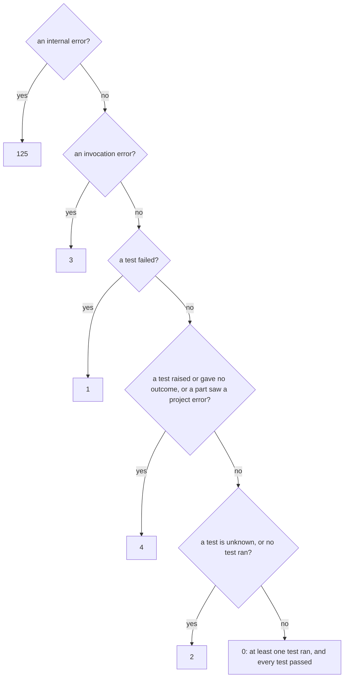

**Shows that the words do not:** The words list the codes as 0, 1, 2, 3, 4, 125, but the precedence is 125, 3, 1, 4, 2, 0. The reader has to map one order onto the other. The cascade draws each code once, in the order it is checked, so a run that meets two rows visibly stops at the first one.

**Loses:** the code span `unknown` (it becomes plain "unknown"), and the bold lead-in on line 68. The span has no links.

**Order checked against:** `crates/reporting/src/lib.rs:174-188` (`exit_code`: internal_errors → 125, invocation_errors → 3, failed → 1, raised || project_errors → 4, unknown || passed == 0 → 2, else 0).

**Prose outside the fence that changes:** none. Line 69 becomes the first bullet of the list.

**Checked again here:** the order of the five questions is the order of `exit_code` in `crates/reporting/src/lib.rs:174-188`.

#### An interrupt stops the run, and a second one exits at once

Replaces [line 49](https://github.com/kalonji-tools/purba/blob/78232b7/docs/decisions/an-interrupt-stops-the-run-and-a-second-one-exits-at-once.md?plain=1#L49-L49), what a second interrupt does, and why it works · diagram · its reader rates it **borderline**

**Today**, verbatim:

> - **A second interrupt skips the cleanup left, and exits at once.** Any two interrupts count, so SIGINT and then SIGTERM make a second. The first interrupt gives each interrupt signal its default action, so the second ends purba even while a cleanup runs C code.

**The figure**:

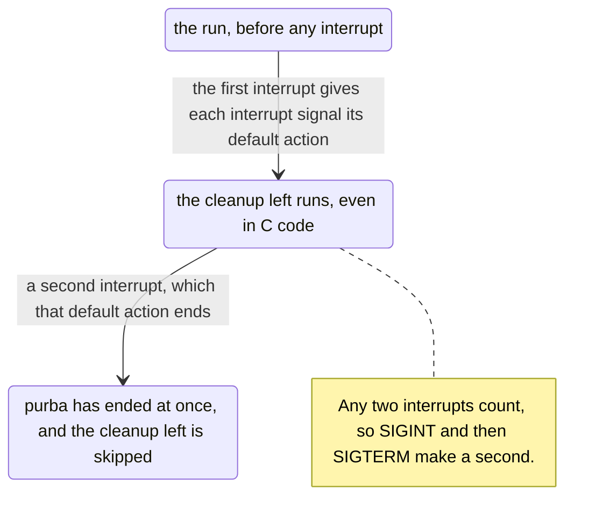

**Shows that the words do not:** The line packs a cause-and-effect chain into three sentences. The figure puts the change to the default action on the first arrow, so the reader sees that the second arrow needs nothing from purba, which is why it works even in C code.

**Loses:** nothing from the span, as long as the bullet keeps its bold lead-in and the fence is indented under it (as in the accepted reporting record).

**Order checked against:**
- `crates/execution/src/interrupt.rs:49-57`: the handler keeps the first signal in `KEPT`, then calls `give_default_actions`.
- `interrupt.rs:227-237`: `give_default_actions` sets `libc::signal(signum, SIG_DFL)` for each signal.
- `interrupt.rs:214-217`: `put_back` gives the default actions again after each later call or load.
- `interrupt.rs:53-55`: two signals waiting at once go to `die_by`.
- `interrupt.rs:34`: `NAMES` holds SIGINT, SIGTERM and SIGHUP, so any two of them count.

**Prose outside the fence that changes:** none. The bullet keeps its bold lead-in, and the fence sits indented beneath it.

**Checked again here:** the label "the cleanup left runs, even in C code" moves "even in C code" to the cleanup. The record says the second interrupt ends purba even while a cleanup runs C code. The label wants that wording before it goes in.

#### Assertion's rewrite crosses each part whole, and only assertion opens it

Replaces [lines 27-31](https://github.com/kalonji-tools/purba/blob/78232b7/docs/decisions/assertions-rewrite-crosses-each-part-whole-and-only-assertion-opens-it.md?plain=1#L27-L31), table header and rows on what crosses, and who reads it · diagram · its reader rates it **borderline**

**Today**, verbatim:

> | question | answer |
> |---|---|
> | what assertion's rewrite gives | one `Rewrite`, which holds the rewritten text and the text of each assert |
> | how it crosses | whole, from command to dispatch to execution, and into assertion's `load` |
> | who reads its text and its asserts | assertion alone |

**The figure**:

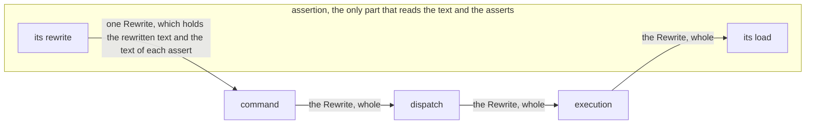

**Shows that the words do not:** Assertion appears at both ends of the path; every part in the middle carries the value without opening it. That is the record's title as a shape.

**Loses:** the code spans `Rewrite` and `load`; the question-and-answer framing of these three rows.

**Order checked against:**
- `crates/command/src/lib.rs:172`: command calls `purba_assertion::rewrite(module)`.
- `crates/dispatch/src/lib.rs:35`: dispatch's `Module::new` holds the rewrite.
- `crates/dispatch/src/lib.rs:107`: dispatch hands it to `purba_execution::Module::new`.
- `crates/execution/src/lib.rs:343`: execution calls `purba_assertion::load(py, &module.path, &module.rewrite)`.

**Prose outside the fence that changes:** none. The table header must open again after the fence, so rows 32-34 remain a table.

#### Execution calls a test by its function's name, and reporting prints the identity it is given

Replaces [lines 30-41](https://github.com/kalonji-tools/purba/blob/78232b7/docs/decisions/execution-calls-a-test-by-its-functions-name.md?plain=1#L30-L41), the question-and-answer table of what crosses each part · diagram · its reader rates it **borderline**

**Today**, verbatim:

> | question | answer |
> |---|---|
> | what execution takes | a module, and the name of one function in it |
> | what a module holds | its path as the tester typed it, and assertion's rewrite of it |
> | how execution finds the function | its worker loads each module once, keyed by the path, and looks the name up in that module |
> | what an in-process worker is | a value of execution, which dispatch holds |
> | what an outcome holds | no name of its test |
> | who puts each outcome beside its test | dispatch, which uses selection and execution |
> | what reporting takes | each outcome or error, beside a value that prints itself |
> | how selection's identity prints | `path::function`, as [a tester runs purba on one module](a-tester-runs-purba-on-one-module-and-reads-one-line-for-each-test.md#decision-outcome) lays out a line |
> | who constructs an identity | selection alone, because its fields are private |
> | who builds a part's input | the part that uses it. Command builds dispatch's input, and dispatch builds execution's module |

**The figure**:

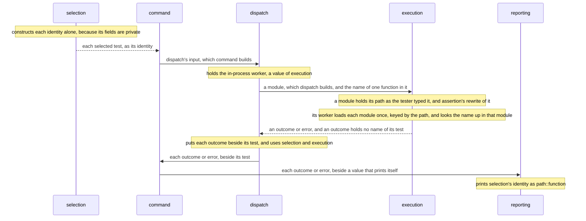

**Shows that the words do not:** the route the identity takes: selection to command to dispatch to reporting. Execution is the one part it skips, because execution gets only a function's name. In the table, the reader rebuilds that route from five rows that are not next to each other.

**Loses:**
- the link to `a-tester-runs-purba-on-one-module-and-reads-one-line-for-each-test.md#decision-outcome`; a new sentence keeps it.
- the code span `path::function`.
- the question-and-answer framing.

Two arrows add claims to the span, though not to the record:
- `dispatch->>command` comes from the record's own Context row 15: "dispatch hands command three outcomes, each beside its test".
- `command->>reporting` comes from Downside line 48: "Command can hand it a name that command formatted".

The table itself does not say who hands reporting its input. The reviewer should judge whether drawing those two arrows is acceptable.

**Order checked against:**
- `selection-->>command`: `crates/command/src/lib.rs:168` (`purba_selection::select`) runs before `command->>dispatch` at `:100` (`purba_dispatch::hand`). The module is built at `:173`.
- `dispatch->>execution`: dispatch builds the module at `crates/dispatch/src/lib.rs:107` and calls `worker.run(&executable, test.function())` at `:128`. One message; the load at `:108` comes before the run, but the figure does not draw it.
- `execution-->>dispatch`: `crates/execution/src/lib.rs:293` returns `Result<Outcome, Error>`; `Outcome` holds only `kind` (`:305`, `:455`).
- `dispatch->>command`: `crates/dispatch/src/lib.rs:130` `each(Handed::Test(test, result))`, after the run at `:128`.
- `command->>reporting`: `crates/command/src/lib.rs:102` `report.line(&test, &result)`, inside the function that dispatch calls.
- notes: private fields at `crates/selection/src/lib.rs:36-39`; `path::function` at `selection/src/lib.rs:57`; `line<T: Display>` at `crates/reporting/src/lib.rs:56`.

**Prose outside the fence that changes:** one new sentence after the fence: "[A tester runs purba on one module, and reads one line for each test](a-tester-runs-purba-on-one-module-and-reads-one-line-for-each-test.md#decision-outcome) lays out the line where an identity prints as `path::function`."

#### A tester runs purba on one module, and reads one line for each test

Replaces [line 40](https://github.com/kalonji-tools/purba/blob/78232b7/docs/decisions/a-tester-runs-purba-on-one-module-and-reads-one-line-for-each-test.md?plain=1#L40-L40), sentences 1, 2, 3, 6 and 7 of the stdout order bullet · diagram · its reader rates it **borderline**

**Today**, verbatim:

> - **A run prints to stdout the line of each test that selection refuses, then each other test's line, and the count.** Each other test's line prints as dispatch hands the test on. Each group of lines keeps source order. A module that does not load prints its line, then the line of each of its tests. A load that the first interrupt lands in prints no line, unless it meets an internal error. A module that does not parse prints its line and the count, and no line for a test. After an interrupt before selection ends, no line and no count print, as [An interrupted run prints its count, and dies by the signal](an-interrupted-run-prints-its-count-and-dies-by-the-signal.md#decision-outcome) says. The line of a thread's exception prints when purba takes it. It follows the line of the test that ran then, and the error of a load prints before the first test of its module. An [unreached test](../../CONTEXT.md#unreached-test) prints no line, as [An interrupted run prints its count, and dies by the signal](an-interrupted-run-prints-its-count-and-dies-by-the-signal.md#decision-outcome) says.

Sentences 4, 5, 8, 9 and 10 stay verbatim after the fence (a module that does not load, a load hit by an interrupt, a thread's exception, an unreached test). Drawing them too would repeat the dispatch figure that `reporting-writes-each-line-…` already draws.

**The figure**, indented 2 spaces under the bullet:

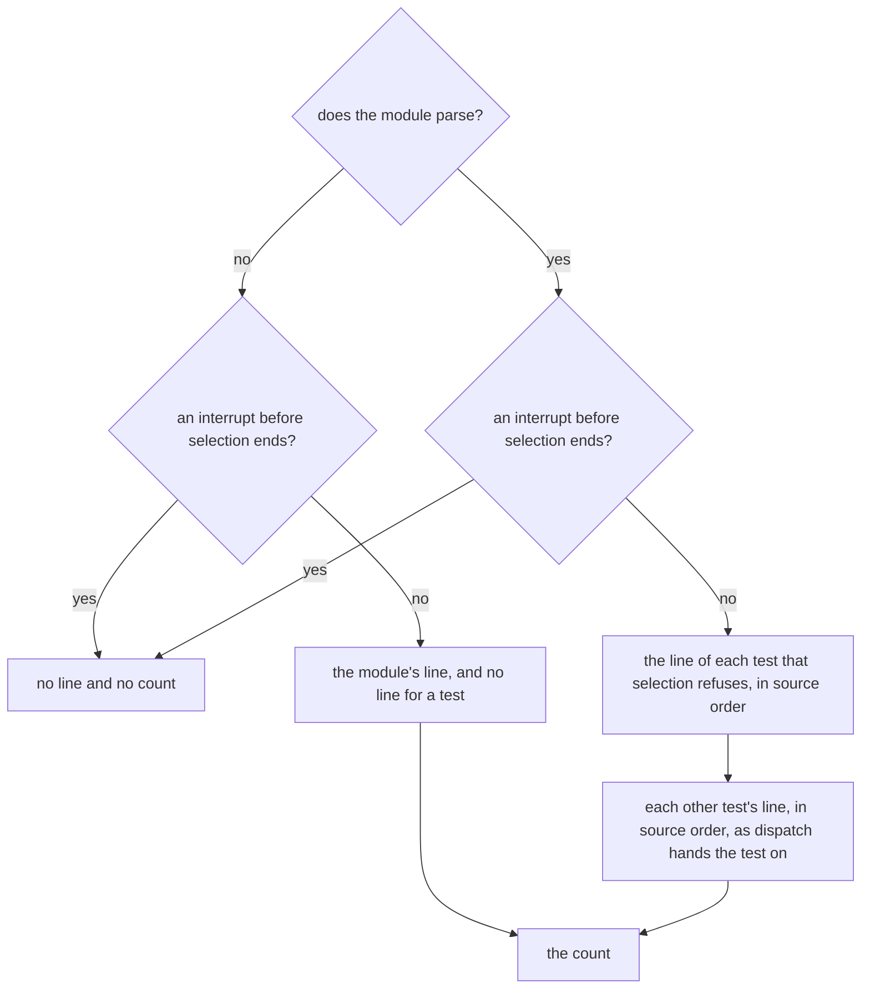

**Shows that the words do not:** The prose spreads three outcomes across sentences 1, 6 and 7, with other cases in between. The figure shows that two questions produce those three outcomes (nothing; the module's line and the count; the test lines and the count), and that two of the three paths end in the same count.

**Loses:** the link to `an-interrupted-run-prints-its-count-and-dies-by-the-signal.md#decision-outcome` in sentence 7, which a new sentence keeps; the bold on the lead-in.

**Order checked against:**
- Parse fails → interrupt check → the module's line → the count: `crates/command/src/lib.rs:80-86` → `stopped` at 128 (`not_interrupted`), 129 (`report.error`), 130 (`report.finish`).
- Parse succeeds → selection → interrupt check → refused lines → dispatch's lines → count: lines 88-91 → 92 (`not_interrupted`) → 94-99 (refused lines) → 100-114 (`purba_dispatch::hand`) → 118 (`report.finish`).

**Prose outside the fence that changes:**
- The lead-in becomes: "- **A run prints to stdout in the order below.**"
- A new sentence after the five kept sentences: "[An interrupted run prints its count, and dies by the signal](an-interrupted-run-prints-its-count-and-dies-by-the-signal.md#decision-outcome) holds why an interrupt before selection ends prints no line and no count."

**Checked again here:** both paths hold in `crates/command/src/lib.rs`: a parse that fails reaches `stopped` (lines 123-131), which checks for an interrupt, then prints the module's line, then the count.

#### A module that binds a name purba adds is a project error

Replaces [lines 32-35](https://github.com/kalonji-tools/purba/blob/78232b7/docs/decisions/a-module-that-binds-a-name-purba-adds-is-a-project-error.md?plain=1#L32-L35), the two load checks, and the check after each test · diagram · its reader rates it **borderline**

**Today**, verbatim:

> - **Before the body of the module runs, the load checks that no function holds such a name as a local name.**
> - **After the body runs, the load checks that each such name still holds what purba put there.**
> - **When either check fails, the load fails.** The error is `NameError: <file> binds _purba_ran, the name of purba's assert hook`.
> - **After each test, assertion checks the hook again.** When the hook changes, that test has the outcome `raised`, with that `NameError`. Assertion then puts the hook back for the next test.

**The figure**:

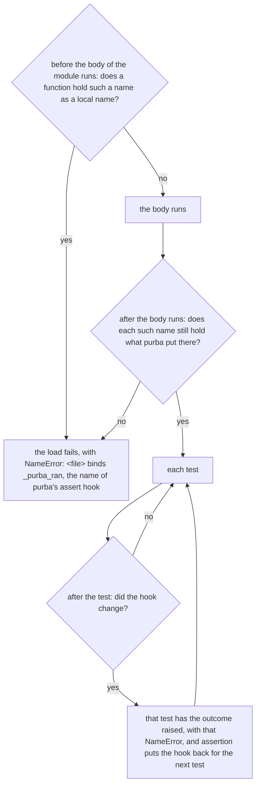

**Shows that the words do not:** Both load checks lead to the same failed load, while the check after each test leads somewhere else: the test is `raised`, and the run goes on to the next test. In the prose the reader must connect "either check" back to two earlier bullets.

**Loses:** the code span on the error text; the code spans on `raised` and `NameError`; the bold lead-ins. "Such a name" still points back to line 31, which stays.

**Order checked against:**
- local-name check before the body runs: `crates/assertion/src/lib.rs:248` (`check_locals`) before 249 (`exec`).
- the check after the body: lines 221-222 (`run(...).and_then(|()| check(...))`).
- a failure is the error: lines 230-232; `bound()` at 296-300 sets the text.
- tests run after the load: `crates/dispatch/src/lib.rs:108` (load) before 122-128 (each test).
- the check after each test: `crates/assertion/src/lib.rs:173` (`call()`, then `check`), whatever the test returned.
- putting the hook back: line 175 (`set_item(RAN, …)`).
- one `watch` per test: `crates/execution/src/lib.rs:431`.

**Prose outside the fence that changes:** none

**Checked again here:** `check_locals` runs before `exec` (`crates/assertion/src/lib.rs:248-249`), and the hook is checked after every call, whatever it returned (line 173).

### How the project works

#### Liability is recorded from the act that makes it true

Replaces [lines 153-160](https://github.com/kalonji-tools/purba/blob/78232b7/docs/decisions/liability-is-recorded-from-the-act-that-makes-it-true.md?plain=1#L153-L160), when the job carries a verdict to the new head · diagram · its reader rates it **borderline**

**Today**, verbatim:

> The tree at the head it writes may equal the tree at the head it replaced.
> It then reports the same conclusion again on the new head.
> A conclusion is reported again only where it answers for the tree.
>
> GitHub draws a check run's conclusion from a fixed set, and `success` and `failure` are the two members of it that answer.
> The rest report what happened to the run, so this job names the conclusion it refused and leaves the context absent.
> The pull request then stays blocked until somebody closes it and reopens it, which runs the gates on the rewritten head.
> Where the two trees differ this job carries nothing.

**The figure**:

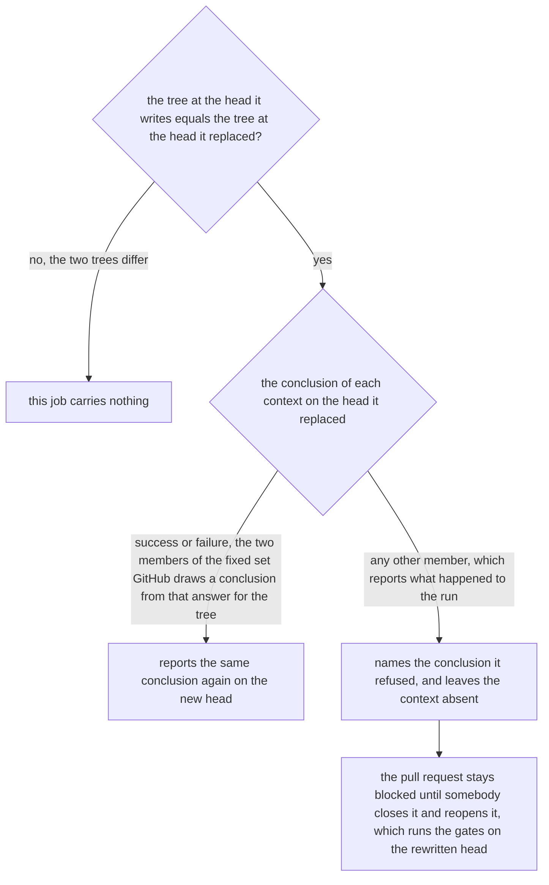

**Shows that the words do not:** The prose states a two-level branch: trees equal or not, then a conclusion that answers or not. But it states the tree-differs case last, after the reasons, so the reader must rebuild the tree. The figure puts the three outcomes side by side, each under the condition that leads to it.

**Loses:** the code spans `success` and `failure`. The span has no links.

**Order checked against:** `.github/scripts/carry-verdicts.sh:60-63` (the tree compare comes first and exits when the trees differ), then `:72-84` (only `success | failure` is carried; any other conclusion is echoed and skipped), then `:89` (`post_check_run` on `<after>` with the same conclusion). Left out the script's `before = after` early exit (`:46-49`), because the record does not state it.

**Prose outside the fence that changes:**
- Line 152 → "This job carries each verdict forward on that basis, as the figure draws."
- Line 161, where "that case" loses its antecedent → "The `sign` job cannot reach the figure's case where the trees differ, because it refuses a branch whose replay changes the content before it rewrites anything."
- This edit points at the figure rather than keeping a link; the person should judge whether that is allowed.
- Borderline because the edge labels must carry the reasons from lines 155 and 157.

#### An artifact is rewritten until its direction is agreed

Replaces [lines 76-77](https://github.com/kalonji-tools/purba/blob/78232b7/docs/decisions/an-artifact-is-rewritten-until-its-direction-is-agreed.md?plain=1#L76-L77), the draft state, and how the type's declaration is lifted · diagram · its reader rates it **borderline**

**Today**, verbatim:

> While the type is `null` the issue is a draft, and its body and its spec are rewritten freely with no mark owed.
> The declaration is public, it is a string comparison, and lifting it is recorded as `issue_type_removed`.

**The figure**:

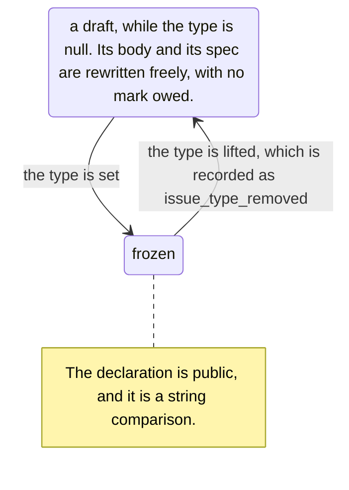

**Shows that the words do not:** The freeze is a cycle. Lifting the type takes a frozen issue back to a draft. The prose leaves the reader to infer this by joining "type null = draft" to "lifting it". The figure draws the way back as an arrow.

**Loses:** the code spans on `null` and `issue_type_removed`. The span has no links.

**Order checked against:** not purba code; a GitHub process, so the states come from the record only. The frozen state and its "type is set" arrow come from line 60 and the table row at line 72, not from this span. The "lifted → draft" arrow is the inference that line 131 states ("Removing a type un-freezes an issue"). The person should judge whether pulling line 72's claim into the figure counts as an added claim.

**Prose outside the fence that changes:** none

#### A commit message outlives its review

Replaces [lines 54-60](https://github.com/kalonji-tools/purba/blob/78232b7/docs/decisions/a-commit-outlives-its-review.md?plain=1#L54-L60), where each statement goes, by who makes it and permanence · diagram · its reader rates it **borderline**

**Today**, verbatim:

> Everything a review consumes and discards belongs in the pull request or the issue.
>
> Permanence decides among the statements the committer can make truthfully.
> A statement the committer cannot make belongs wherever the person who can make it acts.
> [Liability is recorded from the act that makes it true](liability-is-recorded-from-the-act-that-makes-it-true.md) divides liability along that line.
> The origin statement is the part a contributor can make, so it belongs in the commit.
> The review statement is the part no committer can make, so it stays where the reviewer acts.

**The figure**:

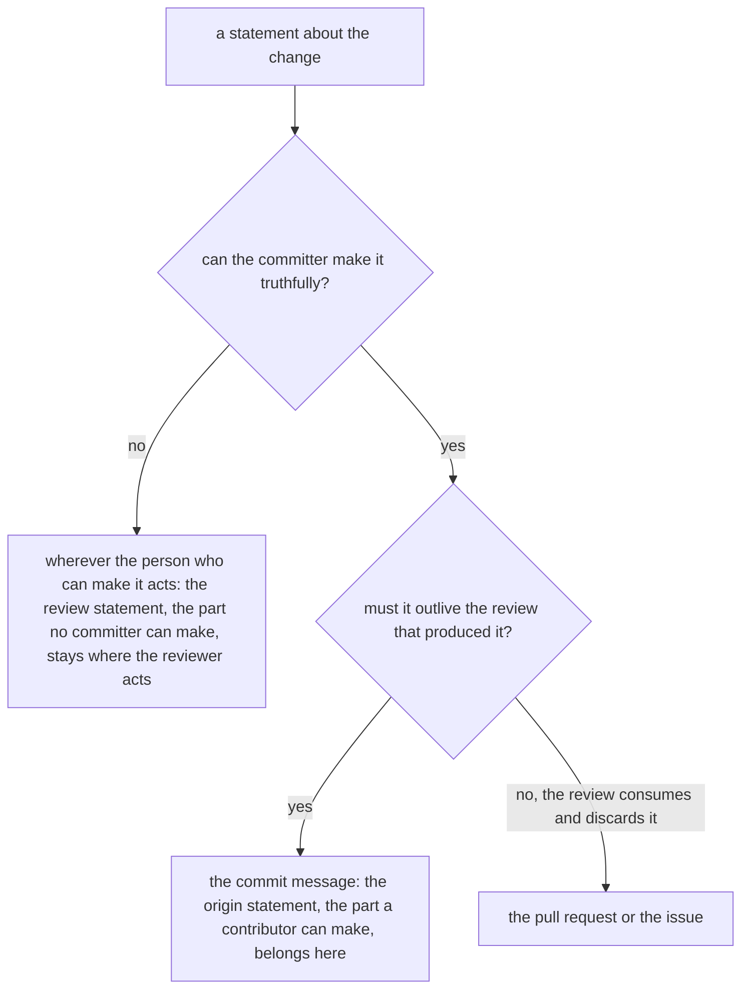

**Shows that the words do not:** The question of who can make the statement comes before permanence, and permanence decides only inside its "yes" branch. Line 56 states that nesting in one clause, and the reader must rebuild it. The figure also puts the three places a statement can go side by side.

**Loses:** The link to `liability-is-recorded-from-the-act-that-makes-it-true.md`, which the changed sentence below keeps. The "yes, outlives review" leaf names the origin statement. The record never says in so many words that the origin statement outlives review. That follows from line 52 ("and nothing else") together with line 59, so the reviewer should confirm that this does not count as a new claim. The figure keeps the record's split between contributor (line 59) and committer (lines 56, 60) as written. The figure covers only the permanence rule. Line 83 adds a third condition for the body ("no other location already carries it"), and the commit leaf does not show it. Line 52 stays above the figure as the headline, unchanged.

**Order checked against:** No code order is drawn, because this is a rule for writers with no code behind it. The order of the two questions comes from the record itself, line 56: "Permanence decides among the statements the committer can make truthfully."

**Prose outside the fence that changes:** "[Liability is recorded from the act that makes it true](liability-is-recorded-from-the-act-that-makes-it-true.md) divides liability along the first question."

#### A task is named for what it does to the tree

Replaces [line 42](https://github.com/kalonji-tools/purba/blob/78232b7/docs/decisions/a-task-is-named-for-what-it-does-to-the-tree.md?plain=1#L42-L42), which bare task runs which tasks · diagram · its reader rates it **borderline**

**Today**, verbatim:

> `fmt`, `lint` and `test` each depend on their prefix with a wildcard, and `check` runs `lint` and `test`.

**The figure**:

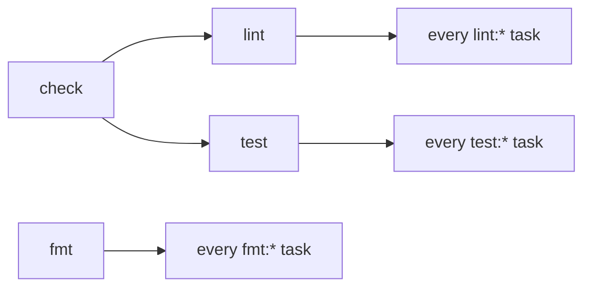

**Shows that the words do not:** `check` reaches every `lint:*` and `test:*` task through two levels, and `fmt` sits outside `check`. The sentence leaves that two-level reach for the reader to put together. Line 49, "So `check` does not run it", depends on that reach.

**Loses:** Code spans on `fmt`, `lint`, `test`, `check` and the wildcard patterns, because the labels are plain text. The words "with a wildcard" become `:*` inside a label. An arrow means "depends on", and the figure does not say so.

**Order checked against:** No order is drawn. mise runs `depends` with no order between siblings. The edges are `.config/tasks.toml:17` (`check` depends on `["lint", "test"]`), `:23` (`fmt` on `["fmt:*"]`), `:48` (`lint` on `["lint:*"]`) and `:133` (`test` on `["test:*"]`).

**Prose outside the fence that changes:** none. Lines 41 and 43-49 stay. `build` and `list:records` stay out of the figure, because their sentences carry reasons a label would drop.

#### A location inherits its readers

Replaces [lines 35-36](https://github.com/kalonji-tools/purba/blob/78232b7/docs/decisions/a-location-inherits-its-readers.md?plain=1#L35-L36), readers accumulate down the path tree, with one example · diagram · its reader rates it **borderline**

**Today**, verbatim:

> A directory names the actors it adds, and a file's readers are the union of every binding from the project root down to it.
> A directory that binds nothing is transparent: `src/config/pyproject.toml` reads `src/`'s actors when `config/` binds none.

**The figure**:

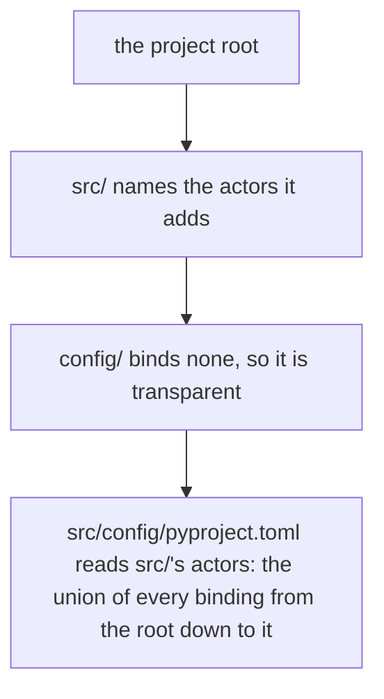

**Shows that the words do not:** The figure draws the path from the root to the file, so the reader sees the union build up one directory at a time, and sees that the transparent `config/` adds nothing on the way.

**Loses:** the code spans `src/config/pyproject.toml`, `src/` and `config/`. Also, two general claims ("a directory names the actors it adds" and "a directory that binds nothing is transparent") now appear only through the example. A reviewer may count that as a claim made narrower.

**Order checked against:** no order drawn. The arrows show path containment, not a sequence over time.

**Prose outside the fence that changes:** none

#### Architectural significance is declared, not detected

Replaces [lines 48-52](https://github.com/kalonji-tools/purba/blob/78232b7/docs/decisions/significance-is-declared-not-detected.md?plain=1#L48-L52), who reads a pull request, by whether it touches a record · diagram · its reader rates it **borderline**

**Today**, verbatim:

> A pull request that touches a record carries all three links in one diff, and the code owner reads it.
> A pull request that touches no record is further down a chain whose decision already merged.
> The reviewer reads the change against the record that governs it.
> Where no record governs it, the reviewer asks whether one is owed.
> That question is a suggestion and never a gate, and nothing enforces it.

**The figure**:

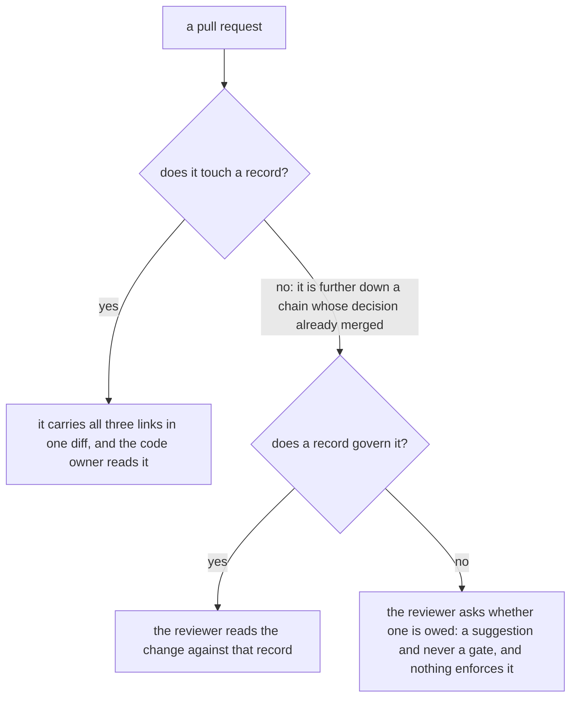

**Shows that the words do not:** The prose gives a decision two levels deep as five sentences in a row. The figure shows the nesting: "does a record govern it?" applies only to a pull request that touches no record.

**Loses:** nothing. "All three links" still points back to line 45.

**Order checked against:** no order drawn. ⚠️ The figure makes one tension in the prose plainer: the "no" edge says the decision "already merged", and the branch under it can still answer "no record governs it". The prose says both, so the figure says both too.

**Prose outside the fence that changes:** none

**Checked again here:** the tension is in the record. Line 49 says a pull request that touches no record has a decision that already merged, and line 51 allows no record to govern it.

## Close calls, marked none

Each of these has a shape a figure could draw, and its reader judged that the figure would read no clearer or would change a claim.

- **[A part-of-speech tagger decides the tense rule](https://github.com/kalonji-tools/purba/blob/78232b7/docs/decisions/a-part-of-speech-tagger-decides-the-tense-rule.md?plain=1#L38-L41)**, lines 38-41: the tense walk branches, but `check-prose.rs:1034-1075` runs it as a loop with two flags, so a figure would add claims the four lines do not make.
- **[A path not marked to skip starts the gate](https://github.com/kalonji-tools/purba/blob/78232b7/docs/decisions/a-path-not-marked-to-skip-starts-the-gate.md?plain=1#L27-L31)**, lines 27-31: the parts table could be a flow (`build.yml:43-64,182-206`), but its arrows would state relations the table does not.
- **[A test returns nothing, and the first part that sees a breach of a test refuses it](https://github.com/kalonji-tools/purba/blob/78232b7/docs/decisions/a-test-returns-nothing-and-the-first-part-that-sees-a-breach-refuses-it.md?plain=1#L31-L39)**, lines 31-39: the table gives the part for each breach, and a flow would drop its "a test" column.
- **[A concern is what no part can own](https://github.com/kalonji-tools/purba/blob/78232b7/docs/decisions/a-concern-is-what-no-part-can-own.md)**, lines 37 and 46-48: two short lists of parts are easy to hold in the head.
- **[An outside contribution is applied, not merged](https://github.com/kalonji-tools/purba/blob/78232b7/docs/decisions/an-outside-contribution-is-applied-not-merged.md?plain=1#L8-L11)**, lines 8-11: two starts end the same way, and the earlier draft moved the prose into its labels. The prose holds against `sign.yml`.
- **[An actor is what it does, not what it is](https://github.com/kalonji-tools/purba/blob/78232b7/docs/decisions/an-actor-is-what-it-does-not-what-it-is.md?plain=1#L68-L70)**, lines 68-70: a loop between two states, which three lines already say plainly.
- **[Only GitHub runs what lives under `.github`](https://github.com/kalonji-tools/purba/blob/78232b7/docs/decisions/only-github-runs-what-lives-under-github.md)**: the placement rule is a decision flow that matches `check-placement.sh:82-88`, but its two sentences (27 and 36) sit apart with reasons between them, and the controls table already lists every case.
- **[A KeyboardInterrupt that no signal caused is the test's own raise](https://github.com/kalonji-tools/purba/blob/78232b7/docs/decisions/a-keyboardinterrupt-that-no-signal-caused-is-the-tests-own-raise.md?plain=1#L27-L30)**, lines 27-30: a tree would claim two things the record never says, and without them it is a flat fan.
- **[purba runs inside the tester's interpreter](https://github.com/kalonji-tools/purba/blob/78232b7/docs/decisions/purba-runs-inside-the-testers-interpreter.md?plain=1#L34-L39)**, lines 34-39: `LANDSCAPE.md` already draws this figure, and line 32 links to it. A copy could drift, and it loses the glossary links.
- **[The zip alerts of check-prose are dismissed as unused](https://github.com/kalonji-tools/purba/blob/78232b7/docs/decisions/the-zip-alerts-of-check-prose-are-dismissed-as-unused.md)**: a graph for lines 13-16 would drop four source links and add an edge, and lines 36-40 read clearest as a numbered list.
- **[purba supports a Python that has two years left](https://github.com/kalonji-tools/purba/blob/78232b7/docs/decisions/purba-supports-a-python-with-two-years-left.md?plain=1#L31-L31)**, line 31: a formula reads no clearer than the sentence, and a timeline would state today's floor, which the record leaves out.
- **[A suppression is an outcome and not a switch](https://github.com/kalonji-tools/purba/blob/78232b7/docs/decisions/a-suppression-is-an-outcome-and-not-a-switch.md?plain=1#L36-L40)**, lines 36-40: the branches carry reasons (lines 37 and 40) that no label can hold.
- **[A test names two values of one type by two fixtures](https://github.com/kalonji-tools/purba/blob/78232b7/docs/decisions/a-test-names-two-values-of-one-type-by-two-fixtures.md?plain=1#L35-L46)**: the Python block at lines 35-46 already shows how the fixtures depend on each other.
- **[Configuration takes the first location its tool reads](https://github.com/kalonji-tools/purba/blob/78232b7/docs/decisions/configuration-takes-the-first-location-its-tool-reads.md?plain=1#L48-L66)**, lines 48-66: the strongest shape among the close calls, a routing with four branches. Each branch has a reason or a link beside it, so no contiguous span holds the routing alone. A figure beside line 48 that keeps the prose is still open to the person.
- **[purba parses Python with ruff's parser](https://github.com/kalonji-tools/purba/blob/78232b7/docs/decisions/purba-parses-python-with-ruff.md?plain=1#L103-L108)**, lines 103-108: the earlier draft redraws a clear four-row matrix.
- **[purba carries no tool manager beside mise, and no compiler of its own](https://github.com/kalonji-tools/purba/blob/78232b7/docs/decisions/purba-carries-no-tool-manager-beside-mise-and-no-compiler-of-its-own.md?plain=1#L95-L98)**, lines 95-98: a causal chain that is already one link for each line.

One more close call sits inside a candidate's record: the `os._exit` guard at line 73 of [A run exits 0 only when it checked something and every test passed](https://github.com/kalonji-tools/purba/blob/78232b7/docs/decisions/a-run-exits-0-only-when-it-checked-something-and-every-test-passed.md?plain=1#L73-L73) is a list of conditions, not a sequence.

## Records no figure makes clearer

These 73 were read whole, and their readers found no span that a figure makes clearer. The 16 close calls above are among them.

- [A blocked test has no outcome](https://github.com/kalonji-tools/purba/blob/78232b7/docs/decisions/a-blocked-test-has-no-outcome.md)
- [A case of each kind checks that no failure prints as another kind](https://github.com/kalonji-tools/purba/blob/78232b7/docs/decisions/a-case-of-each-kind-checks-that-no-failure-prints-as-another-kind.md)
- [A command test checks only command's rules](https://github.com/kalonji-tools/purba/blob/78232b7/docs/decisions/a-command-test-checks-only-commands-rules.md)
- [A concern is what no part can own](https://github.com/kalonji-tools/purba/blob/78232b7/docs/decisions/a-concern-is-what-no-part-can-own.md)
- [A decision record is rewritten, not amended](https://github.com/kalonji-tools/purba/blob/78232b7/docs/decisions/a-record-is-rewritten-not-amended.md)
- [A figure in a record is a fence GitHub renders](https://github.com/kalonji-tools/purba/blob/78232b7/docs/decisions/a-figure-in-a-record-is-a-fence-github-renders.md)
- [A gate owns the mechanical standard](https://github.com/kalonji-tools/purba/blob/78232b7/docs/decisions/a-gate-owns-the-mechanical.md)
- [A gate reads its marks on the base branch](https://github.com/kalonji-tools/purba/blob/78232b7/docs/decisions/a-gate-reads-its-marks-on-the-base-branch.md)
- [A gate refuses each invariant a tool can see, from the first code it reads](https://github.com/kalonji-tools/purba/blob/78232b7/docs/decisions/a-gate-refuses-each-invariant-a-tool-can-see.md)
- [A KeyboardInterrupt that no signal caused is the test's own raise](https://github.com/kalonji-tools/purba/blob/78232b7/docs/decisions/a-keyboardinterrupt-that-no-signal-caused-is-the-tests-own-raise.md)
- [A loaded module joins sys.modules under its file's name, without .py](https://github.com/kalonji-tools/purba/blob/78232b7/docs/decisions/a-loaded-module-joins-sys-modules-under-its-files-name.md)
- [A module whose load fails leaves sys.modules as it found it](https://github.com/kalonji-tools/purba/blob/78232b7/docs/decisions/a-module-whose-load-fails-leaves-sys-modules-as-it-found-it.md)
- [An actor is what it does, not what it is](https://github.com/kalonji-tools/purba/blob/78232b7/docs/decisions/an-actor-is-what-it-does-not-what-it-is.md)
- [An artifact holds the minimum that conveys its point](https://github.com/kalonji-tools/purba/blob/78232b7/docs/decisions/an-artifact-holds-the-minimum-that-conveys-its-point.md)
- [An error says its kind, and reporting takes four ways in](https://github.com/kalonji-tools/purba/blob/78232b7/docs/decisions/an-error-says-its-kind-and-reporting-takes-four-ways-in.md)
- [An error stops only the work that depends on it](https://github.com/kalonji-tools/purba/blob/78232b7/docs/decisions/an-error-stops-only-the-work-that-depends-on-it.md)
- [A new question gets a new record](https://github.com/kalonji-tools/purba/blob/78232b7/docs/decisions/a-new-question-gets-a-new-record.md)
- [An implementation follows test-driven development](https://github.com/kalonji-tools/purba/blob/78232b7/docs/decisions/an-implementation-follows-test-driven-development.md)
- [An interrupted run prints its count, and dies by the signal](https://github.com/kalonji-tools/purba/blob/78232b7/docs/decisions/an-interrupted-run-prints-its-count-and-dies-by-the-signal.md)
- [An invariant needs no design of its own](https://github.com/kalonji-tools/purba/blob/78232b7/docs/decisions/an-invariant-needs-no-design-of-its-own.md)
- [A normaliser's style is chosen for the human who reads the code](https://github.com/kalonji-tools/purba/blob/78232b7/docs/decisions/a-normalisers-style-is-chosen-for-the-human-who-reads-the-code.md)
- [An outside contribution is applied, not merged](https://github.com/kalonji-tools/purba/blob/78232b7/docs/decisions/an-outside-contribution-is-applied-not-merged.md)
- [An unpublished comment carries what no other location carries](https://github.com/kalonji-tools/purba/blob/78232b7/docs/decisions/an-unpublished-comment-carries-what-no-other-location-carries.md)
- [A part-of-speech tagger decides the tense rule](https://github.com/kalonji-tools/purba/blob/78232b7/docs/decisions/a-part-of-speech-tagger-decides-the-tense-rule.md)
- [A path not marked to skip starts the gate](https://github.com/kalonji-tools/purba/blob/78232b7/docs/decisions/a-path-not-marked-to-skip-starts-the-gate.md)
- [A pinned candidate decides when a milestone is done](https://github.com/kalonji-tools/purba/blob/78232b7/docs/decisions/a-pinned-candidate-decides-when-a-milestone-is-done.md)
- [A record names every location where it applies](https://github.com/kalonji-tools/purba/blob/78232b7/docs/decisions/a-record-names-every-location-where-it-applies.md)
- [A refusal states the rule, why it holds, and where it was found](https://github.com/kalonji-tools/purba/blob/78232b7/docs/decisions/a-refusal-states-the-rule-why-it-holds-and-where-it-was-found.md)
- [A register belongs to one location](https://github.com/kalonji-tools/purba/blob/78232b7/docs/decisions/a-register-belongs-to-one-location.md)
- [A script calculates the order of design, and only a changed input moves it](https://github.com/kalonji-tools/purba/blob/78232b7/docs/decisions/only-a-changed-input-moves-the-order-of-design.md)
- [A script that needs a Rust library is a cargo script](https://github.com/kalonji-tools/purba/blob/78232b7/docs/decisions/a-script-that-needs-a-rust-library-is-a-cargo-script.md)
- [A standard a gate cannot decide does not become a gate](https://github.com/kalonji-tools/purba/blob/78232b7/docs/decisions/a-standard-a-gate-cannot-decide-does-not-become-a-gate.md)
- [A suppression is an outcome and not a switch](https://github.com/kalonji-tools/purba/blob/78232b7/docs/decisions/a-suppression-is-an-outcome-and-not-a-switch.md)
- [A term belongs to the glossary](https://github.com/kalonji-tools/purba/blob/78232b7/docs/decisions/a-term-belongs-to-the-glossary.md)
- [A test carries only purba's own decorators](https://github.com/kalonji-tools/purba/blob/78232b7/docs/decisions/a-test-carries-only-purbas-own-decorators.md)
- [A test causes an internal error through a switch that only a test build carries](https://github.com/kalonji-tools/purba/blob/78232b7/docs/decisions/a-test-causes-an-internal-error-through-a-switch-that-only-a-test-build-carries.md)
- [A test names the fixture of each input](https://github.com/kalonji-tools/purba/blob/78232b7/docs/decisions/a-test-names-the-fixture-of-each-input.md)
- [A test names two values of one type by two fixtures](https://github.com/kalonji-tools/purba/blob/78232b7/docs/decisions/a-test-names-two-values-of-one-type-by-two-fixtures.md)
- [A test returns nothing, and the first part that sees a breach of a test refuses it](https://github.com/kalonji-tools/purba/blob/78232b7/docs/decisions/a-test-returns-nothing-and-the-first-part-that-sees-a-breach-refuses-it.md)
- [A test that selection refuses prints before any test runs](https://github.com/kalonji-tools/purba/blob/78232b7/docs/decisions/a-test-that-selection-refuses-prints-before-any-test-runs.md)
- [A workflow is granted an identity, not a power](https://github.com/kalonji-tools/purba/blob/78232b7/docs/decisions/a-workflow-is-granted-an-identity-not-a-power.md)
- [A workflow names each action by its commit](https://github.com/kalonji-tools/purba/blob/78232b7/docs/decisions/a-workflow-names-each-action-by-its-commit.md)
- [bats tests the installed wheel from outside purba](https://github.com/kalonji-tools/purba/blob/78232b7/docs/decisions/bats-tests-the-installed-wheel-from-outside-purba.md)
- [Configuration takes the first location its tool reads](https://github.com/kalonji-tools/purba/blob/78232b7/docs/decisions/configuration-takes-the-first-location-its-tool-reads.md)
- [Dependabot proposes each newer action](https://github.com/kalonji-tools/purba/blob/78232b7/docs/decisions/dependabot-proposes-each-newer-action.md)
- [Each test runs in a process of its own](https://github.com/kalonji-tools/purba/blob/78232b7/docs/decisions/each-test-runs-in-a-process-of-its-own.md)
- [Every crate lives under crates/](https://github.com/kalonji-tools/purba/blob/78232b7/docs/decisions/every-crate-lives-under-crates.md)
- [Every part of the skeleton is Rust, inside the extension module](https://github.com/kalonji-tools/purba/blob/78232b7/docs/decisions/every-part-of-the-skeleton-is-rust-inside-the-extension-module.md)
- [One file marks every tracked path for each gate that can skip](https://github.com/kalonji-tools/purba/blob/78232b7/docs/decisions/one-file-marks-every-tracked-path-for-each-gate-that-can-skip.md)
- [One manifest declares each package](https://github.com/kalonji-tools/purba/blob/78232b7/docs/decisions/one-manifest-declares-each-package.md)
- [One pull request answers one issue](https://github.com/kalonji-tools/purba/blob/78232b7/docs/decisions/one-pull-request-answers-one-issue.md)
- [Only GitHub runs what lives under `.github`](https://github.com/kalonji-tools/purba/blob/78232b7/docs/decisions/only-github-runs-what-lives-under-github.md)
- [Parsing hands on no tree that ruff recovered](https://github.com/kalonji-tools/purba/blob/78232b7/docs/decisions/parsing-hands-on-no-tree-that-ruff-recovered.md)
- [purba borrows from Simplified Technical English rather than adopting it](https://github.com/kalonji-tools/purba/blob/78232b7/docs/decisions/purba-borrows-from-simplified-technical-english-rather-than-adopting-it.md)
- [purba carries no tool manager beside mise, and no compiler of its own](https://github.com/kalonji-tools/purba/blob/78232b7/docs/decisions/purba-carries-no-tool-manager-beside-mise-and-no-compiler-of-its-own.md)
- [purba divides by responsibility and not by language](https://github.com/kalonji-tools/purba/blob/78232b7/docs/decisions/purba-divides-by-responsibility-and-not-by-language.md)
- [purba is always strict](https://github.com/kalonji-tools/purba/blob/78232b7/docs/decisions/purba-is-always-strict.md)
- [purba meets the next trait solver before it stabilizes](https://github.com/kalonji-tools/purba/blob/78232b7/docs/decisions/purba-meets-the-next-trait-solver-before-it-stabilizes.md)
- [purba parses Python with ruff's parser](https://github.com/kalonji-tools/purba/blob/78232b7/docs/decisions/purba-parses-python-with-ruff.md)
- [purba ranks an honest outcome first](https://github.com/kalonji-tools/purba/blob/78232b7/docs/decisions/purba-ranks-an-honest-outcome-first.md)
- [purba records delegation and does not prevent it](https://github.com/kalonji-tools/purba/blob/78232b7/docs/decisions/purba-records-delegation-and-does-not-prevent-it.md)
- [purba runs inside the tester's interpreter](https://github.com/kalonji-tools/purba/blob/78232b7/docs/decisions/purba-runs-inside-the-testers-interpreter.md)
- [purba's public surface starts empty and has no plugin API](https://github.com/kalonji-tools/purba/blob/78232b7/docs/decisions/purbas-public-surface-starts-empty-and-has-no-plugin-api.md)
- [purba supports a Python that has two years left](https://github.com/kalonji-tools/purba/blob/78232b7/docs/decisions/purba-supports-a-python-with-two-years-left.md)
- [purba writes its scripts in bash until purba can test them](https://github.com/kalonji-tools/purba/blob/78232b7/docs/decisions/purba-writes-its-scripts-in-bash-until-purba-can-test-them.md)
- [Reporting renders the exit code, and command returns it](https://github.com/kalonji-tools/purba/blob/78232b7/docs/decisions/reporting-renders-the-exit-code-and-command-returns-it.md)
- [The agent that marks a pull request ready watches it](https://github.com/kalonji-tools/purba/blob/78232b7/docs/decisions/the-agent-that-marks-a-pull-request-ready-watches-it.md)
- [The crate carries an rlib](https://github.com/kalonji-tools/purba/blob/78232b7/docs/decisions/the-crate-carries-an-rlib.md)
- [The glossary stays open, and a gate rewrites each word it avoids](https://github.com/kalonji-tools/purba/blob/78232b7/docs/decisions/the-glossary-stays-open-and-a-gate-rewrites-each-word-it-avoids.md)
- [The nightly is named by a date](https://github.com/kalonji-tools/purba/blob/78232b7/docs/decisions/the-nightly-is-named-by-a-date.md)
- [The person owns the Decision Outcome](https://github.com/kalonji-tools/purba/blob/78232b7/docs/decisions/the-person-owns-the-decision-outcome.md)
- [The skeleton crosses the seam in execution and assertion](https://github.com/kalonji-tools/purba/blob/78232b7/docs/decisions/the-skeleton-crosses-the-seam-in-execution-and-assertion.md)
- [The zip alerts of check-prose are dismissed as unused](https://github.com/kalonji-tools/purba/blob/78232b7/docs/decisions/the-zip-alerts-of-check-prose-are-dismissed-as-unused.md)

## Records not read, because they hold a figure

- [A change is specified before it is built](https://github.com/kalonji-tools/purba/blob/78232b7/docs/decisions/a-change-is-specified-before-it-is-built.md)
- [A design in depth waits for what it assumes](https://github.com/kalonji-tools/purba/blob/78232b7/docs/decisions/a-design-in-depth-waits-for-what-it-assumes.md)
- [A failure's kind is what the part that first sees it observes](https://github.com/kalonji-tools/purba/blob/78232b7/docs/decisions/a-failures-kind-is-what-the-part-that-first-sees-it-observes.md)
- [A line names its kind in the glossary's words](https://github.com/kalonji-tools/purba/blob/78232b7/docs/decisions/a-line-names-its-kind-in-the-glossarys-words.md)
- [An interrupt puts back no more than a normal end does](https://github.com/kalonji-tools/purba/blob/78232b7/docs/decisions/an-interrupt-puts-back-no-more-than-a-normal-end-does.md)
- [A panic inside a test gives that test an internal error](https://github.com/kalonji-tools/purba/blob/78232b7/docs/decisions/a-panic-inside-a-test-gives-that-test-an-internal-error.md)
- [A worker loads each module once, and command hands each module once](https://github.com/kalonji-tools/purba/blob/78232b7/docs/decisions/a-worker-loads-each-module-once.md)
- [Command lends one parse to selection and assertion](https://github.com/kalonji-tools/purba/blob/78232b7/docs/decisions/command-lends-one-parse-to-selection-and-assertion.md)
- [Each part is a crate](https://github.com/kalonji-tools/purba/blob/78232b7/docs/decisions/each-part-is-a-crate.md)
- [Reporting writes each line as dispatch hands it the test](https://github.com/kalonji-tools/purba/blob/78232b7/docs/decisions/reporting-writes-each-line-as-dispatch-hands-it-the-test.md)
