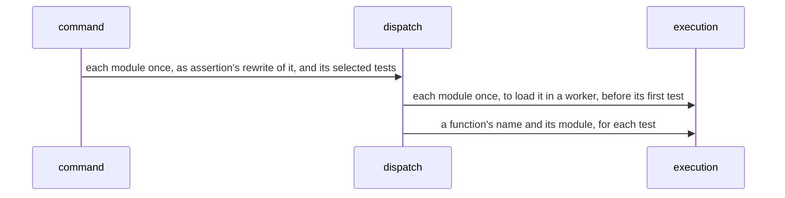
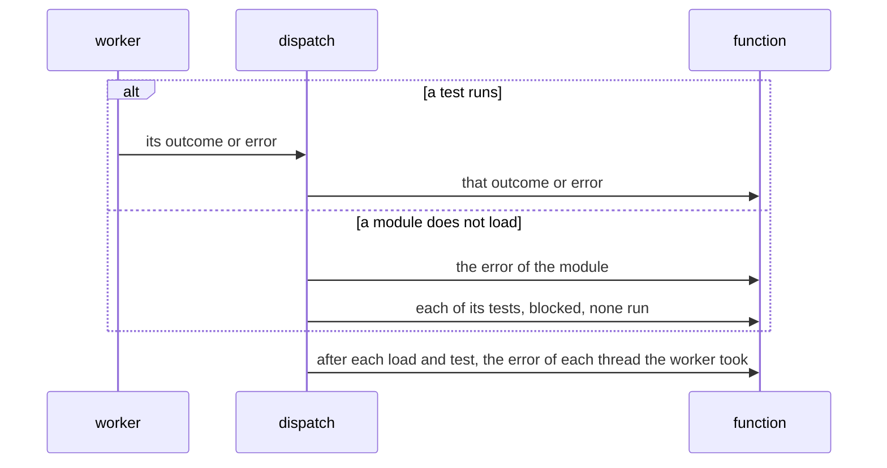
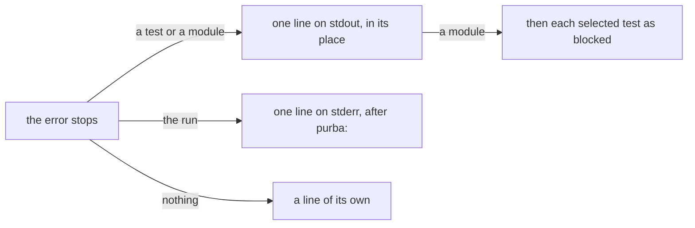
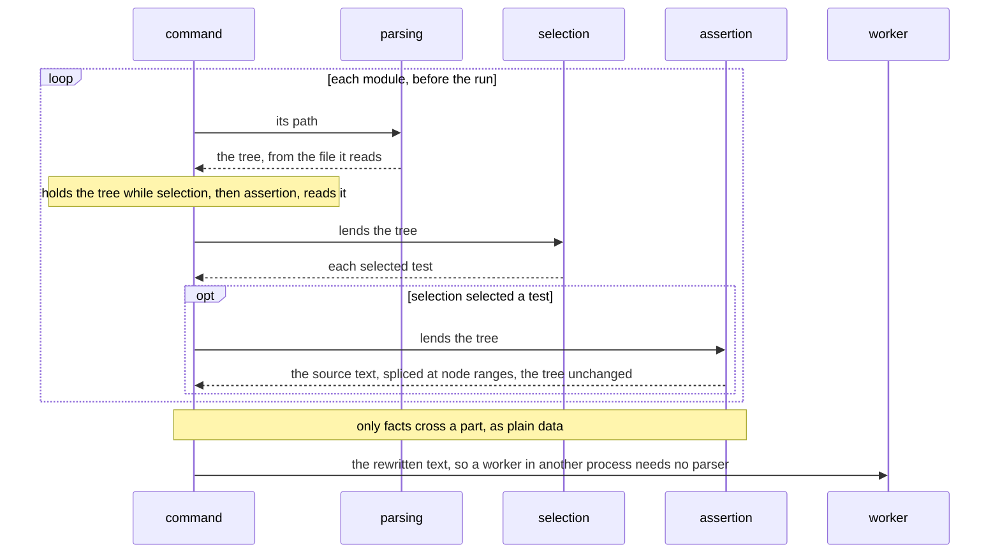
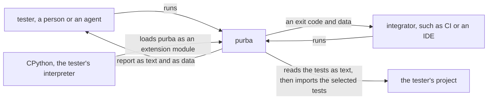
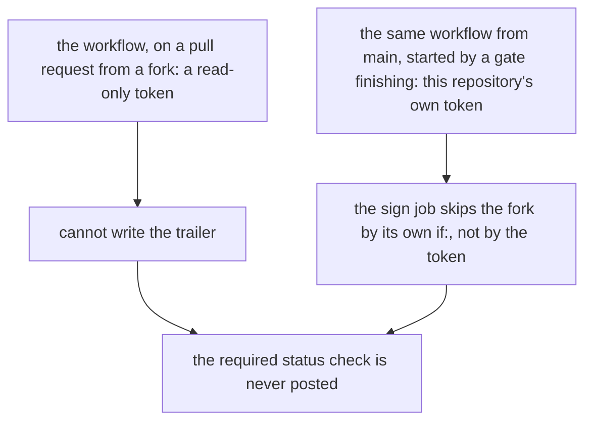
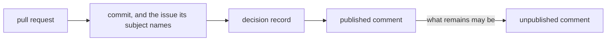
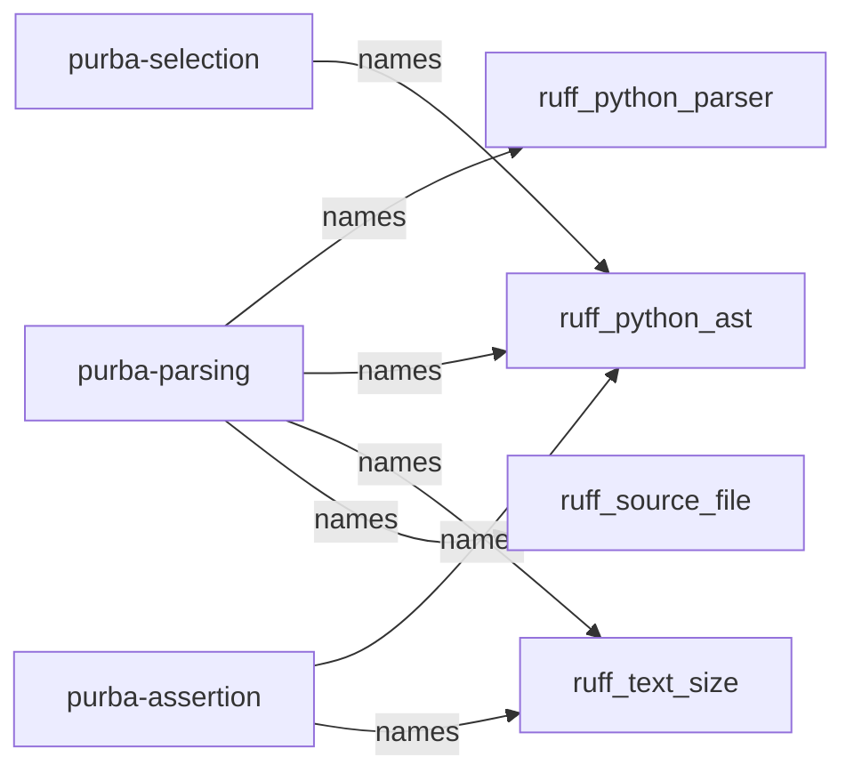
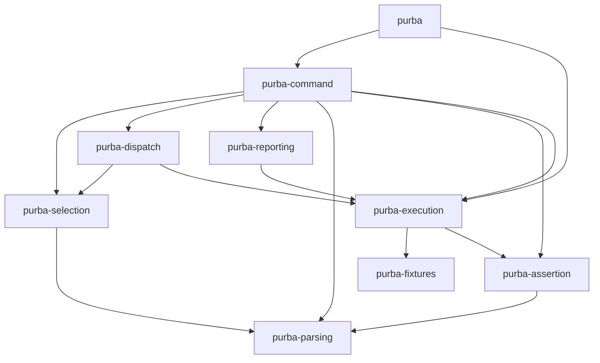

# Which records would a figure say in fewer words?

Of the 94 records on `main` at `04ae25d`, nine would be shorter with a figure. The gains are small: one record saves 23 words, three save 11 to 16, and five save 7 or fewer. Two of the nine carry a defect: one figure adds a claim, and one loses the glossary links. Of the four figures already in records, one passes once its source is rewritten, and it renders the same. The other three fail, whether or not an HTML tag inside a label counts as a word. No record needs a form that neither fence draws.

This file answers [Which records would a figure say in fewer words, and what would each figure replace?](https://github.com/kalonji-tools/purba/issues/787). The branch is never merged.

## How it was measured

- **The records** are a snapshot of `origin/main` at `04ae25d`: 94 files under `docs/decisions/`, `.template.md` excluded. Six agents read 15 or 16 records each, whole.
- **A word** is a run of letters or digits, and an apostrophe inside a word joins it. A link destination `](…)` is dropped, because the reader sees the link text. Inside a fence, every token counts: node ids, keywords such as `flowchart` and `LR`, and HTML tags such as `<b>`. So a figure is never undercounted. [`count-words.mjs`](record-figures-tools/count-words.mjs)
- **Each `mermaid` fence parses** under Mermaid 12.2.0, the version GitHub's `mermaidMarkdown` bundle names on 2026-11-04 (it named 12.1.0 on 2026-10-10). A control fence with a node named `call` fails with GitHub's own `CALLBACKNAME` error. [`parse-fences.mjs`](record-figures-tools/parse-fences.mjs)
- **Each candidate** is a whole rewritten record that applies only that one figure. The lines outside the replaced span are byte-identical to `main`.

## Candidates

| record | replaces | kind | words | saved |
|---|---|---|---:|---:|
| [A worker loads each module once, and command hands each module once](#a-worker-loads-each-module-once-and-command-hands-each-module-once) | [lines 26-31](https://github.com/kalonji-tools/purba/blob/04ae25d/docs/decisions/a-worker-loads-each-module-once.md?plain=1#L26-L31) | diagram | 499 → 476 | 23 |
| [Reporting writes each line as dispatch hands it the test](#reporting-writes-each-line-as-dispatch-hands-it-the-test) | [line 29](https://github.com/kalonji-tools/purba/blob/04ae25d/docs/decisions/reporting-writes-each-line-as-dispatch-hands-it-the-test.md?plain=1#L29-L29) | diagram | 715 → 699 | 16 |
| [A line names its kind in the glossary's words](#a-line-names-its-kind-in-the-glossarys-words) | [line 42](https://github.com/kalonji-tools/purba/blob/04ae25d/docs/decisions/a-line-names-its-kind-in-the-glossarys-words.md?plain=1#L42-L42) | diagram | 1208 → 1194 | 14 |
| [Command lends one parse to selection and assertion](#command-lends-one-parse-to-selection-and-assertion) | [lines 39-46](https://github.com/kalonji-tools/purba/blob/04ae25d/docs/decisions/command-lends-one-parse-to-selection-and-assertion.md?plain=1#L39-L46) | diagram | 763 → 752 | 11 |
| [A design in depth waits for what it assumes](#a-design-in-depth-waits-for-what-it-assumes) | [lines 39-44](https://github.com/kalonji-tools/purba/blob/04ae25d/docs/decisions/a-design-in-depth-waits-for-what-it-assumes.md?plain=1#L39-L44) | formula | 1177 → 1170 | 7 |
| [purba runs inside the tester's interpreter](#purba-runs-inside-the-testers-interpreter) | [lines 34-39](https://github.com/kalonji-tools/purba/blob/04ae25d/docs/decisions/purba-runs-inside-the-testers-interpreter.md?plain=1#L34-L39) | diagram | 694 → 690 | 4 |
| [An outside contribution is applied, not merged](#an-outside-contribution-is-applied-not-merged) | [lines 8-11](https://github.com/kalonji-tools/purba/blob/04ae25d/docs/decisions/an-outside-contribution-is-applied-not-merged.md?plain=1#L8-L11) | diagram | 1090 → 1087 | 3 |
| [An unpublished comment carries what no other location carries](#an-unpublished-comment-carries-what-no-other-location-carries) | [lines 53-54](https://github.com/kalonji-tools/purba/blob/04ae25d/docs/decisions/an-unpublished-comment-carries-what-no-other-location-carries.md?plain=1#L53-L54) | diagram | 1112 → 1111 | 1 |
| [purba parses Python with ruff's parser](#purba-parses-python-with-ruffs-parser) | [lines 103-108](https://github.com/kalonji-tools/purba/blob/04ae25d/docs/decisions/purba-parses-python-with-ruff.md?plain=1#L103-L108) | diagram | 1139 → 1138 | 1 |

## Figures already in records

| record | with its figure | best version without it | best figure | verdict |
|---|---:|---:|---:|---|
| [Each part is a crate](#each-part-is-a-crate) | 977 | 962, five "X uses Y" lines | 960, the same graph with `&` | passes once rewritten |
| [A change is specified before it is built](#a-change-is-specified-before-it-is-built) | 1046, or 1026 without its HTML tags | 1022, four bullets | 1022, markdown labels | fails: the bullets win, and the markdown labels tie them |
| [A panic inside a test gives that test an internal error](#a-panic-inside-a-test-gives-that-test-an-internal-error) | 1060 | 1012, a five-row table | 1020, short ids | fails: the table wins |
| [A failure's kind is what the part that first sees it observes](#a-failures-kind-is-what-the-part-that-first-sees-it-observes) | 1543 | 1441, three sentences | none shorter | fails: it repeats the record's own bullets |

## The candidates, drawn

### A worker loads each module once, and command hands each module once

Replaces [lines 26-31](https://github.com/kalonji-tools/purba/blob/04ae25d/docs/decisions/a-worker-loads-each-module-once.md?plain=1#L26-L31) · diagram · 499 → 476 words



New or reworded prose outside the fence:

> The worker does not load again a module that failed to load, and dispatch runs none of its tests.
> The sequence of one run in [the landscape](../../LANDSCAPE.md#the-parts-and-their-dependencies) draws it.

The sequence partly repeats the sequence of one run that LANDSCAPE.md draws, which this record already points at.

### Reporting writes each line as dispatch hands it the test

Replaces [line 29](https://github.com/kalonji-tools/purba/blob/04ae25d/docs/decisions/reporting-writes-each-line-as-dispatch-hands-it-the-test.md?plain=1#L29-L29) · diagram · 715 → 699 words



New or reworded prose outside the fence:

> - **Dispatch calls a function that command gives it, once for each test, each module that does not load, and each error of a thread.** The function returns `ControlFlow`, and no test runs after a `Break`.

The fence sits inside a list item, so GitHub spaces that list as loose paragraphs. It may repeat LANDSCAPE.md's sequence of one run.

### A line names its kind in the glossary's words

Replaces [line 42](https://github.com/kalonji-tools/purba/blob/04ae25d/docs/decisions/a-line-names-its-kind-in-the-glossarys-words.md?plain=1#L42-L42) · diagram · 1208 → 1194 words



New or reworded prose outside the fence:

> - **A line goes where its error stops.** The line names the test or the module that the error charges.

The content is a three-way case split rather than a flow, and the fence sits inside a list item.

### Command lends one parse to selection and assertion

Replaces [lines 39-46](https://github.com/kalonji-tools/purba/blob/04ae25d/docs/decisions/command-lends-one-parse-to-selection-and-assertion.md?plain=1#L39-L46) · diagram · 763 → 752 words



⚠️ **Defect:** the last arrow, from command to the worker, is a claim the table does not make. The table says only that a worker gets the rewritten text. [A worker loads each module once](https://github.com/kalonji-tools/purba/blob/04ae25d/docs/decisions/a-worker-loads-each-module-once.md) routes it from command through dispatch.

### A design in depth waits for what it assumes

Replaces [lines 39-44](https://github.com/kalonji-tools/purba/blob/04ae25d/docs/decisions/a-design-in-depth-waits-for-what-it-assumes.md?plain=1#L39-L44) · formula · 1177 → 1170 words

```math
\text{score of an item} = \sum_{\text{its risks in the landscape}} \text{probability} \times \text{impact}
```

New or reworded prose outside the fence:

> 1. Take the item with the highest score among the items that nothing blocks.
> A [risk](../../CONTEXT.md#risk)'s impact comes from the quality it breaks.

The parser checks `mermaid` only. This `math` fence is checked by its render on this branch.

### purba runs inside the tester's interpreter

Replaces [lines 34-39](https://github.com/kalonji-tools/purba/blob/04ae25d/docs/decisions/purba-runs-inside-the-testers-interpreter.md?plain=1#L34-L39) · diagram · 694 → 690 words



⚠️ **Defect:** the glossary links on *tester* and *integrator* are lost, because a Mermaid label holds no Markdown link. The line above it, "The landscape draws each neighbour.", stays.

### An outside contribution is applied, not merged

Replaces [lines 8-11](https://github.com/kalonji-tools/purba/blob/04ae25d/docs/decisions/an-outside-contribution-is-applied-not-merged.md?plain=1#L8-L11) · diagram · 1090 → 1087 words



The code spans on `main`, `sign` and `if:` are lost. Most of the figure is the prose moved into node labels.

### An unpublished comment carries what no other location carries

Replaces [lines 53-54](https://github.com/kalonji-tools/purba/blob/04ae25d/docs/decisions/an-unpublished-comment-carries-what-no-other-location-carries.md?plain=1#L53-L54) · diagram · 1112 → 1111 words



It replaces a one-sentence ordered list that already reads in order.

### purba parses Python with ruff's parser

Replaces [lines 103-108](https://github.com/kalonji-tools/purba/blob/04ae25d/docs/decisions/purba-parses-python-with-ruff.md?plain=1#L103-L108) · diagram · 1139 → 1138 words



The arrows turn the table's lookup around: a reader looks up a crate's users from the user's side.

## The figures already in records, judged

### Each part is a crate

As written it loses to five "X uses Y" lines, 977 to 962. The same fourteen edges written with Mermaid's `&` grouping name each source once, and come to 960. GitHub draws the two fences the same.



### A change is specified before it is built

The figure's labels carry 20 `<b>` and `<br>` tags, which this count reads as 20 words. Counted with them, the four bullets below win, 1022 to 1046. Counted without them, each tag read as a space, the bullets still win, 1022 to 1026. A rewrite with Markdown labels comes to 1022, a tie.

An earlier version of this file said the figure wins without its tags, 1014 to 1022. That count deleted each tag without a space, so the words on either side of each `<br>` joined, and twelve words were lost.

- Design: file the issue, triage, design spec, until the issue type is set.
- Implement: implementation plan, implement, post pass, until it is marked ready.
- Review: review, reduce the commits where wanted, sign, until it is approved. Rework returns to Implement as a new commit.
- Merge: required gates green, merge, debrief where it differs.

### A panic inside a test gives that test an internal error

Where a panic happens, which part stops it, and what takes the internal error form a matrix, so a table says it shorter: 1012 words against 1060, or 1052 without the tags. The opening line "The figure shows where each panic stops." becomes "When purba's assert hook panics, Rust's panic hook prints, and purba's hook notes it."

| a panic | stops at | the internal error goes to |
|---|---|---|
| of the assert hook, that crosses the test's call | execution | that test |
| of the assert hook, that the test catches | execution, which reads the note after the call | that test |
| of the assert hook, that the load of a module catches | execution, which reads the note after the load | that module and its tests |
| in execution outside the call, or the load of a module | dispatch | that test, or that module and its tests |
| in selection, while it reads a module | command | that module, and no test of it runs |

### A failure's kind is what the part that first sees it observes

The record's own bullets already say which part sees each refusal: selection and execution in the bullet on refused tests, assertion in the bullet on module names. So most of the figure repeats them. The fact the figure alone holds, which part first sees each remaining kind, takes three sentences (1441 words against 1543). A one-row-per-part table comes to 1520, and a slimmed figure to 1528.

> Command first sees a missing argument, parsing a path it cannot read or a syntax error, and reporting a refused write.
> Assertion first sees a module that does not load, and execution a thread's exception, the outcomes passed, failed, raised and unknown, and purba's own `PanicException`.
> Every part can see a panic or an error purba never expects.

## Records no figure shortens

- [A blocked test has no outcome](https://github.com/kalonji-tools/purba/blob/04ae25d/docs/decisions/a-blocked-test-has-no-outcome.md)
- [A case of each kind checks that no failure prints as another kind](https://github.com/kalonji-tools/purba/blob/04ae25d/docs/decisions/a-case-of-each-kind-checks-that-no-failure-prints-as-another-kind.md)
- [A command test checks only command's rules](https://github.com/kalonji-tools/purba/blob/04ae25d/docs/decisions/a-command-test-checks-only-commands-rules.md)
- [A commit message outlives its review](https://github.com/kalonji-tools/purba/blob/04ae25d/docs/decisions/a-commit-outlives-its-review.md)
- [A concern is what no part can own](https://github.com/kalonji-tools/purba/blob/04ae25d/docs/decisions/a-concern-is-what-no-part-can-own.md)
- [A figure in a record is a fence GitHub renders](https://github.com/kalonji-tools/purba/blob/04ae25d/docs/decisions/a-figure-in-a-record-is-a-fence-github-renders.md)
- [A gate owns the mechanical standard](https://github.com/kalonji-tools/purba/blob/04ae25d/docs/decisions/a-gate-owns-the-mechanical.md)
- [A gate reads its marks on the base branch](https://github.com/kalonji-tools/purba/blob/04ae25d/docs/decisions/a-gate-reads-its-marks-on-the-base-branch.md)
- [A gate refuses each invariant a tool can see, from the first code it reads](https://github.com/kalonji-tools/purba/blob/04ae25d/docs/decisions/a-gate-refuses-each-invariant-a-tool-can-see.md)
- [A KeyboardInterrupt that no signal caused is the test's own raise](https://github.com/kalonji-tools/purba/blob/04ae25d/docs/decisions/a-keyboardinterrupt-that-no-signal-caused-is-the-tests-own-raise.md)
- [A loaded module joins sys.modules under its file's name, without .py](https://github.com/kalonji-tools/purba/blob/04ae25d/docs/decisions/a-loaded-module-joins-sys-modules-under-its-files-name.md)
- [A location inherits its readers](https://github.com/kalonji-tools/purba/blob/04ae25d/docs/decisions/a-location-inherits-its-readers.md)
- [A module that binds a name purba adds is a project error](https://github.com/kalonji-tools/purba/blob/04ae25d/docs/decisions/a-module-that-binds-a-name-purba-adds-is-a-project-error.md)
- [A module whose load fails leaves sys.modules as it found it](https://github.com/kalonji-tools/purba/blob/04ae25d/docs/decisions/a-module-whose-load-fails-leaves-sys-modules-as-it-found-it.md)
- [An actor is what it does, not what it is](https://github.com/kalonji-tools/purba/blob/04ae25d/docs/decisions/an-actor-is-what-it-does-not-what-it-is.md)
- [An artifact holds the minimum that conveys its point](https://github.com/kalonji-tools/purba/blob/04ae25d/docs/decisions/an-artifact-holds-the-minimum-that-conveys-its-point.md)
- [An artifact is rewritten until its direction is agreed](https://github.com/kalonji-tools/purba/blob/04ae25d/docs/decisions/an-artifact-is-rewritten-until-its-direction-is-agreed.md)
- [An error says its kind, and reporting takes three ways in](https://github.com/kalonji-tools/purba/blob/04ae25d/docs/decisions/an-error-says-its-kind-and-reporting-takes-three-ways-in.md)
- [An error stops only the work that depends on it](https://github.com/kalonji-tools/purba/blob/04ae25d/docs/decisions/an-error-stops-only-the-work-that-depends-on-it.md)
- [A new question gets a new record](https://github.com/kalonji-tools/purba/blob/04ae25d/docs/decisions/a-new-question-gets-a-new-record.md)
- [An implementation follows test-driven development](https://github.com/kalonji-tools/purba/blob/04ae25d/docs/decisions/an-implementation-follows-test-driven-development.md)
- [An interrupted run prints its count, and dies by the signal](https://github.com/kalonji-tools/purba/blob/04ae25d/docs/decisions/an-interrupted-run-prints-its-count-and-dies-by-the-signal.md)
- [An interrupt stops the run, and a second one exits at once](https://github.com/kalonji-tools/purba/blob/04ae25d/docs/decisions/an-interrupt-stops-the-run-and-a-second-one-exits-at-once.md)
- [An invariant needs no design of its own](https://github.com/kalonji-tools/purba/blob/04ae25d/docs/decisions/an-invariant-needs-no-design-of-its-own.md)
- [A normaliser's style is chosen for the human who reads the code](https://github.com/kalonji-tools/purba/blob/04ae25d/docs/decisions/a-normalisers-style-is-chosen-for-the-human-who-reads-the-code.md)
- [A part-of-speech tagger decides the tense rule](https://github.com/kalonji-tools/purba/blob/04ae25d/docs/decisions/a-part-of-speech-tagger-decides-the-tense-rule.md)
- [A path not marked to skip starts the gate](https://github.com/kalonji-tools/purba/blob/04ae25d/docs/decisions/a-path-not-marked-to-skip-starts-the-gate.md)
- [A pinned candidate decides when a milestone is done](https://github.com/kalonji-tools/purba/blob/04ae25d/docs/decisions/a-pinned-candidate-decides-when-a-milestone-is-done.md)
- [A decision record is rewritten, not amended](https://github.com/kalonji-tools/purba/blob/04ae25d/docs/decisions/a-record-is-rewritten-not-amended.md)
- [A record names every location where it applies](https://github.com/kalonji-tools/purba/blob/04ae25d/docs/decisions/a-record-names-every-location-where-it-applies.md)
- [A refusal states the rule, why it holds, and where it was found](https://github.com/kalonji-tools/purba/blob/04ae25d/docs/decisions/a-refusal-states-the-rule-why-it-holds-and-where-it-was-found.md)
- [A register belongs to one location](https://github.com/kalonji-tools/purba/blob/04ae25d/docs/decisions/a-register-belongs-to-one-location.md)
- [A run exits 0 only when it checked something and every test passed](https://github.com/kalonji-tools/purba/blob/04ae25d/docs/decisions/a-run-exits-0-only-when-it-checked-something-and-every-test-passed.md)
- [A script that needs a Rust library is a cargo script](https://github.com/kalonji-tools/purba/blob/04ae25d/docs/decisions/a-script-that-needs-a-rust-library-is-a-cargo-script.md)
- [Assertion's rewrite crosses each part whole, and only assertion opens it](https://github.com/kalonji-tools/purba/blob/04ae25d/docs/decisions/assertions-rewrite-crosses-each-part-whole-and-only-assertion-opens-it.md)
- [A standard a gate cannot decide does not become a gate](https://github.com/kalonji-tools/purba/blob/04ae25d/docs/decisions/a-standard-a-gate-cannot-decide-does-not-become-a-gate.md)
- [A suppression is an outcome and not a switch](https://github.com/kalonji-tools/purba/blob/04ae25d/docs/decisions/a-suppression-is-an-outcome-and-not-a-switch.md)
- [A task is named for what it does to the tree](https://github.com/kalonji-tools/purba/blob/04ae25d/docs/decisions/a-task-is-named-for-what-it-does-to-the-tree.md)
- [A term belongs to the glossary](https://github.com/kalonji-tools/purba/blob/04ae25d/docs/decisions/a-term-belongs-to-the-glossary.md)
- [A test carries only purba's own decorators](https://github.com/kalonji-tools/purba/blob/04ae25d/docs/decisions/a-test-carries-only-purbas-own-decorators.md)
- [A test causes an internal error through a switch that only a test build carries](https://github.com/kalonji-tools/purba/blob/04ae25d/docs/decisions/a-test-causes-an-internal-error-through-a-switch-that-only-a-test-build-carries.md)
- [A tester runs purba on one module, and reads one line for each test](https://github.com/kalonji-tools/purba/blob/04ae25d/docs/decisions/a-tester-runs-purba-on-one-module-and-reads-one-line-for-each-test.md)
- [A test names the fixture of each input](https://github.com/kalonji-tools/purba/blob/04ae25d/docs/decisions/a-test-names-the-fixture-of-each-input.md)
- [A test names two values of one type by two fixtures](https://github.com/kalonji-tools/purba/blob/04ae25d/docs/decisions/a-test-names-two-values-of-one-type-by-two-fixtures.md)
- [A test returns nothing, and the first part that sees a breach of a test refuses it](https://github.com/kalonji-tools/purba/blob/04ae25d/docs/decisions/a-test-returns-nothing-and-the-first-part-that-sees-a-breach-refuses-it.md)
- [A test that selection refuses prints before any test runs](https://github.com/kalonji-tools/purba/blob/04ae25d/docs/decisions/a-test-that-selection-refuses-prints-before-any-test-runs.md)
- [A workflow is granted an identity, not a power](https://github.com/kalonji-tools/purba/blob/04ae25d/docs/decisions/a-workflow-is-granted-an-identity-not-a-power.md)
- [A workflow names each action by its commit](https://github.com/kalonji-tools/purba/blob/04ae25d/docs/decisions/a-workflow-names-each-action-by-its-commit.md)
- [bats tests the installed wheel from outside purba](https://github.com/kalonji-tools/purba/blob/04ae25d/docs/decisions/bats-tests-the-installed-wheel-from-outside-purba.md)
- [Configuration takes the first location its tool reads](https://github.com/kalonji-tools/purba/blob/04ae25d/docs/decisions/configuration-takes-the-first-location-its-tool-reads.md)
- [Dependabot proposes each newer action](https://github.com/kalonji-tools/purba/blob/04ae25d/docs/decisions/dependabot-proposes-each-newer-action.md)
- [Each test runs in a process of its own](https://github.com/kalonji-tools/purba/blob/04ae25d/docs/decisions/each-test-runs-in-a-process-of-its-own.md)
- [Every crate lives under crates/](https://github.com/kalonji-tools/purba/blob/04ae25d/docs/decisions/every-crate-lives-under-crates.md)
- [Every part of the skeleton is Rust, inside the extension module](https://github.com/kalonji-tools/purba/blob/04ae25d/docs/decisions/every-part-of-the-skeleton-is-rust-inside-the-extension-module.md)
- [Execution calls a test by its function's name, and reporting prints the identity it is given](https://github.com/kalonji-tools/purba/blob/04ae25d/docs/decisions/execution-calls-a-test-by-its-functions-name.md)
- [Liability is recorded from the act that makes it true](https://github.com/kalonji-tools/purba/blob/04ae25d/docs/decisions/liability-is-recorded-from-the-act-that-makes-it-true.md)
- [One file marks every tracked path for each gate that can skip](https://github.com/kalonji-tools/purba/blob/04ae25d/docs/decisions/one-file-marks-every-tracked-path-for-each-gate-that-can-skip.md)
- [One manifest declares each package](https://github.com/kalonji-tools/purba/blob/04ae25d/docs/decisions/one-manifest-declares-each-package.md)
- [One pull request answers one issue](https://github.com/kalonji-tools/purba/blob/04ae25d/docs/decisions/one-pull-request-answers-one-issue.md)
- [A script calculates the order of design, and only a changed input moves it](https://github.com/kalonji-tools/purba/blob/04ae25d/docs/decisions/only-a-changed-input-moves-the-order-of-design.md)
- [Only GitHub runs what lives under `.github`](https://github.com/kalonji-tools/purba/blob/04ae25d/docs/decisions/only-github-runs-what-lives-under-github.md)
- [Parsing hands on no tree that ruff recovered](https://github.com/kalonji-tools/purba/blob/04ae25d/docs/decisions/parsing-hands-on-no-tree-that-ruff-recovered.md)
- [purba borrows from Simplified Technical English rather than adopting it](https://github.com/kalonji-tools/purba/blob/04ae25d/docs/decisions/purba-borrows-from-simplified-technical-english-rather-than-adopting-it.md)
- [purba carries no tool manager beside mise, and no compiler of its own](https://github.com/kalonji-tools/purba/blob/04ae25d/docs/decisions/purba-carries-no-tool-manager-beside-mise-and-no-compiler-of-its-own.md)
- [purba divides by responsibility and not by language](https://github.com/kalonji-tools/purba/blob/04ae25d/docs/decisions/purba-divides-by-responsibility-and-not-by-language.md)
- [purba is always strict](https://github.com/kalonji-tools/purba/blob/04ae25d/docs/decisions/purba-is-always-strict.md)
- [purba meets the next trait solver before it stabilizes](https://github.com/kalonji-tools/purba/blob/04ae25d/docs/decisions/purba-meets-the-next-trait-solver-before-it-stabilizes.md)
- [purba ranks an honest outcome first](https://github.com/kalonji-tools/purba/blob/04ae25d/docs/decisions/purba-ranks-an-honest-outcome-first.md)
- [purba records delegation and does not prevent it](https://github.com/kalonji-tools/purba/blob/04ae25d/docs/decisions/purba-records-delegation-and-does-not-prevent-it.md)
- [purba's public surface starts empty and has no plugin API](https://github.com/kalonji-tools/purba/blob/04ae25d/docs/decisions/purbas-public-surface-starts-empty-and-has-no-plugin-api.md)
- [purba supports a Python that has two years left](https://github.com/kalonji-tools/purba/blob/04ae25d/docs/decisions/purba-supports-a-python-with-two-years-left.md)
- [purba writes its scripts in bash until purba can test them](https://github.com/kalonji-tools/purba/blob/04ae25d/docs/decisions/purba-writes-its-scripts-in-bash-until-purba-can-test-them.md)
- [Reporting renders the exit code, and command returns it](https://github.com/kalonji-tools/purba/blob/04ae25d/docs/decisions/reporting-renders-the-exit-code-and-command-returns-it.md)
- [Architectural significance is declared, not detected](https://github.com/kalonji-tools/purba/blob/04ae25d/docs/decisions/significance-is-declared-not-detected.md)
- [The agent that marks a pull request ready watches it](https://github.com/kalonji-tools/purba/blob/04ae25d/docs/decisions/the-agent-that-marks-a-pull-request-ready-watches-it.md)
- [The crate carries an rlib](https://github.com/kalonji-tools/purba/blob/04ae25d/docs/decisions/the-crate-carries-an-rlib.md)
- [The glossary stays open, and a gate rewrites each word it avoids](https://github.com/kalonji-tools/purba/blob/04ae25d/docs/decisions/the-glossary-stays-open-and-a-gate-rewrites-each-word-it-avoids.md)
- [The nightly is named by a date](https://github.com/kalonji-tools/purba/blob/04ae25d/docs/decisions/the-nightly-is-named-by-a-date.md)
- [The person owns the Decision Outcome](https://github.com/kalonji-tools/purba/blob/04ae25d/docs/decisions/the-person-owns-the-decision-outcome.md)
- [The skeleton crosses the seam in execution and assertion](https://github.com/kalonji-tools/purba/blob/04ae25d/docs/decisions/the-skeleton-crosses-the-seam-in-execution-and-assertion.md)
- [The zip alerts of check-prose are dismissed as unused](https://github.com/kalonji-tools/purba/blob/04ae25d/docs/decisions/the-zip-alerts-of-check-prose-are-dismissed-as-unused.md)
