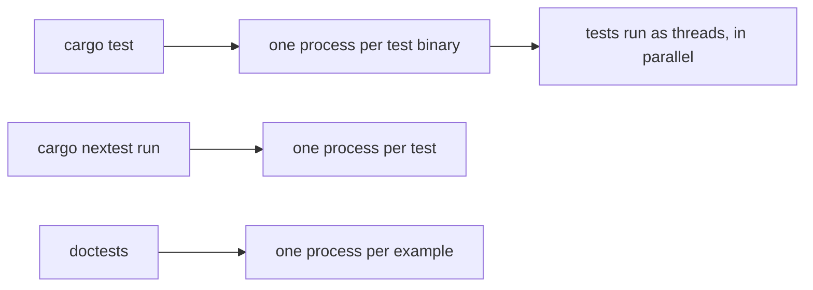

# Which testing practices hold for a test written in Rust, and which Rust tools check each

This file answers [#956](https://github.com/kalonji-tools/purba/issues/956).
It is never merged.
It starts from the language-agnostic survey for [#954](https://github.com/kalonji-tools/purba/issues/954), `research/testing-practices.md` at commit `bbc590c`, and uses that survey's numbers P1 to P14 and groups A to G, so the two files can be read side by side.
It does not survey the general sources again, and it does not cover Python ([#955](https://github.com/kalonji-tools/purba/issues/955) does).
Every source was fetched on 2026-11-13 unless its row in the [source register](#source-register) says otherwise.

## Answer

Most practices hold for Rust as stated, but Rust changes how a test meets them, and in three places the change is large.

First, the verdict.
A Rust test fails when it panics, and `unwrap()`, `expect()` and the `?` operator are checks in the same sense as `assert!`.
So "the test contains an assertion" is the wrong proxy for P1 in Rust.
In the six projects I surveyed, between 27% (tokio) and 96% (rust-analyzer) of test bodies contain no standard assertion macro at all; they check through helpers, snapshot macros and `unwrap`.
The compiler adds a check that the general survey has no counterpart for: `Result` and every `Future` are `#[must_use]`, so a test that drops a result it should have checked gets a warning by default.

Second, independence.
The standard harness (libtest) runs the tests of one binary as threads of one process, in parallel, by default.
Shared process state is therefore a hazard by design, and the Rust 2024 edition made `std::env::set_var` `unsafe` because it is unsound when another thread reads the environment.
The most used alternative runner, cargo-nextest, runs each test in its own process, and says it will keep that default "in perpetuity".
Shuffling exists in libtest only as an unstable flag, unstable since 2021, and I found no shuffle in nextest.

Third, switching tests off.
Rust has a built-in reason field (`#[ignore = "…"]`), and clippy has a lint for an ignore without one, but it is in the off-by-default `pedantic` group.
Rust has no way to skip a test at run time; the feature request has been open since 2020.
So projects skip by returning early, and the harness then reports the skipped test as `ok`.

The clippy lints that touch tests are few, and most are off by default.
More important, clippy does not look at test code at all unless it is run with `--tests` or `--all-targets`, a fact a 2025 issue called undocumented.
No lint today checks that a test can fail; one attempt closed stale in 2024 and a second is an open pull request.
Some Rust sources disagree with each other directly.
The Book tells a test to check an error with `assert!(value.is_err())`; clippy's `assertions_on_result_states` flags exactly that form, and was moved out of a default group into `restriction` in 2022 because it made tests less clear.
`missing_assert_message` exempts test functions, because messages there "would be too noisy".

Rust adds practices the general survey did not find: documentation examples that run as tests, tests that a piece of code must *not* compile, undefined-behaviour checking under the Miri interpreter, exhaustive thread-schedule exploration with loom, and inline snapshot assertions, which four of the six projects use heavily.
Two practices were dropped or stalled inside Rust itself: rustc removed its partial MC/DC coverage in 2025, and the RFC to make `assert!` print operand values was accepted in 2017 and is still unstable.

| practice | Rust verdict | what in Rust makes the difference | checked by (default) |
|---|---|---|---|
| [P1 self-checking](#p1-the-test-decides-its-own-verdict) | holds; mechanism changes | panic is the verdict; `unwrap`/`expect`/`?` are checks; `#[must_use]` on `Result` and `Future` | rustc `unused_must_use` (warn); clippy `let_underscore_future` (on), `should_panic_without_expect` (off); no "can fail" lint exists |
| [P2 deterministic](#p2-same-code-same-result) | holds | tools for the causes: loom, Miri isolation, tokio's paused clock, proptest's saved failures | no lint; nextest retries mark tests flaky (retries off by default) |
| [P3 independent](#p3-no-test-depends-on-another) | holds, and matters more | tests share one process as threads; `set_var` is `unsafe` since edition 2024 | compiler (`unsafe` on `set_var`); nextest process-per-test; libtest `--shuffle` unstable |
| [P4 one condition](#p4-one-behaviour-or-condition-per-test) | holds in its strict premise | std assertions panic, so the first failure ends the test (Meszaros's premise still true) | nothing |
| [P5 failure output](#p5-a-failure-explains-itself) | holds; contested inside Rust | `assert_eq!` prints both sides; `assert!` prints only the expression | clippy `missing_assert_message` (off, skips tests), `assertions_on_result_states` (off), `manual_assert_eq` (off), `bool_assert_comparison` (on) |
| [P6 no logic](#p6-no-logic-in-a-test) | changes | attribute macros (rstest, test-case) move the case loop out of the body | nothing |
| [P7 literal over shared](#p7-literal-and-visible-over-shared-and-dry) | holds, in a new form | inline snapshots keep the literal in the test and let a tool rewrite it | nothing |
| [P8 phased layout](#p8-a-phased-layout) | holds as stated | the Book states it | nothing |
| [P9 public interface](#p9-test-through-the-public-interface) | changes; contested | unit tests in the same file can call private items; `tests/` can only call the public API | the compiler enforces privacy for `tests/`; clippy `tests_outside_test_module` (off), `items_after_test_module` (on) |
| [P10 state over mocks](#p10-real-collaborators-and-state-over-mocks-and-interactions) | holds; mechanics change | no run-time patching: a mock needs a trait or a `cfg(test)` seam | clippy `cfg_not_test` (off) |
| [P11 fast, hermetic](#p11-fast-small-hermetic) | holds | libtest warns at 60 s, never kills; Miri isolates by default | clippy `disallowed_methods` (on, needs a list); nextest `slow-timeout` |
| [P12 adequacy](#p12-adequacy-coverage-assertions-mutants) | holds | `-C instrument-coverage`; cargo-mutants; MC/DC removed from rustc | not a property of one test |
| [P13 test-first](#p13-write-the-test-first) | changes in two projects | cargo and clap ask for a passing test commit *before* the fix | not decidable |
| [P14 not switched off](#p14-do-not-leave-tests-switched-off) | holds; harder to see | no run-time skip, so tests skip by early return and report `ok` | clippy `ignore_without_reason` (off) |

"On" means the lint's group is warn or deny by default: clippy's `correctness`, `suspicious`, `style`, `complexity` and `perf` (L1 [A], README table).
"Off" means `pedantic`, `restriction` or `nursery`, which a project must turn on.
And no clippy lint, on or off, sees test code unless clippy compiles the tests ([R10](#r10-clippy-does-not-look-at-tests-unless-asked)).

## 1. The sources, and why I chose them

The issue names four kinds of Rust source: the test harness and runners, test libraries, the lints in rustc and clippy, and the RFCs.
I added the Rust documentation that states testing guidance (the Book, the Reference, the rustc, rustdoc and Cargo books, the edition guide, the API guidelines), because the harness's behaviour is specified there.
Fetch commands and commits are in the [source register](#source-register).

| kind | sources | why these |
|---|---|---|
| official documentation | Reference (D1), Book (D2), rustc book (D3), rustdoc book (D4), Cargo book and Cargo contributor guide (D5), edition guide (D6), API guidelines (D10) | They define what a Rust test is and what the harness does. The Book and the API guidelines are the only official sources that give advice, not just mechanics. |
| harness and runner source | libtest (D8), std (D7), rustc lints (D9), cargo-nextest docs and config (T1) | libtest is the default runner; nextest is the runner the surveyed projects use most (tokio, rust-analyzer and ruff run it in CI). |
| lints | clippy source at `rust-1.100.0` (L1), clippy issue tracker (L2) | clippy is the lint tool shipped with Rust. The tracker holds the false positives and the history of moved lints. |
| test libraries | proptest (T2), insta (T3), mockall (T4), rstest (T5), test-case (T6), pretty_assertions (T7), serial_test (T8), loom (T9), Miri (T10), cargo-mutants (T11) | One or more per practice they touch: properties, snapshots, mocks, parameterised tests, diffs, serialisation, concurrency, undefined behaviour, mutants. |
| RFCs and tracking issues | RFC 1866, 2011, 2318, 3558; rust-lang/rust #44838, #89583, #64888, #49359, #50297, #68007; PR #144999 (R1–R6) | Each changed, or tried to change, how a test is written or run. Several are still open, which is a finding. |
| projects | tokio, ripgrep, cargo, rust-analyzer, ruff, clap (section 4) | Six widely used Rust projects with large suites, of different kinds: async runtime, CLI search tool, build tool, IDE server, Python linter, argument parser. |

I used no blog posts, talks or secondary write-ups.
I did not find an empirical study of Rust tests among the sources the issue allows, and I did not search the academic literature for one; that is a gap, listed in the [C] rows.

### Liveness

Default branch's last commit and latest release, fetched with `gh api repos/<r>/commits/<branch>` and `gh api repos/<r>/releases/latest` (or the latest tag's commit when the repository publishes no GitHub releases).

| tool or project | last commit on default branch | latest release (date) |
|---|---|---|
| rust-lang/rust (rustc, libtest, std) | 2026-11-13 | 1.100.0 (2026-11-12) |
| rust-lang/rust-clippy | 2026-11-12 | ships with Rust; tag `rust-1.100.0` |
| rust-lang/cargo | 2026-11-13 | tag `0.101.0`, commit 2026-11-05 (the commit Rust 1.100.0 pins) |
| nextest-rs/nextest | 2026-11-12 | cargo-nextest-0.9.151 (2026-11-03) |
| proptest-rs/proptest | 2026-10-10 | tag v1.12.0, commit 2026-10-10 |
| BurntSushi/quickcheck | 2026-04-03 | tag quickcheck_macros-1.2.0, commit 2026-02-10 |
| mitsuhiko/insta | 2026-10-26 | 1.49.0 (2026-10-03) |
| asomers/mockall | 2026-11-03 | tag v0.15.0, commit 2026-06-28 |
| la10736/rstest | 2026-11-11 | v0.28.0 (2026-10-18) |
| frondeus/test-case | 2026-11-01 | v3.4.1 (2026-11-01) |
| rust-pretty-assertions | 2025-09-26 | v1.4.1 (2024-09-15) |
| palfrey/serial_test | 2026-11-08 | v4.0.1 (2026-07-25) |
| tokio-rs/loom | 2026-11-08 | v0.7.3 (2026-11-08) |
| rust-lang/miri | 2026-11-13 | no releases or tags; ships as a rustup component |
| sourcefrog/cargo-mutants | 2026-10-19 | v27.1.0 (2026-06-02) |
| taiki-e/cargo-llvm-cov | 2026-11-01 | v0.9.1 (2026-09-06) |
| xd009642/tarpaulin | 2026-11-10 | 0.37.6 (2026-11-05) |
| tokio-rs/tokio | 2026-11-10 | tokio-1.54.1 (2026-10-21) |
| BurntSushi/ripgrep | 2026-11-09 | 15.2.0 (2026-07-15) |
| rust-lang/rust-analyzer | 2026-11-13 | 2026-11-09 (2026-11-09) |
| astral-sh/ruff | 2026-11-13 | 0.17.5 (2026-11-12) |
| clap-rs/clap | 2026-11-02 | v4.6.7 (2026-09-14) |

All are live.
pretty_assertions is the least active (last commit 2025-09-26); I use it only for its description of what it does.

## 2. The practices in Rust

Each practice below gives the verdict, what in Rust makes the difference, who checks it (tool, lint name, default, known false positives from the tool's own tracker), and what the six projects do.
The project numbers come from `git grep` and an `awk` scan over each project's `.rs` files at its release tag; the method and its limits are in the [appendix](#appendix-how-the-project-numbers-were-counted).

### Group A. The verdict

#### P1. The test decides its own verdict

**Verdict.** Holds. Rust changes what counts as a check.

**What Rust changes.**
- A test fails by panicking. The Reference: "Tests that return `()` pass as long as they terminate and do not panic." "Tests that return a `Result<(), E>` pass as long as they return `Ok(())`." (D1 [A]) The Book: "Each test is run in a new thread, and when the main thread sees that a test thread has died, the test is marked as failed." (D2 [A])
- So `unwrap()`, `expect()` and `?` are checks. The Book recommends `?` in a test: it "can be a convenient way to write tests that should fail if any operation within them returns an `Err` variant." (D2 [A])
- Clippy treats this as normal: its `unwrap_used`, `expect_used`, `panic`, `dbg_macro`, `print_stdout`/`print_stderr`, `indexing_slicing` and `useless_vec` lints each have an `allow-…-in-tests` option (L1 [A], `clippy_config/src/conf.rs`). All default to `false`, so a project that turns on, say, `unwrap_used` must also opt in to allowing it in tests.
- The compiler catches a dropped check. `Result` carries `#[must_use = "this `Result` may be an `Err` variant, which should be handled"]` and `Future` carries `#[must_use = "futures do nothing unless you `.await` or poll them"]` (D7 [A]). The rustc lint `unused_must_use` is `Warn` by default (D9 [A]). An async test that forgets `.await` on the call it means to check gets this warning. Clippy's `let_underscore_future` (`suspicious`, on) flags `let _ = <future>`: "Futures must be polled for work to be done." (L1 [A])
- The compiler also catches a test that would never run. rustc's `unnameable_test_items` (Warn) fires on a `#[test]` inside a function body, whose example comment reads "This test will not fail because it does not run." (D9 [A]) Clippy's `test_attr_in_doctest` (`suspicious`, on) flags `#[test]` inside a documentation example, because such code "will somewhat surprisingly not be run by `cargo test`" (L1 [A]). These are the Rust counterparts of the rotten green tests in the general survey.
- `#[should_panic]` passes on *any* panic unless it names the expected text. The Book: "A `should_panic` test would pass even if the test panics for a different reason from the one we were expecting." (D2 [A]) This is the same flaw as JUnit's `@Test(expected=…)` in the general survey. The Reference allows `expected = "…"` as a substring match (D1 [A]).
- A documentation example marked `no_run` is compiled but not run (D4 [A]). Its only check is that it compiles. tokio has 328 `no_run` blocks (section 4).

**Who checks it.**

| check | tool and name | default | false positives in the tracker |
|---|---|---|---|
| result or future dropped | rustc `unused_must_use` | warn | none searched ([C]) |
| `let _ = future` | clippy `let_underscore_future` | on (`suspicious`) | none searched ([C]) |
| test never runs | rustc `unnameable_test_items`; clippy `test_attr_in_doctest` | warn; on | `test_attr_in_doctest`: [#17724](https://github.com/rust-lang/rust-clippy/issues/17724) (open: "the lint just does a plaintext search and therefor catches `#[test]` even inside of macros"), [#16447](https://github.com/rust-lang/rust-clippy/issues/16447) (closed: fires when `test_harness` is present) (L2 [A]) |
| any panic passes | clippy `should_panic_without_expect`, since 1.74 | off (`pedantic`) | none found by title or body search (L2 [A]) |
| test has no failure site | none. [#13579](https://github.com/rust-lang/rust-clippy/pull/13579) `test_without_fail_case` closed unmerged as stale; [#17626](https://github.com/rust-lang/rust-clippy/pull/17626) `test_without_assertions` (proposed for `suspicious`) is open | — | — |

Among the 832 lint declarations I extracted from clippy at `rust-1.100.0`, the only names containing `test` or `assert` are `assert_is_empty`, `items_after_test_module`, `cfg_not_test`, `assertions_on_result_states`, `bool_assert_comparison`, `tests_outside_test_module`, `missing_assert_message`, `debug_assert_with_mut_call`, `manual_assert_eq`, `redundant_test_prefix`, `missing_asserts_for_indexing`, `assertions_on_constants`, `manual_assert`, `needless_doctest_main` and `test_attr_in_doctest` (L1 [A]). None checks that a test has an assertion.

**What the projects do.**
Counting test bodies that contain no `assert!`, `assert_eq!` or `assert_ne!`:

| project | test bodies scanned | no std assertion | one | two or more |
|---|---|---|---|---|
| tokio | 2,279 | 607 (27%) | 706 | 966 |
| ripgrep (`#[test]` only) | 465 | 136 (29%) | 69 | 260 |
| cargo | 4,831 | 3,800 (79%) | 500 | 531 |
| rust-analyzer | 8,239 | 7,899 (96%) | 197 | 143 |
| ruff | 5,962 | 4,317 (72%) | 848 | 797 |
| clap | 1,612 | 629 (39%) | 300 | 683 |

These tests are not unchecked.
They check through project helpers (rust-analyzer's `check_assist(…)`, cargo's `.with_stderr_data(str![…])`, tokio-test's `assert_ready!`), through snapshot macros, or through `unwrap`.
A rule "a test must contain an assertion" would flag most of rust-analyzer's suite; this is the general survey's helper false positive (PMD, eslint-plugin-jest) at a much larger scale.
No project states a rule about it.

#### P2. Same code, same result

**Verdict.** Holds. Rust does not remove the causes, but it has tools aimed at three of them.

**What Rust adds.**
- Thread schedules: loom "runs a test many times, permuting the possible concurrent executions of that test under the C11 memory model" (T9 [A]).
- Undefined behaviour and the host: Miri "ensures a fully deterministic execution by isolating the program from the host system"; entropy, environment variables and clocks get deterministic "fake" implementations (T10 [A]). It still "tests one of many possible executions"; `-Zmiri-many-seeds` tries seeds `0..64` (T10 [A]).
- Time: tokio's test macro takes `start_paused = true`; with the clock paused, "the clock is auto-advanced to the next pending timer" (J1 [A], `tokio/src/time/clock.rs`, `tokio-macros/src/lib.rs`).
- Random input: proptest's default seed is `Random` (T2 [A], `config.rs`), which the general survey's Meszaros would call nondeterministic. proptest reconciles it the way the general survey guessed ([B] there): it saves each failing case under `proptest-regressions` and replays it first, so "the test will not fail on one run and then spuriously pass on the next"; "It is recommended to check these files in to your source control" (T2 [A]).

**Who checks it.**
No lint does.
At run time, nextest's `--retries` reruns failures and marks a test that passes on a retry as flaky; the default is `retries = 0` and `flaky-result = "pass"` (T1 [A], `default-config.toml`), and `--flaky-result fail` exists since 0.9.131 (T1 [A]).
nextest's stress mode runs a test N times or for a duration (T1 [A]).
libtest has no retry.

**What the projects do.**
- None of the six configures retries (`git grep retries` over `.config`, `.github`: no test retry configuration; ruff's only hit is an apt timeout) (J1–J6 [A]).
- tokio runs loom in a separate workflow, Miri on the library and integration tests, and uses the paused clock in 152 places (J1 [A]).
- ruff puts its file-watching tests in a serial group "to avoid race conditions" (J5 [A], `.config/nextest.toml`).
- Where they break it, they say so: rust-analyzer ignores one test with `#[ignore = "flaky test that tends to hang"]` (J4 [A]); tokio ignores three loom tests, "Temporarily disabled due to a false positive in loom" (J1 [A], `loom_cancellation_token.rs`).

#### P3. No test depends on another

**Verdict.** Holds, and matters more in Rust than the general survey suggests, because of how libtest runs tests.

**What Rust changes.**
- libtest runs the tests of one binary in one process, as threads, in parallel: "By default, uses the amount of concurrency available on the hardware" (D3 [A]). The Book: "you must make sure your tests don’t depend on each other or on any shared state, including a shared environment, such as the current working directory or environment variables." (D2 [A])
- The default order is "alphabetical" (D3 [A]). Shuffling (`--shuffle`, `--shuffle-seed`) needs `-Z unstable-options`; its tracking issue [#89583](https://github.com/rust-lang/rust/issues/89583) has been open since 2021-10-06 (D3, R5 [A]).
- Edition 2024 made `std::env::set_var` and `remove_var` `unsafe`: "It can be unsound to call `std::env::set_var` or `std::env::remove_var` in a multithreaded program" (D6 [A]); the std docs: "the only sound option is to not use `set_var` or `remove_var` in multi-threaded programs at all" (D7 [A]). A libtest test binary is a multi-threaded program.
- Doctests are different: "These executables run in parallel in separate processes", with the warning "this execution model of doctests is not guaranteed and may change in the future" (D5 [A]). Edition 2024 tries to compile doctests into one binary, but "The tests still run in independent processes" (D6 [A]).
- nextest makes the process the unit: "the default execution model is now, and will always be, process-per-test", and process-per-test means "Test authors and libraries don't need to coordinate global state usage" (T1 [A]). It lists the costs: shared in-memory state and process creation on Windows and macOS (T1 [A]).
- mockall's static-method and foreign-function expectations "are global. If you want to use a static method in multiple tests, you must provide your own synchronization." (T4 [A])

**Who checks it.**
The compiler checks one cause (an `unsafe` block is required for `set_var` from edition 2024).
No lint checks independence.
At run time: libtest `--shuffle` (unstable); nextest isolates by process; I found no shuffle option in the nextest documentation at 0.9.151 and no nextest issue about shuffling (a search for "shuffle" returns only two dependency bumps) (T1 [A]).
Serialising instead of isolating: serial_test's `#[serial]` (T8 [A]) and nextest test groups, which are "similar to `cargo test` with the `serial_test` crate, or a global mutex" (T1 [A]).
nextest's own page says a mutex for a fixed port "is not the "correct" way to write such tests"; bind to port 0 or a Unix socket instead (T1 [A]).

**What the projects do.**
- cargo's `#[cargo_test]` macro gives each test its own directory under `CARGO_TARGET_TMPDIR` (J3 [A], `cargo-test-macro`, `cargo-test-support/src/paths.rs`); ripgrep's `Dir::new` does the same under the system temp directory (J2 [A]).
- ruff serialises one binary with a nextest group (J5 [A]).
- None of the six uses serial_test, and none shuffles in CI (J1–J6 [A], grep).

#### The two run models

### Group B. The diagnosis

#### P4. One behaviour or condition per test

**Verdict.** Holds, and its original premise still holds in Rust.

**What Rust changes.**
The general survey found that GoogleTest, Go and JUnit removed Meszaros's premise ("when one assertion fails, the rest of the test is not executed") with keep-going assertions.
Rust's standard assertions do not: "The `assert!` macro calls `panic!` to cause the test to fail" (D2 [A]), and a panic ends the test.
I did not survey third-party keep-going assertion crates ([C]).
A snapshot assertion compares a whole value at once (T3 [A]), which makes "one assertion" and "one condition" come apart further.

**Who checks it.** Nothing. Clippy has no assertion-count lint (L1 [A], lint list above).

**What the projects do.**
Tests with two or more standard assertions outnumber tests with one in tokio, ripgrep and clap (P1 table).
rust-analyzer states a rule one level up: "Do not place several marks into a single test or condition. Do not reuse marks between several tests." (J4 [A], style guide, about its `cov_mark` coverage marks).

#### P5. A failure explains itself

**Verdict.** Holds. The Rust sources disagree with each other about how.

**What Rust changes.**
- `assert_eq!` prints both values; `assert!` "only indicates that it got a `false` value" (D2 [A]). The Book does not use expected and actual: "in Rust, they’re called `left` and `right`, and the order in which we specify the value we expect and the value the code produces doesn’t matter." (D2 [A]) Go's wiki, in the general survey, insists on "Got before Want".
- Custom messages are format arguments; the Book: "Custom messages are useful for documenting what an assertion means" (D2 [A]).
- RFC 1866 (more readable `assert_eq!` output) was implemented; its tracking issue closed in 2020 (R2 [A]). RFC 2011 (make `assert!` "recognize more expressions" and print them) was accepted in 2017; its tracking issue [#44838](https://github.com/rust-lang/rust/issues/44838) is still open (R1 [A]).
- Libraries fill the gap: pretty_assertions replaces `assert_eq!` with "a colorful diff" (T7 [A]); snapshot libraries print a diff of the whole value (T3 [A]).

**Who checks it, and the disagreements.**

| lint | group, version | what it asks | the dispute |
|---|---|---|---|
| `missing_assert_message` | restriction (off), 1.70 | a message on each assertion | It exempts tests: "Although the same reasoning applies to testing functions, this lint ignores them as they would be too noisy." Known problem: "you can suppress this lint simply by adding placeholder messages" (L1 [A]). False positive [#13490](https://github.com/rust-lang/rust-clippy/issues/13490), closed (L2 [A]). |
| `assertions_on_result_states` | restriction (off), 1.64 | `r.unwrap_err()` over `assert!(r.is_err())` | The Book recommends the flagged form: "use `assert!(value.is_err())`" (D2 [A]). The lint was moved to `restriction` by [PR #9273](https://github.com/rust-lang/rust-clippy/pull/9273) in 2022: "This lint causes regression on readability of code and log output." Its own doc keeps the known problem "decreases the readability of code and log output" (L1, L2 [A]). |
| `manual_assert_eq` | pedantic (off), 1.97 | `assert_eq!(a, b)` over `assert!(a == b)` | It skips byte-slice types to avoid "excessively large assertion output" (L1 [A]). |
| `bool_assert_comparison` | style (on), 1.53 | `assert!(!x)` over `assert_eq!(x, false)` | Its reason is length: "It is shorter to use the equivalent." clap allows it workspace-wide (L1, J6 [A]). |
| `should_panic_without_expect` | pedantic (off), 1.74 | name the expected panic text | clap has it commented out (`#should_panic_without_expect = "warn"`) (J6 [A]). |

**What the projects do.**
ripgrep wrote its own `eqnice!` macro that prints "printed outputs differ!" with both texts framed (J2 [A]).
Four of six use snapshot assertions with diffs: insta (ruff), expect-test (rust-analyzer), snapbox (cargo, clap) (J3–J6 [A]).
pretty_assertions appears once in the six projects' Rust sources, in ruff (J5 [A]).

### Group C. Reading

#### P6. No logic in a test

**Verdict.** Changes. The common Rust form of a parameterised test has no loop in its body.

**What Rust changes.**
- rstest's `#[case(…)]` and test-case's `#[test_case(…)]` are attribute macros; "`rstest` will generate an independent test for each case" (T5 [A]); test-case "generates parametrized test instances" (T6 [A]). The loop moves into the macro; each case is its own named test. This is Meszaros's Parameterized Test pattern from the general survey, done by the compiler.
- Property tests compute their expectation by design (T2 [A]), as in the general survey.
- The Book's testing chapter says nothing for or against logic in a test (D2 [A]; `grep -iE 'loop|logic|if '` over ch11 finds only prose about `cfg` and binary crates).

**Who checks it.** Nothing in rustc or clippy is specific to tests (L1 [A]).

**What the projects do.**
With strings and comments stripped, 445 of 2,279 tokio tests (20%) contain a `for`, `while` or `loop`, and 175 (8%) an `if`; for clap it is 28 and 49 of 1,607 (2% and 3%) (J1, J6 [A]).
ruff has 2,232 `#[test_case(…)]` lines (J5 [A]).
ripgrep's `rgtest!` macro runs each test body twice when the `pcre2` feature is on, once per regex engine (J2 [A], `tests/macros.rs`).
No project states a rule about logic in tests.

#### P7. Literal and visible over shared and DRY

**Verdict.** Holds, in a form the general survey did not have.

**What Rust changes.**
Inline snapshot assertions keep the expected value as a literal inside the test, and a tool rewrites the literal when the behaviour changes on purpose (insta's `@"…"`, expect-test's `expect![[…]]`, snapbox's `str![[…]]`).
insta's default update mode is `auto`: "`no` for CI environments or `new` otherwise", where `new` writes candidate files "pending review" (T3 [A]).
This sides with Google's "DAMP, not DRY" on visibility, and removes most of the cost of repetition that the general survey names, because the literal is generated.

**Who checks it.** Nothing in rustc or clippy. ruff's CI runs `cargo insta test --unreferenced reject`, which fails on snapshot files no test uses (J5 [A]).

**What the projects do.**

| project | inline snapshot literals | file snapshots |
|---|---|---|
| cargo | 4,954 `str![[` | 398 `file![` |
| rust-analyzer | 2,979 `expect![[` | 63 `expect_file![` |
| ruff | 3,184 inline `@"…"` | 3,733 `.snap` files |

rust-analyzer's style guide asks for minimal inline fixtures: "if you copy-paste a snippet of real code into the tests, make sure to remove everything which could be removed" (J4 [A]).
cargo's contributor guide names the trade-off between in-source and file-backed snapshots and keeps both styles (J3 [A], `doc/contrib/src/tests/writing.md`).

#### P8. A phased layout

**Verdict.** Holds as stated.
The Book: "The bodies of test functions typically perform these three actions: Set up any needed data or state. Run the code you want to test. Assert that the results are what you expect." (D2 [A])

**Who checks it.** Nothing.

**What the projects do.** [C] I did not measure it.

### Group D. Coupling

#### P9. Test through the public interface

**Verdict.** Changes, and the Rust sources do not settle it.

**What Rust changes.**
- Rust has two built-in places for tests, and the compiler fixes what each can reach. Unit tests sit in a `#[cfg(test)] mod tests` in the same file and "can test private interfaces"; integration tests in `tests/` "can only call functions that are part of your library’s public API" (D2 [A]).
- The Book takes no side: "There’s debate within the testing community about whether or not private functions should be tested directly … Rust’s privacy rules do allow you to test private functions." (D2 [A])
- A binary crate cannot be imported by a test, so the Book recommends a thin `src/main.rs` over a `src/lib.rs` (D2 [A]).
- Cargo's book suggests merging many integration-test files into one binary for build and run speed (D5 [A]); each file is otherwise its own executable, "run serially" (D5 [A]).

**Who checks it.**
The compiler enforces the boundary for `tests/`.
Clippy has two layout lints:

| lint | group, version | false positives in the tracker |
|---|---|---|
| `tests_outside_test_module` | restriction (off), 1.70 | [#11024](https://github.com/rust-lang/rust-clippy/issues/11024) (open: "can be triggered in integration tests"), [#16476](https://github.com/rust-lang/rust-clippy/issues/16476) (open: fires with `#[cfg(all(test))]`) (L2 [A]) |
| `items_after_test_module` | style (on), 1.71 | [#10713](https://github.com/rust-lang/rust-clippy/issues/10713) (closed, "disagrees with widespread practice"), [#11050](https://github.com/rust-lang/rust-clippy/issues/11050) (closed, rstest), [#11153](https://github.com/rust-lang/rust-clippy/issues/11153) (closed, test-case), [#12247](https://github.com/rust-lang/rust-clippy/issues/12247) (open: a `cfg(test)` module with no tests in it) (L2 [A]) |

`tests_outside_test_module` asks for every `#[test]` inside a `cfg(test)` module, which integration tests in `tests/` do not use; the Book says they "don’t need the `#[cfg(test)]` annotation" (D2 [A]). Issue #11024 is the result.

**What the projects do.** They split.
- tokio: "Tokio avoids unit tests as much as possible" (J1 [A], `docs/contributing/pull-requests.md`); 303 files under `tests/` directories (J1 [A]).
- cargo: most of the suite is integration tests that run the `cargo` binary; "writing unit tests is also encouraged!" (J3 [A]).
- rust-analyzer, ruff and ripgrep have 469, 375 and 162 `#[cfg(test)]` lines respectively (J2, J4, J5 [A]).

#### P10. Real collaborators and state over mocks and interactions

**Verdict.** Holds as a preference in the Rust sources I found; the mechanics change.

**What Rust changes.**
- There is no run-time patching. A mock needs a seam: a trait or generic parameter, or conditional compilation that swaps a type under `cfg(test)`.
- mockall can mock "almost any trait or struct", including "traits and structs defined in external crates" (T4 [A]). That runs against "Only Mock Types You Own" from the general survey; mockall does not take a side on it.
- Clippy takes the classicist side in one lint. `cfg_not_test` (restriction, off, 1.81) flags `#[cfg(not(test))]` and says "Enabling this also guards against excessive mockery as well, which is an anti-pattern." (L1 [A]) No false-positive issue found (L2 [A]).

**What the projects do.** Fakes are more common than mocks.
- tokio is the only one of six that uses mockall: it replaces `std::fs::File` with a mock under `#[cfg(test)]` and the real one under `#[cfg(not(test))]` (J1 [A], `tokio/src/fs/file.rs`, `mocks.rs`). That is exactly the pattern `cfg_not_test` flags, and a mock of a type tokio does not own. tokio also ships mock I/O and stream types in tokio-test (J1 [A]).
- ruff allows `disallowed_methods` workspace-wide, then turns it back on in `ruff_db` and seven `ty_*` crates (`reason = "Prefer System trait methods over std methods"`), with a list that bans direct file-system calls ("Use System::read_to_string instead in ty crates"). Tests use an in-memory file system, whose docs say to "Use a tempdir with the real file system" for advanced behaviour (J5 [A]).
- cargo tests against a local fake registry from `cargo-test-support` (J3 [A]).

### Group E. Cost to run

#### P11. Fast, small, hermetic

**Verdict.** Holds.

**What Rust changes.**
- libtest warns after 60 seconds ("test {} has been running for over {} seconds", `TEST_WARN_TIMEOUT_S = 60`) and never stops a test (D8 [A]). nextest notes that with `cargo test` "There is also no way to configure timeouts for tests" (T1 [A]).
- nextest prints SLOW after 60 seconds by default and can terminate after N periods (T1 [A]). rstest has a per-test `#[timeout(…)]` (T5 [A]).
- Miri isolates a test from the host by default (T10 [A]).
- libtest's `--ensure-time` is unstable, tracking issue [#64888](https://github.com/rust-lang/rust/issues/64888), open since 2019 (D3, R5 [A]).
- A test that leaks a child process: nextest marks it "leaky", but detects only subprocesses that inherit stdout or stderr (T1 [A]). The default `leak-timeout` is 200 ms; nextest raised it after "flakiness around leaky tests in CI under overloaded circumstances" ([PR #2671](https://github.com/nextest-rs/nextest/pull/2671), T1 [A]).

**Who checks it.**
Clippy `disallowed_methods` (style, on) can ban `std::thread::sleep` or file-system calls, but only for a list the project writes (L1 [A]).
No lint is specific to tests.

**What the projects do.**
- ruff's CI profile marks a test slow after 1 s and terminates it after 60 s, "as a stop-gap measure to terminate on deadlock" (J5 [A]). rust-analyzer terminates after 5 periods of 60 s (J4 [A]) and skips "some long-running tests" locally unless `RUN_SLOW_TESTS=1` (J4 [A]).
- rust-analyzer bans `std::process::Command::new` because "the latter forces the choice of a working directory" (J4 [A], `clippy.toml`).
- ripgrep sleeps in two tests that sort files by time (one says "This order is important when sorting them by system time-stamps") and in a retry loop that creates test directories, with no stated reason (J2 [A]).

### Group F. Adequacy

#### P12. Adequacy: coverage, assertions, mutants

**Verdict.** Holds; Rust's tooling took a position on MC/DC.

**What Rust changes.**
- rustc has `-C instrument-coverage`. Its `-Z coverage-options` offers `block` (default), `branch` and `condition`, all unstable (D3 [A]).
- MC/DC was added behind an unstable flag in 2024 and removed by [PR #144999](https://github.com/rust-lang/rust/pull/144999) (merged 2025-08-08): it "has proven itself to be a major burden on overall maintenance of coverage instrumentation" (R6 [A]). A reintroduction, [PR #155926](https://github.com/rust-lang/rust/pull/155926), closed unmerged on 2026-04-28 (R6 [A]). The NASA MC/DC rule in the general survey has no rustc support today.
- `coverage(off)` on a function needs `#![feature(coverage)]` (D3 [A]).
- cargo-mutants: coverage "don't tell you whether the test really _checks_ anything" (T11 [A]). It skips test functions and `#[cfg(test)]` code, and runs a baseline first, because a failing baseline makes results "meaningless" (T11 [A]). Its mutants are chosen to be "likely to compile" (T11 [A]), so the type checker removes many invalid mutants before a test runs.
- Clippy's `cfg_not_test` gives a coverage reason: `cfg(not(test))` "may give the false impression that a codebase has 100% coverage" (L1 [A]).

**What the projects do.**
No project gates on coverage.
rust-analyzer uploads to Codecov with `informational: true` and `patch: off` (J4 [A]); clap runs tarpaulin and uploads, and the coverage job is not in its CI gate's `needs` list (J6 [A]).
None of the six runs cargo-mutants in CI (J1–J6 [A], grep of `.github`).

### Group G. Process

#### P13. Write the test first

**Verdict.** Changes in two projects, in a direction the general survey's evidence (Fucci 2017) points to.

**What the sources say.**
- The Book teaches red first: "Write a test that fails and run it to make sure it fails for the reason you expect." (D2 [A], ch. 12)
- cargo's contributor guide: "prefer adding tests as their own commit *before* any functionality changes. The tests should pass in each commit, demonstrating the behavior before your change and how each commit affects behavior." (J3 [A])
- clap's guide: "Add tests in a commit before their feature or fix, showing the current behavior (i.e. they should pass)." (J6 [A])

Both projects write the test first, but make it pass on the old code, so the fix commit's diff to the expected output shows the change.
With snapshot assertions this is cheap.
It keeps the order, and drops the red step.

**Who checks it.** Not decidable from code (as in the general survey).

#### P14. Do not leave tests switched off

**Verdict.** Holds, and in Rust a switched-off test can be invisible.

**What Rust changes.**
- `#[ignore = "reason"]` is in the language (D1 [A]); `cargo test -- --include-ignored` runs them (D3 [A]). rustdoc's `ignore` takes the reason in a comment: "It is customary to add the reason why it should be ignored in a `(…)` comment." (D4 [A])
- There is no run-time skip. [#68007](https://github.com/rust-lang/rust/issues/68007), "Add ability to ignore tests at runtime", is open since 2020-01-08; its workaround is an early `return`, after which "the output of the test is `ok` and not `ignored`, misleading the user that the test was successful" (R5 [A]).
- A `#[cfg(…)]` on a test removes it from the binary, so it is not listed as ignored either. `#[cfg_attr(cond, ignore)]` keeps it visible.

**Who checks it.**
Clippy `ignore_without_reason`, pedantic (off), since 1.88 (L1 [A]). During review, the FCP suggested `pedantic` and the author agreed (L2 [A], [PR #13931](https://github.com/rust-lang/rust-clippy/pull/13931)). No false-positive issue found; [#16111](https://github.com/rust-lang/rust-clippy/issues/16111) is a user who could not make it fire at all, because tests were not compiled (L2 [A]).

**What the projects do.**

| project | what they do with switched-off tests | do they say why |
|---|---|---|
| rust-analyzer | rule: "Do not `#[ignore]` tests. If the test currently does not work, assert the wrong behavior and add a fixme" (J4 [A]). 9 real `#[ignore]`s remain, 6 with a reason in the attribute. | 6 of 9 in the attribute |
| cargo | `#[cargo_test(nightly, …)]` panics at compile time without a reason: "`#[cargo_test]` with a rule also requires a reason" (J3 [A]). All 11 plain `#[ignore]`s have `= "…"`. A comment in the macro links an internals thread, `pre-rfc-skippable-tests`, for run-time skips. | yes, enforced |
| ruff | turns on `pedantic` and then allows `ignore_without_reason`: "Too many existing instances, and there's no auto fix." (J5 [A]). 11 `#[ignore]`s, 2 with a reason in the attribute; four are kept on purpose as scratch tests "for ad-hoc debugging" or "to quickly debug some formatting issue". | mostly in comments above |
| tokio | 82 bare `#[cfg_attr(miri, ignore)]`; 5 `#[ignore]`, 3 with a comment; one whole test is commented out with `/* … */` in `tests/sync_mutex.rs` (J1 [A]). | partly |
| ripgrep | 1 `#[ignore]` with "FIXME: Re-enable this test once inner literal extraction works."; 3 tests `return` early under `is_cross()` and report `ok` (J2 [A]). | yes, in comments |
| clap | 2 `#[ignore] // Not a good path for supporting this atm` (J6 [A]). | yes, in comments |

A commented-out test (tokio) and an early return (ripgrep) are invisible to `ignore_without_reason` and to any count of ignored tests.

## 3. What Rust adds

These practices appear in Rust's own sources and not in the general survey.

#### R1. Documentation examples are tests

`cargo test` runs code examples in documentation comments (D2, D5 [A]).
The API guidelines ask that "Every public module, trait, struct, enum, function, method, macro, and type definition should have an example" and that examples use `?`, not `unwrap`, because "example code is often copied verbatim by users" (D10 [A]).
tokio: "Ideally, every API has at least one documentation test" (J1 [A]).
nextest does not run doctests ([nextest#16](https://github.com/nextest-rs/nextest/issues/16), open since 2022), so tokio and ruff run `cargo test --doc` as a separate CI step (T1, J1, J5 [A]).

#### R2. Tests that code must not compile

rustdoc's `compile_fail` makes a doctest pass only if compilation fails, with the warning "code failing with the current Rust release may work in a future release" (D4 [A]).
Like a bare `#[should_panic]`, it passes on any compile error.
tokio and clap also list `trybuild` in a manifest (J1, J6 [A]); I did not fetch trybuild's documentation ([C]).

#### R3. Undefined-behaviour checking in the test run

`cargo miri test` runs the suite under an interpreter that reports out-of-bounds access, use-after-free, invalid values, data races and leaks (T10 [A]).
Miri "can just tell you if *a particular way of interacting with your code* (e.g., a test suite) causes any undefined behavior *in a particular execution*" (T10 [A]).
tokio and rust-analyzer run it in CI (J1, J4 [A]); tokio switches 82 tests off under Miri (P14).

#### R4. Exhaustive concurrency testing

loom permutes schedules under the C11 memory model (T9 [A]).
tokio runs it in a dedicated workflow with `LOOM_MAX_PREEMPTIONS: 2` (J1 [A]).
loom has false positives too: tokio disables three loom tests because of one (J1 [A]).

#### R5. Panics, `unwrap` and `?` as assertions

See P1. Clippy's seven `allow-…-in-tests` options exist because restriction lints against panicking code would otherwise fire on ordinary tests (L1 [A]).
They have false positives of their own: [#11119](https://github.com/rust-lang/rust-clippy/issues/11119) (open: a helper in an integration test is not "in tests"), [#10011](https://github.com/rust-lang/rust-clippy/issues/10011) (closed: no effect in integration tests), [#14145](https://github.com/rust-lang/rust-clippy/issues/14145) (open request: cover `unwrap_err`) (L2 [A]).
cargo and clap turn on `allow-print-in-tests` and `allow-dbg-in-tests`; clap also allows `unwrap` and `expect` in tests (J3, J6 [A]).

#### R6. `should_panic` and its limits

The Reference: the return type of a `should_panic` test "must be `()`" (D1 [A]).
The rustc book: tests "must be built with the `unwind` panic strategy" because "all tests run in the same process"; `-Z panic-abort-tests` is unstable (D3 [A]).
So tokio puts `#[cfg(not(target_family = "wasm"))] // wasm currently doesn't support unwinding` on its `should_panic` tests (J1 [A]).
rust-analyzer forbids it: "Do not use `#[should_panic]` tests. Instead, explicitly check for `None`, `Err`, etc." — "`#[should_panic]` is a tool for library authors to make sure that the API does not fail silently when misused." (J4 [A]) It enforces this with its own text check in `xtask/src/tidy.rs`, which panics on `#[should_panic` unless the line above contains `FIXME` or the file is on an allow list (J4 [A]).

#### R7. Test code is conditionally compiled

`#[cfg(test)]` code exists only in test builds (D2 [A]), which makes `#[cfg(not(test))]` a seam for substitution (P10) and a way to hide code from coverage (P12).
Clippy's `cfg_not_test`, `tests_outside_test_module` and `items_after_test_module` all concern this (P9, P10).

#### R8. Snapshot testing as a default style

Four of six projects use snapshot assertions as their main check (P5, P7).
insta defines them: tests that "assert values against a reference value (the snapshot)" and are "particularly useful if your reference values are very large or change often" (T3 [A]).
cargo's guide: "Be sure to check the snapshots to make sure they make sense." (J3 [A])

#### R9. Two run models, thread and process

See P3. Which model runs a test changes which practices it must follow: a test that is safe under nextest can be unsound under `cargo test` if it calls `set_var`.

#### R10. Clippy does not look at tests unless asked

Two clippy test lints carry the note "Clippy can only lint compiled code. For this lint to trigger, you must configure `cargo clippy` to include test compilation, for instance, by using flags such as `--tests` or `--all-targets`." (L1 [A], on `ignore_without_reason` and `redundant_test_prefix`.)
[#16111](https://github.com/rust-lang/rust-clippy/issues/16111): "It took some time to discover that no lints work for test code at all, and then to discover undocumented `--tests` option by pure chance." (L2 [A])
Five projects pass `--tests` or `--all-targets` in CI (tokio, cargo, rust-analyzer, ruff, clap); ripgrep's CI runs no clippy (J1–J6 [A]).

#### R11. Test naming

Clippy `redundant_test_prefix` (restriction, off, 1.88) flags a `test_` prefix as redundant with `#[test]` (L1 [A]).
In the six projects, a minority of `#[test]` functions start with `test_`: tokio 86 of 1,189, cargo 94 of 511, clap 66 of 1,554, ruff 557 of 5,719, rust-analyzer 1,396 of 8,413, ripgrep 110 of 466 (J1–J6 [A], counts of `fn test_` within two lines after `#[test]`).

## 4. What the projects do

### The projects

| project | tag surveyed | test attribute lines (upper bound) | runner in CI | clippy on tests in CI | other checks in CI |
|---|---|---|---|---|---|
| tokio | tokio-1.54.1 | 1,224 `#[test]` + 1,085 `#[tokio::test]` | nextest, plus `cargo test --doc` | `--tests` | Miri, loom, AddressSanitizer, `cargo hack --each-feature` |
| ripgrep | 15.2.0 | 465 `#[test]` + 333 `rgtest!` | cargo test via `ci/` scripts | none | cargo-fuzz installed in CI |
| cargo | 0.101.0 | 4,454 `#[cargo_test]` + 530 `#[test]` | cargo test | `--all-targets` | `cargo hack check` |
| rust-analyzer | 2026-11-09 | 8,415 `#[test]` | nextest | `--all-targets` | Miri on two crates; llvm-cov (informational) |
| ruff | 0.17.5 | 5,717 `#[test]` + 2,232 `#[test_case]` | `cargo insta test --test-runner nextest` | `--all-targets` | `--unreferenced reject` for snapshots |
| clap | v4.6.7 | 1,612 `#[test]` | cargo test | `--all-targets` | tarpaulin (uploaded, not gated) |

The counts include `#[test]` text inside string fixtures, so they overstate rust-analyzer most (see the appendix).

### Practice by project

"Follows" means the evidence below; "breaks, says why" means a broken instance with a stated reason.

| practice | tokio | ripgrep | cargo | rust-analyzer | ruff | clap |
|---|---|---|---|---|---|---|
| P1 verdict | helpers (`assert_ready!`); 27% no std assert | `eqnice!`; 29% | snapshot helpers; 79% | `check_*` helpers; 96% | snapshots, `?`; 72% | snapbox; 39% |
| P2 deterministic | loom, Miri, paused clock; 3 loom tests off, reason given | sleeps for timestamps, reason given | — | 1 flaky test ignored, reason given | serial group "to avoid race conditions" | — |
| P3 independent | — | own temp dir per test | own temp dir per test (macro) | — | serial group | — |
| P4 one condition | mostly several asserts | mostly several | — | one mark per test (rule) | — | mostly several |
| P5 failure output | — | custom diff macro | snapshot diff | snapshot diff | snapshot diff | snapshot diff; allows `bool_assert_comparison` |
| P6 no logic | 20% loop, 8% if | body runs twice (macro) | — | — | 2,232 `test_case` | 2% loop, 3% if |
| P7 literal | — | — | inline snapshots | inline snapshots; "minimal" fixtures | inline and file snapshots | — |
| P8 layout | [C] | [C] | [C] | [C] | [C] | [C] |
| P9 public API | "avoids unit tests"; breaks it with in-source loom and fs tests | mostly CLI tests | mostly CLI tests; "unit tests also encouraged" | crate-level fixtures | crate-level | mostly `tests/` |
| P10 mocks | mockall for `std::fs`, via `cfg(not(test))` | real file system | fake registry | real analysis | in-memory file system fake | — |
| P11 fast | — | — | — | 5×60 s terminate; slow tests opt-in | slow at 1 s, kill at 60 s | — |
| P12 adequacy | — | — | — | coverage informational | — | coverage uploaded, not gated |
| P13 test-first | "should include one or more tests" | — | passing test commit first | — | — | passing test commit first |
| P14 switched off | 82 bare Miri ignores; one test commented out | early-return skips | reason enforced by macro | rule against ignore; 9 left, 6 with reason | lint allowed, reason "Too many existing instances" | 2, comment reasons |

A dash means I found no evidence either way in what I read; it is not a claim that the project ignores the practice.

## 5. Contested, dropped or stalled inside Rust

| item | what happened | source |
|---|---|---|
| `assertions_on_result_states` | moved to `restriction` in 2022: "causes regression on readability of code and log output"; the Book recommends the form it flags | L2 PR #9273, D2 [A] |
| `items_after_test_module` | reported as disagreeing "with widespread practice" in 2023; issue closed after a fix | L2 #10713 [A] |
| `missing_assert_message` | exempts tests as "too noisy" | L1 [A] |
| `ignore_without_reason` | placed in `pedantic` after the FCP suggestion; ruff allows it for "Too many existing instances" | L2 #13931, J5 [A] |
| a lint that a test can fail | 2024 attempt closed as stale; 2026 attempt open | L2 #13579, #17626 [A] |
| MC/DC coverage | added unstable 2024, removed 2025-08-08, reintroduction closed 2026-04-28 | R6 [A] |
| generic `assert!` (RFC 2011) | accepted 2017, tracking issue still open | R1 [A] |
| custom test frameworks (eRFC 2318) | experimental RFC from 2018; tracking issue #50297 open | R3 [A] |
| libtest JSON output | tracking issue #49359 open since 2018; eRFC 3558 (2024) lays out a path | R4 [A] |
| `--shuffle` | unstable since 2021 (#89583) | R5 [A] |
| run-time skip | requested 2020 (#68007), open | R5 [A] |
| `set_var` in tests | safe before edition 2024, `unsafe` from it | D6 [A] |
| `#[should_panic]` | rust-analyzer forbids it and enforces the ban with a text check | J4 [A] |
| `#[ignore]` | rust-analyzer forbids it; 9 remain | J4 [A] |

## [C] rows and what I could not do

| item | why |
|---|---|
| An empirical study of Rust test suites | Not searched. All evidence here is documentation, source and tracker text, plus my own counts. |
| False positives for `unused_must_use`, `let_underscore_future`, `unnameable_test_items` | Not searched. |
| False positives for `should_panic_without_expect`, `ignore_without_reason`, `redundant_test_prefix`, `cfg_not_test` | Searched by name in the clippy tracker; no false-positive issue found. A search miss is not proof of none. |
| Keep-going assertion crates (P4) | Not surveyed. |
| trybuild's documentation (R2) | Not fetched; only its presence in two manifests is [A]. |
| quickcheck, cargo-llvm-cov, tarpaulin, assert_cmd, trycmd, cargo-fuzz | Liveness only; their documentation was not read. |
| P8 in the projects | Not measured; no tool or count decides it. |
| Whether a project's tests are behaviour-focused (P9) beyond file layout | Not measured. |
| Whether projects practise red-first TDD (P13) | Needs commit history; I read only contributor guides. |
| `assertions_on_result_states`'s group before 2022 | The moving PR says "Move … to restriction" and does not name the earlier group. |
| Crates.io download counts, to back "widely used" | Not fetched, to avoid the crates.io API. I chose tools and projects by their role and activity, not by downloads. |

## Appendix: how the project numbers were counted

Each project was cloned with `git clone --depth 1 --branch <tag>` into a scratch directory; cargo is the `0.101.0` tag, which is the commit Rust 1.100.0 pins.
Counts are over `git ls-files '*.rs'`.

- Attribute and macro counts: `grep -c -E <pattern>` summed over files, e.g. `^\s*#\[ignore\s*=` for an ignore with a reason, `^\s*#\[ignore\]` for a bare one, `#\[should_panic\s*(=|\(\s*expected)` for a should_panic with text. A multi-line `#[should_panic(` counts as without text, so the "with text" numbers are lower bounds.
- Per-test scan (P1, P4, P6): an `awk` script starts a test at `#[test]`, `#[tokio::test]`, `#[cargo_test]`, `#[rstest]` or `#[test_case`, takes the body from the `fn` line to the first `}` at the same indentation, and counts `assert!`, `assert_eq!` and `assert_ne!` (not `debug_assert`), `if`, and `for`/`while`/`loop`. Macro-defined tests (ripgrep's `rgtest!`) are not scanned.
- Strings: the P1 table scans raw source. Fixture strings can add both tests (a `#[test]` inside a string) and assertions. As a check, I reran the scan with string literals and `//` comments stripped: the "no std assert" share moved by at most 3 points (cargo 79% to 82%; tokio, rust-analyzer, ruff and clap unchanged to the point). The stripper is crude and lost about a fifth of ripgrep's tests, so ripgrep has no stripped figure. For `if` and loops, fixture strings inflate the counts (rust-analyzer's loop count falls from 1,272 to 77 once strings are stripped), so P6 reports only tokio and clap, whose test counts were unchanged by stripping.
- `#[test]` text inside fixture strings is also counted in the "test attribute lines" column, so it is an upper bound.

## Source register

Fetch method: `git clone --depth 1 --branch <tag>` (or `git fetch --depth 1 <sha>` for a submodule commit) and `grep`/`sed` over the files; `curl -sSL -A 'Mozilla/5.0' -o <file> <raw.githubusercontent.com URL>`; `gh api`, `gh issue view`, `gh pr view` for tracker data.
All rows are [A] unless marked.

| id | source | fetched from |
|---|---|---|
| D1 | The Rust Reference, "Testing attributes" (`src/attributes/testing.md`) at `e24eecf` (the commit Rust 1.100.0 pins) | `git fetch` of rust-lang/reference at that SHA |
| D2 | The Rust Programming Language, ch. 11 and ch. 12-04, at `1500248` (Rust 1.100.0's pin) | rust-lang/book at that SHA |
| D3 | The rustc book, "Tests" and "Instrumentation-based Code Coverage"; unstable book `coverage-options` | rust-lang/rust tag `1.100.0`, sparse checkout of `src/doc` |
| D4 | The rustdoc book, "Documentation tests" | rust-lang/rust tag `1.100.0` |
| D5 | The Cargo book, `cargo-test.md`, `cargo-targets.md`; Cargo contributor guide `tests/index.md`, `tests/writing.md`, `process/working-on-cargo.md` | rust-lang/cargo tag `0.101.0` (`3acc79c`) |
| D6 | Edition guide, Rust 2024: "Unsafe functions", "Rustdoc combined tests" | `raw.githubusercontent.com/rust-lang/edition-guide/master/src/rust-2024/…` (master at `ab8544aeed`, 2026-08-25) |
| D7 | std `env.rs` (`set_var` safety), core `result.rs` and `future/future.rs` (`#[must_use]`) | `raw.githubusercontent.com/rust-lang/rust/1.100.0/library/…` |
| D8 | libtest `time.rs`, `lib.rs`, `formatters/pretty.rs` | rust-lang/rust tag `1.100.0` |
| D9 | rustc lints `unnameable_test_items` (`rustc_lint_defs/src/builtin.rs`), `unused_must_use` (`rustc_lint/src/unused/must_use.rs`) | rust-lang/rust tag `1.100.0` |
| D10 | Rust API Guidelines, "Documentation" (C-EXAMPLE, C-QUESTION-MARK) | `raw.githubusercontent.com/rust-lang/api-guidelines/master/src/documentation.md` (master at `97a0969cb0`, 2025-07-08) |
| L1 | Clippy source at tag `rust-1.100.0` (`d818180`): `declare_clippy_lint!` blocks under `clippy_lints/src`, `clippy_config/src/conf.rs`, `README.md` group table | `git clone --depth 1 --branch rust-1.100.0 https://github.com/rust-lang/rust-clippy`; lint list by an `awk` over the declarations (832 lints) |
| L2 | Clippy tracker: issues #9263, #10011, #10713, #11024, #11050, #11119, #11153, #12247, #13490, #14145, #16111, #16447, #16476, #17488, #17724; PRs #9273, #13579, #13931, #17626 | `gh api 'search/issues?q=repo:rust-lang/rust-clippy+<lint>+label:I-false-positive'`, title and body searches, then `gh issue view` / `gh pr view` |
| R1 | RFC 2011 "Generic assert"; tracking issue rust-lang/rust#44838 | `raw.githubusercontent.com/rust-lang/rfcs/main/text/2011-generic-assert.md`; `gh issue view 44838` |
| R2 | RFC 1866 "More readable assert_eq"; tracking issue #41615 (closed 2020-01-31) | rfcs `text/1866-more-readable-assert-eq.md`; `gh api …/issues/41615/comments` |
| R3 | RFC 2318 "Custom test frameworks" (eRFC); tracking issue #50297 | rfcs `text/2318-custom-test-frameworks.md`; `gh issue view 50297` |
| R4 | RFC 3558 "libtest JSON" (eRFC); tracking issue #49359 | rfcs `text/3558-libtest-json.md`; `gh issue view 49359` |
| R5 | rust-lang/rust #89583 (shuffle), #64888 (report-time), #68007 (run-time ignore) | `gh issue view` |
| R6 | rust-lang/rust PR #144999 (remove MC/DC), PR #155926 (reintroduction) | `gh pr view` |
| T1 | cargo-nextest docs at `cargo-nextest-0.9.151` (`6b3f994`): `design/why-process-per-test.md`, `features/retries.md`, `features/slow-tests.md`, `features/leaky-tests.md`, `features/stress-tests.md`, `configuration/test-groups.md`, `nextest-runner/default-config.toml`; issue #16; PR #2671 | `git clone --depth 1 --branch cargo-nextest-0.9.151`; `gh` |
| T2 | proptest book `failure-persistence.md`, `tips-and-best-practices.md`; `test_runner/config.rs`, at v1.12.0 | `git clone --depth 1 --branch v1.12.0` |
| T3 | insta crate docs (`insta/src/lib.rs`) at 1.49.0 | `git clone --depth 1 --branch 1.49.0` |
| T4 | mockall crate docs (`mockall/src/lib.rs`) at v0.15.0 | `git clone --depth 1 --branch v0.15.0` |
| T5 | rstest README at v0.28.0 | `git clone --depth 1 --branch v0.28.0` |
| T6 | test-case README at v3.4.1 | `raw.githubusercontent.com/frondeus/test-case/v3.4.1/README.md` |
| T7 | pretty_assertions README at v1.4.1 | `raw.githubusercontent.com/rust-pretty-assertions/rust-pretty-assertions/v1.4.1/README.md` |
| T8 | serial_test README at v4.0.1 | `raw.githubusercontent.com/palfrey/serial_test/v4.0.1/README.md` |
| T9 | loom README at v0.7.3 | `raw.githubusercontent.com/tokio-rs/loom/v0.7.3/README.md` |
| T10 | Miri README at master `93c45edea8` (Miri has no tags) | `raw.githubusercontent.com/rust-lang/miri/master/README.md` |
| T11 | cargo-mutants book (`goals.md`, `vs-coverage.md`, `baseline.md`, `mutants.md`) at v27.1.0 | `git clone --depth 1 --branch v27.1.0` |
| J1 | tokio at `tokio-1.54.1`: `docs/contributing/pull-requests.md`, `.github/workflows/*.yml`, `tokio-macros/src/lib.rs`, `tokio/src/time/clock.rs`, `tokio/src/fs/{file.rs,mocks.rs}`, test sources | `git clone --depth 1 --branch tokio-1.54.1` |
| J2 | ripgrep at `15.2.0`: `tests/macros.rs`, `tests/util.rs`, `tests/feature.rs`, `tests/misc.rs`, `.github/workflows/ci.yml` | `git clone --depth 1 --branch 15.2.0` |
| J3 | cargo at `0.101.0`: `clippy.toml`, `Cargo.toml`, `crates/cargo-test-macro/src/lib.rs`, `crates/cargo-test-support/src/paths.rs`, contributor guide, `.github/workflows/main.yml` | as D5 |
| J4 | rust-analyzer at `2026-11-09`: `docs/book/src/contributing/style.md`, `docs/book/src/contributing/README.md`, `Cargo.toml`, `clippy.toml`, `.config/nextest.toml`, `.codecov.yml`, `xtask/src/tidy.rs`, `.github/workflows/*` | `git clone --depth 1 --branch 2026-11-09` |
| J5 | ruff at `0.17.5`: `CONTRIBUTING.md`, `Cargo.toml`, `clippy.toml`, `.config/nextest.toml`, `.github/workflows/ci.yaml`, `crates/ruff_db/src/system/memory_fs.rs` | `git clone --depth 1 --branch 0.17.5` |
| J6 | clap at `v4.6.7`: `CONTRIBUTING.md`, `Cargo.toml`, `.clippy.toml`, `Makefile`, `.github/workflows/ci.yml`, `tests/derive/flags.rs` | `git clone --depth 1 --branch v4.6.7` |
